# Especificación de Requisitos de Software

## Software Requirements Specification — S.R.S.

**Proyecto:** 077 — Plataforma Inteligente de Gestión de Activos Financieros
**Autor:** Ramon Ernesto Nieblas Mendivil
**Empresa:** PluriOne S.A. de C.V. (Develop Talent & Technology)
**Institución:** Universidad Tecnológica de San Luis Río Colorado — Técnico Superior Universitario en Desarrollo de Software Multiplataforma
**Versión:** 0.3 (en elaboración) · **Fecha:** 7 de octubre de 2026

<!--
GUÍA DE USO DE ESTE DOCUMENTO
- Los comentarios como éste no se ven al exportar ni en GitHub. Bórralos conforme llenes.
- Las marcas ⟦…⟧ son decisiones o confirmaciones pendientes; se resuelven en
  «Decisiones y preguntas pendientes - 7 oct.md» y se quitan del texto al decidir.
- Regla de un solo domicilio: cada requisito se ENUNCIA una vez. En las demás secciones
  se cita por identificador ("satisface RF-02"), nunca se repite el texto.
- Léxico fijo: "deberá" para lo obligatorio, en TODO el documento.
- Nunca recicles un identificador. Si partes RF-01, son RF-01a y RF-01b.
- Series separadas de pruebas: CPF-nn para funcionales, CPNF-nn para no funcionales.
- Secciones 1 a 3: QUÉ debe hacer el sistema. Sección 4: CÓMO. El diseño se deriva de la
  sección 3, nunca al revés.
-->

---

## Contenido

1. [Introducción](#1-introducción)
2. [Descripción general](#2-descripción-general)
3. [Requisitos específicos](#3-requisitos-específicos)
4. [Diseño del producto](#4-diseño-del-producto)
5. [Verificación y trazabilidad](#5-verificación-y-trazabilidad)
6. [Referencias](#6-referencias)

---

# 1. Introducción

## 1.1 Propósito del documento

<!-- Se escribe al final. Dos o tres frases: qué es este documento, para quién, y qué decide.
     No describas el producto aquí; eso va en 2.1. -->

## 1.2 Personal involucrado

| Nombre | Rol | Responsabilidad | Contacto |
|---|---|---|---|
| Ramon Ernesto Nieblas Mendivil | Desarrollador / Analista | Análisis, diseño, desarrollo y documentación del sistema | renm1172004@gmail.com |
| Juan Méndez Herrera | Asesor empresarial | Seguimiento administrativo de la estadía | jmendez@develop.com.mx |
| Edgar Loeffelmann Ibarra | Líder de proyecto | Revisión del MVP y aprobación del entregable | eloeffelmann@develop.com.mx |
| Yohani Paola Valdez Ayón ⟦confirmar la grafía: Ayon o Ayón⟧ | Asesora académica | Seguimiento académico y evaluación de la memoria de estadías | ⟦correo⟧ |

## 1.3 Definiciones, acrónimos y abreviaturas

### Términos del dominio

El glosario del dominio financiero se mantiene en un documento aparte: <https://docs.google.com/document/d/1KcARUTQOiaFg6dII6mx0WObz60kwar4wJvxSyKF5j6I/edit?usp=sharing>.

<!-- Pendiente: un término canónico por concepto, con los sinónimos que NO se usan. Términos que
     usan 2.4 a 3.4: transacción (no «operación»), saldo, posición, emisión, colocación, plazo
     nominal y plazo efectivo, carga de datos, portafolio en su conjunto, valor de mercado, resultado no realizado, TWR,
     máxima caída. Términos que agregan 4.3 y 4.4: dominio (de valores) y llave sustituta. -->

| Término | Definición |
|---|---|
| | |

### Acrónimos

| Sigla | Significado |
|---|---|
| AC | Criterio de aceptación (apartado 3.9) |
| AGPL | Licencia Pública General Affero de GNU (*GNU Affero General Public License*) |
| AMIB | Asociación Mexicana de Instituciones Bursátiles |
| API | Interfaz de programación de aplicaciones (*application programming interface*) |
| ARCO | Derechos de acceso, rectificación, cancelación y oposición |
| BMV | Bolsa Mexicana de Valores |
| CETES | Certificados de la Tesorería de la Federación |
| CNBV | Comisión Nacional Bancaria y de Valores |
| CPF / CPNF | Caso de prueba funcional / no funcional |
| CSS | Hojas de estilo en cascada (*Cascading Style Sheets*) |
| CSV | Valores separados por comas (*comma-separated values*) |
| CU | Caso de uso (apartado 4.1) |
| ETF | Fondo cotizado en bolsa (*exchange-traded fund*) |
| FIBRA | Fideicomiso de Infraestructura y Bienes Raíces |
| FIX | Tipo de cambio peso-dólar que determina y publica el Banco de México |
| FK | Llave foránea (*foreign key*) |
| GPL | Licencia Pública General de GNU (*GNU General Public License*) |
| HTTP | Protocolo de transferencia de hipertexto (*Hypertext Transfer Protocol*) |
| HTTPS | Protocolo seguro de transferencia de hipertexto (*Hypertext Transfer Protocol Secure*) |
| IDEF1X | Definición de integración para el modelado de información (*Integration Definition for Information Modeling*) |
| IPC | Índice de Precios y Cotizaciones (S&P/BMV IPC) |
| ISR | Impuesto sobre la renta |
| IVA | Impuesto al valor agregado |
| JSON | Notación de objetos de JavaScript (*JavaScript Object Notation*) |
| LFPDPPP | Ley Federal de Protección de Datos Personales en Posesión de los Particulares |
| LGPL | Licencia Pública General Reducida de GNU (*GNU Lesser General Public License*) |
| LTS | Soporte a largo plazo (*long-term support*) |
| MPL | Licencia Pública de Mozilla (*Mozilla Public License*) |
| MVP | Producto mínimo viable |
| MXN | Peso mexicano (código ISO 4217) |
| OE | Objetivo específico |
| PK | Llave primaria (*primary key*) |
| PRD | Documento de requisitos del producto (*product requirements document*) |
| RAM | Memoria de acceso aleatorio (*random-access memory*) |
| RD | Regla de datos (apartado 3.4) |
| REST | Transferencia de estado representacional (*representational state transfer*) |
| RF / RNF | Requisito funcional / Requisito no funcional |
| SHCP | Secretaría de Hacienda y Crédito Público |
| SIE | Sistema de Información Económica del Banco de México |
| SQL | Lenguaje de consulta estructurado (*Structured Query Language*) |
| SRS | Software Requirements Specification — Especificación de Requisitos de Software |
| TWR | Rendimiento ponderado por tiempo (*time-weighted return*) |
| UDI | Unidad de inversión |
| UK | Llave única (*unique key*) |
| UML | Lenguaje Unificado de Modelado (*Unified Modeling Language*) |
| VN | Valor nominal |
| WAL | Registro de escritura anticipada de PostgreSQL (*write-ahead log*) |
| WCAG | Pautas de Accesibilidad para el Contenido Web (*Web Content Accessibility Guidelines*) |
| WSL | Subsistema de Windows para Linux (*Windows Subsystem for Linux*) |
| XIRR | Rendimiento ponderado por dinero, calculado como tasa interna de retorno con fechas irregulares |

---

# 2. Descripción general

## 2.1 Objetivo del producto

<!-- Texto del Google Docs (versión 0.2). Pendientes señalados en la lista de verificación del
     5 oct y en las notas del 2.4: «De esa restricción» debería decir «De esa decisión» (el motor
     único es una decisión de diseño, no una restricción externa), y falta mencionar que es una
     plataforma web, los varios intermediarios en México, los CETES y el «portafolio en su conjunto». -->

El proyecto 077 es una plataforma de gestión de activos financieros dirigida al inversionista individual. El producto consolida en un único repositorio los instrumentos, posiciones y transacciones que componen un portafolio, y mide sobre esa información el rendimiento y el riesgo del mismo.

Todas las métricas provienen de un motor único de cálculo: ninguna vista del sistema recalcula por su cuenta. De esa restricción se deriva la propiedad central del producto — cualquier cifra presentada al usuario es idéntica en todas las vistas donde aparezca, y reproducible contra el conjunto de datos de referencia definido en el apartado 5.2.

El producto presenta los resultados en un tablero operativo. A partir de la fase de refinamiento los acompaña de una explicación en lenguaje natural de los indicadores calculados (RF-14, apartado 2.6). El producto no emite recomendaciones de inversión ni ejecuta órdenes; estas exclusiones se detallan en el apartado 2.4.

## 2.2 Funciones del producto

<!-- Texto del Google Docs (versión 0.2), escrito sobre los 12 imprescindibles de entonces.
     Pendiente: no cubre RF-25, RF-26a, RF-26b, RF-28, RF-30 ni RF-31, aunque dice ser exhaustivo,
     y F-4 dice «máxima caída del valor», mientras que RF-10 la mide sobre el rendimiento
     acumulado ponderado por tiempo. Erratas: «uno a más» → «uno o más» y «que las originan» → «que la originan». -->

El sistema ofrece seis funciones, descritas desde la perspectiva de quien lo usa. Cada una agrupa uno a más requisitos funcionales del apartado 3.2; la correspondencia se indica entre paréntesis y es exhaustiva: todo requisito imprescindible pertenece a exactamente una función.

F-1. **Acceso y aislamiento de la información.** Una persona crea su cuenta e inicia sesión con sus propias credenciales. A partir de ese momento el sistema le muestra únicamente la información de su propiedad, sin acceso a la de ninguna otra cuenta. (RF-01, RF-02)

F-2. **Registro y consolidación del portafolio.** El usuario crea portafolios, cada uno con un nombre y una divisa base, y registra en ellos las operaciones de compra y venta que realiza. El sistema mantiene la posición vigente de cada instrumento derivándola del historial de operaciones, de modo que la posición nunca se captura a mano ni puede discrepar de las transacciones que las originan. (RF-03, RF-05, RF-06)

F-3. **Provisión de datos de referencia del mercado.** El sistema pone a disposición del usuario un catálogo de instrumentos -clave, nombre y clase de activo- y mantiene el historial de precios de cierre necesario para valuar las posiciones. (RF-04, RF-07)

F-4. **Medición del rendimiento y el riesgo.** Sobre la información consolidada, el sistema calcula a una fecha o para un periodo determinado el valor de mercado y el resultado no realizado del portafolio y cada posición, el rendimiento ponderado por tiempo, y la máxima caída del valor. (RF-08, RF-09, RF-10)

F-5. **Presentación de resultados.** El sistema reúne los indicadores calculados y la evolución del valor del portafolio en el tiempo en un tablero único, que constituye el punto de entrada habitual al sistema. (RF-11)

F-6. **Consentimiento y advertencia de uso.** El sistema recaba el consentimiento expreso del usuario para el tratamiento de sus datos y advierte de forma visible que la información presentada no constituye asesoría de inversión. (RF-12)

## 2.3 Características del usuario

<!-- Texto del Google Docs. Pendientes: «emisores» debería decir «intermediarios», «clase activo» debería decir «clase de activo», y la
     consecuencia de «Competencia técnica» («nunca por carga de archivo») choca con RF-33,
     que prevé importar precios en CSV (decisión P-49). -->

| Dimensión | Qué se asume | Qué no se asume | Consecuencias para el sistema |
|---|---|---|---|
| Relación con el sistema | Persona física, mayor de edad, que administra su propio patrimonio y lo tiene repartido entre instrumentos y emisores distintos. | Que actúe en representación de una persona moral, que administre patrimonio de terceros, ni que espere del sistema una decisión tomada por él. | El aislamiento de la información es horizontal —entre cuentas individuales equivalentes—, lo que excluye la operación multitenant. La mayoría de edad sustenta la capacidad legal para otorgar el consentimiento de RF-12, y la ausencia de expectativa de asesoría, su advertencia visible. La dispersión del patrimonio es la razón de ser de la consolidación. |
| Conocimiento del dominio financiero | Que sabe qué significa comprar y vender un instrumento, que distingue una ganancia de una pérdida, y que el valor de una inversión cambia con el tiempo. | Que conozca el rendimiento ponderado por tiempo ni la máxima caída, que sepa calcularlos, ni que domine la clasificación por clase activo del catálogo. | Cada indicador se presenta acompañado de su unidad y de una definición accesible desde la misma pantalla en que aparece. |
| Competencia técnica | Que usa aplicaciones web y banca en línea sin dificultad. | Que construya hojas de cálculo con fórmulas, importe archivos delimitados ni manipule datos en lote. | La captura de operaciones es por formulario guiado, nunca por carga de archivo (RF-05). |
| Frecuencia y contexto de uso | Consulta esporádica; registra operaciones cuando ocurren. | Uso diario, continuo ni supervisión en tiempo real. | El sistema no puede suponer que el usuario recuerde el estado de su sesión anterior. El tablero debe ser interpretable «en frío», sin contexto de sesiones previas. |
| Número de perfiles | Un único perfil: el del inversionista. | Administradores, operadores, supervisores, ni grupos de usuarios. | No existe jerarquía de privilegios ni matriz de roles. Todos los usuarios disponen de las mismas funciones, y el control de acceso se limita al aislamiento horizontal de RF-02. |

## 2.4 Restricciones generales

Este apartado describe, en términos generales, los elementos externos que limitan las opciones de diseño y construcción de la plataforma, conforme a la cláusula 9.6.7 de ISO/IEC/IEEE 29148:2018 (International Organization for Standardization [ISO] et al., 2018). Cada restricción indica quién o qué la impone y los requisitos o apartados de este documento que la atienden. Al final se listan las exclusiones de alcance (2.4.7).

### 2.4.1 Requisitos regulatorios y políticas

| ID | Restricción | Origen | Requisitos relacionados |
|---|---|---|---|
| R-01 | El sistema no deberá emitir recomendaciones de inversión individualizadas, ni generar o sugerir composiciones de portafolio. | Ley del Mercado de Valores (2005), art. 225: quien otorga de manera habitual y profesional asesoría de inversión en valores, análisis y emisión de recomendaciones de inversión de manera individualizada tiene el carácter de asesor en inversiones y debe registrarse ante la Comisión Nacional Bancaria y de Valores (CNBV). | RF-12 (aviso de no asesoría); RF-14 (la explicación describe los indicadores sin emitir juicios sobre la conveniencia de una inversión y no sugiere comprar, vender ni recomponer el portafolio; P-29); RF-21 (los escenarios son hipotéticos y no sugieren operaciones); RF-22 (simulación solo de composiciones definidas por el usuario); S-15 (si la empresa cuenta con una opinión jurídica sobre el art. 225, RF-14, RF-21 y RF-22 deberán ajustarse a ella; P-29) |
| R-02 | El sistema no deberá recibir, transmitir ni ejecutar órdenes de compra o venta de valores por cuenta del usuario; solo registra operaciones que el usuario ya realizó con su intermediario. | Ley del Mercado de Valores (2005), art. 9, primer párrafo, y art. 2, fr. XV, incisos a) y b): la intermediación con valores inscritos en el Registro Nacional de Valores, que incluye poner en contacto la oferta y la demanda y celebrar operaciones por cuenta de terceros de manera habitual y profesional, solo pueden prestarla las entidades autorizadas como intermediarios del mercado de valores que enumera el art. 113. | RF-05 (captura manual de transacciones) |
| R-03 | La ley exige el consentimiento expreso y revocable del titular para tratar sus datos financieros y patrimoniales, y obliga a poner a su disposición el aviso de privacidad, en el que debe describirse el mecanismo para revocar el consentimiento. | Ley Federal de Protección de Datos Personales en Posesión de los Particulares (LFPDPPP, 2025): art. 7 (consentimiento expreso y revocable), art. 15 (contenido del aviso de privacidad) y art. 16, fr. II (aviso en medios electrónicos). | RF-12 |
| R-04 | Durante el desarrollo no deberán usarse datos reales de clientes ni información interna de la empresa. Los datos de prueba serán sintéticos o provendrán de fuentes cuya licencia permita reutilizarlos (R-05). | Convenio de confidencialidad entre el estudiante y PluriOne S.A. de C.V. | RF-07 y RF-30 (conjunto de datos semilla); 5.2 |
| R-05 | Solo podrán incorporarse al sistema datos de mercado cuya licencia permita usarlos en una aplicación desarrollada para una empresa. No deberán extraerse datos de sitios cuyos términos lo prohíban ni usarse planes gratuitos de uso personal o no comercial. Cada dato externo deberá conservar su fuente, su fecha de carga y su licencia, y mostrarse con la atribución que esta exija. | La Bolsa Mexicana de Valores (BMV) prohíbe reproducir el contenido de su sitio, con o sin fines de lucro, y extraerlo de forma automatizada sin autorización escrita (BMV, s. f.). También licencia por contrato y con pago incluso sus datos de cierre (BMV, 2025). Los planes gratuitos de las API comerciales consultadas son de uso personal o no comercial. El Banco de México permite reutilizar su información siempre que se mencione la fuente y su dirección de Internet (Banco de México, s. f.-c). | RF-07; RF-30; RF-31 (fuente, fecha de carga y licencia de cada dato, y atribución en la interfaz) |
| R-06 | El histórico del S&P/BMV IPC está sujeto a una licencia de S&P Dow Jones Indices que ninguna licencia de la BMV incluye. | Políticas de uso de datos de la BMV (BMV, 2025). | RF-18 (durante la estadía, el índice de referencia deberá ser sintético o tener una licencia que permita usarlo, conforme a R-05) |

### 2.4.2 Limitaciones de hardware

| ID | Restricción | Origen | Requisitos relacionados |
|---|---|---|---|
| R-07 | El desarrollo, las pruebas y la demostración del sistema se realizan, durante toda la estadía y sin servidor de producción (S-03), en el equipo personal del estudiante: Windows 11 Home Single Language, edición que no admite Hyper-V (Microsoft, 2025b), con 16 GB de RAM y espacio libre en disco limitado. | Recursos materiales disponibles: el proyecto no cuenta con presupuesto para equipo ni para servicios en la nube. | 3.5; 3.6.3; RNF-06; RNF-12 |

### 2.4.3 Interfaces con otras aplicaciones

| ID | Restricción | Origen | Requisitos relacionados |
|---|---|---|---|
| R-08 | El sistema no se conecta con los intermediarios (R-02, X-01) ni con proveedores comerciales de datos de mercado (R-05, X-07). La única interfaz externa es la API del Sistema de Información Económica (SIE) del Banco de México: en el MVP se usa para construir el conjunto semilla de tasas, y a partir de la fase de refinamiento el *backend*, que durante la estadía se ejecuta en el equipo de desarrollo (R-07), la consulta una vez al día (RF-32). Además, al desarrollar RF-23, se consulta una sola vez para cargar el tipo de cambio FIX histórico (P-27). Es una interfaz REST, con respuestas en JSON, que exige un *token* de consulta. RF-14 genera la explicación con plantillas, sin un servicio externo, por lo que no agrega una segunda interfaz (P-31). | Según el análisis de fuentes del 5 de octubre de 2026, el SIE es la única fuente oficial sin costo y con API cuya política de uso permite reutilizar los datos (Banco de México, s. f.-c). | RF-23 (FIX histórico); RF-30; RF-32; RNF-05 (confidencialidad del *token*); RNF-09 |
| R-09 | Retirada (P-31): RF-14 genera la explicación con plantillas, sin un servicio externo de inteligencia artificial, por lo que no comunica datos personales ni cifras del usuario a terceros. | — | — |

### 2.4.4 Criticidad de la aplicación

| ID | Restricción | Origen | Requisitos relacionados |
|---|---|---|---|
| R-10 | Las cifras que presenta el sistema orientan decisiones sobre el patrimonio del usuario, por lo que un error de cálculo puede inducirlo a decisiones equivocadas. Además, las fuentes externas no garantizan la exactitud de sus datos. | Criticidad de la aplicación. El Banco de México declina toda responsabilidad por la precisión de su información (Banco de México, s. f.-c), y la BMV, por su veracidad y sus errores (BMV, s. f.). | RNF-01 y RNF-02 (OE-5); 5.2 |
| R-11 | Las valuaciones del sistema son estimaciones informativas: no son precios oficiales de valuación ni sustituyen los estados de cuenta del intermediario. | El cálculo y el suministro habitual y profesional de precios actualizados para la valuación de valores están reservados a los proveedores de precios autorizados por la CNBV (Ley del Mercado de Valores, 2005, arts. 322 y 323). Hoy son dos: PiP y Valmer (CNBV, s. f.). | RF-12 (aviso visible de que las valuaciones son estimaciones informativas, no precios oficiales); RF-26b (valor estimado de CETES) |

### 2.4.5 Seguridad (protección y confidencialidad)

| ID | Restricción | Origen | Requisitos relacionados |
|---|---|---|---|
| R-12 | La ley obliga a proteger los datos personales contra daño, pérdida, alteración, destrucción o uso, acceso o tratamiento no autorizados. El convenio obliga a resguardar la información de la empresa a la que se tenga acceso. | LFPDPPP (2025), art. 18 (medidas de seguridad administrativas, técnicas y físicas); convenio de confidencialidad entre el estudiante y PluriOne S.A. de C.V. | RF-01; RF-02; RNF-03 a RNF-05 |

### 2.4.6 Limitaciones que vienen de otros sistemas, incluido el tiempo real

| ID | Restricción | Origen | Requisitos relacionados |
|---|---|---|---|
| R-13 | No se dispone de datos de mercado en tiempo real. | La BMV considera de tiempo real todo dato con menos de 20 minutos de retraso, y licencia sus datos con contrato y pago, incluso los de cierre (BMV, 2025). El proyecto no cuenta con presupuesto para esas licencias. | RF-07 (precios de cierre diarios del conjunto semilla); RF-08; RF-31 (fecha de cada dato en la interfaz) |
| R-14 | Las tasas de las subastas primarias de CETES solo se generan en cada subasta, y el SIE las fecha en su fecha de colocación, posterior a la subasta. En el cuarto trimestre de 2026, las de 28, 91 y 182 días son semanales, y las de 1 y 2 años, quincenales. El calendario cambia cada trimestre. | Programa trimestral de subastas de la Secretaría de Hacienda y Crédito Público (SHCP, 2026); el Banco de México emite las convocatorias y publica los resultados en el cuadro CF107 del SIE (Banco de México, s. f.-d). | RF-26b (rige la última colocación de cada plazo con fecha igual o anterior a la de valuación, aunque el SIE ya haya publicado la siguiente); RF-30; RF-32; RF-34 |
| R-15 | La API del SIE limita a 10,000 diarias las consultas históricas de cada *token* y, si se rebasa el límite, bloquea el *token* hasta el fin del día. | Límites de consulta del SIE (Banco de México, s. f.-b). | RF-23 (carga única del FIX histórico; P-27); RF-30; RF-32 (una sola consulta diaria de hasta 20 series; los cálculos leen de la base de datos, nunca del API); RNF-08 |

### 2.4.7 Exclusiones de alcance

No son restricciones impuestas, sino decisiones de la delimitación del proyecto mediante la técnica MoSCoW (categoría «No se incluirá»). La asesoría de inversión, la ejecución de órdenes y los datos en tiempo real, también excluidos, se fundamentan en R-01, R-02 y R-13, y la exclusión X-07, en R-05.

| ID | Exclusión | Consecuencia |
|---|---|---|
| X-01 | Conexión automática con los intermediarios e importación de sus estados de cuenta. | Toda transacción se captura manualmente (RF-05). |
| X-02 | Operación *multitenant* para varias organizaciones cliente. | Un solo perfil de usuario y aislamiento horizontal (2.3; RF-02). |
| X-03 | Cálculo fiscal de lotes y del costo promedio fiscal. | El costo promedio de RF-08 no tiene efectos fiscales. |
| X-04 | Ventas en corto y préstamo de valores. | El saldo de un instrumento con cada intermediario, dentro del portafolio, no puede quedar negativo (RF-28). |
| X-05 | Rendimiento y riesgo por intermediario. | Se miden solo para el portafolio en su conjunto. |
| X-06 | Consolidación de varios portafolios de un mismo usuario. | Cada portafolio se mide por separado. |
| X-07 | Fuentes comerciales de precios (Twelve Data, EODHD o Marketstack) mientras PluriOne no contrate su licencia. | La arquitectura las admite como un adaptador desactivado por configuración (RNF-10); los precios provienen del conjunto semilla sintético (RF-07) y, desde la fase de refinamiento, de la captura del usuario (RF-33). |

## 2.5 Suposiciones y dependencias

Este apartado enumera los factores que afectan a los requisitos de este documento sin ser restricciones de diseño, conforme a la cláusula 9.6.8 de ISO/IEC/IEEE 29148:2018 (ISO et al., 2018). A diferencia de las restricciones del apartado 2.4, que se imponen desde fuera y se acatan, las suposiciones (S) son condiciones que se dan por ciertas sin poder garantizarlas, y las dependencias (D), elementos externos de los que dependen el sistema o el proyecto. Si alguna deja de cumplirse, cambian los requisitos; por eso cada elemento indica qué ocurriría y qué requisitos o apartados habría que revisar. Las suposiciones sobre el usuario se describen en el apartado 2.3. Las que dependen de la empresa o de los asesores se confirmarán con ellos, y cada cambio se registrará en la revisión histórica (3.1).

### 2.5.1 Suposiciones sobre la organización y el calendario

| ID | Suposición | Consecuencia si no se cumple | Requisitos o apartados afectados |
|---|---|---|---|
| S-01 | Se asume que la delimitación MoSCoW de la Definición del proyecto (18 requisitos imprescindibles, requisitos diferidos con fecha y exclusiones) es el alcance del proyecto, que el estudiante definió con la libertad que el líder de proyecto dio para fijar el alcance funcional y las tecnologías; el líder solo fijó la entrega del MVP a más tardar el 18 de octubre de 2026 y que la carpeta docs/ contenga dos archivos Markdown, uno del MVP y otro del documento de requisitos del producto (PRD; P-19) ⟦confirmar cuándo y por qué medio⟧. Por esa misma libertad, también se asume que la empresa no espera servicios en la nube ni tecnologías distintas de las del apartado 3.5, salvo las decisiones que siguen abiertas. | Si el alcance cambia, se rehacen 3.2, 2.6, 2.4.7 y 5.3, y se registra una versión nueva en 3.1. Si se exigen otros servicios o tecnologías, cambian 3.5 y 3.6.2, su costo choca con R-07, y lo que deba entrar antes del 18 de octubre desplazará requisitos imprescindibles a la fase de refinamiento. | 2.4.7; 2.6; 3.1; 3.2; 3.5; 3.6.2; 5.3; R-07 |
| S-02 | Se asume que una sola persona, en los cuatro roles del apartado 3.7, puede completar los 18 requisitos imprescindibles a más tardar el domingo 18 de octubre de 2026, y los requisitos de 2.6 en las fechas que este fija, antes de la semana del 16 de noviembre, reservada para la capacitación, la entrega y el cierre. | Si los imprescindibles no caben, se acuerda con el líder de proyecto cuáles pasan a la fase de refinamiento, y cambian 3.2, 2.6 y 3.8. Si los requisitos de 2.6 no caben, 2.6.3 los pasa a una fase posterior a la estadía en orden MoSCoW estricto, que conserva RF-14 (P-26); un retraso en RF-20 arrastra a RF-17 y a RF-21, que dependen de él (P-28). | 2.6; 3.2; 3.8; 5.3; RF-13 a RF-24; RF-27; RF-32 a RF-34; RF-39 |
| S-03 | Se asume que durante la estadía no habrá servidor de producción (P-25). Por ello, el sistema se ejecuta, se prueba y se demuestra en el equipo de desarrollo (R-07), 3.6.2 describe los requisitos de un servidor futuro y 3.8 entrega el código, la base de datos y el manual técnico, no un sistema en operación. | Si hay servidor, 3.5 y 3.6.2 lo describen, 3.8 agrega un hito de despliegue y la aceptación de 3.9 se hace sobre él. 3.3 incorporará requisitos de cifrado en tránsito y de respaldo, y RF-32 deja de depender de que el equipo de desarrollo esté encendido. | 3.5; 3.6.2; 3.8; 3.9; RF-32; R-07; R-08; RNF-03 a RNF-06; RNF-12 |
| S-04 | Se asume, conforme a P-20, que durante la estadía solo habrá cuentas de prueba, con correos y datos ficticios, creadas por el estudiante, los evaluadores o quienes reciban la capacitación, y que ningún inversionista registrará datos reales ⟦confirmar con la empresa, incluida la capacitación⟧. Por ello, RF-12 se verifica con un aviso de privacidad de demostración. | Si se registran datos reales, aunque sea solo el correo de un evaluador, el aviso de RF-12 debe indicar la identidad y el domicilio del responsable del tratamiento (LFPDPPP, 2025, art. 15, fr. I) ⟦confirmar con la empresa quién lo sería⟧, y R-04 deja de bastar, porque solo cubre el desarrollo. Además, las medidas de R-12 deben dimensionarse para una operación real, y es probable que RF-01 tenga que recuperar la contraseña por correo electrónico, lo que agrega una interfaz externa (R-08). | RF-01; RF-12; R-03; R-04; R-08; R-12; RNF-03 a RNF-05; 3.6.2 |
| S-05 | Se asume que quienes revisan y aceptan el sistema (D-07) admiten que se demuestre y se valide con precios de cierre sintéticos, señalados como datos de demostración (RF-07), y con tasas reales de CETES (RF-30), como decidió el estudiante (P-21) ⟦confirmar con ellos⟧. La corrección del valor de mercado, del TWR y de la máxima caída no depende de que los precios sean reales, así que la aceptación de 3.9 evalúa el cálculo contra 5.2. | Si se exigen precios reales de acciones, ETF o FIBRA, RF-07 debe cambiar de fuente, lo que choca con R-05 y X-07 mientras la empresa no contrate una licencia. Adelantar RF-33 no lo resuelve, porque durante la estadía no hay usuarios con estados de cuenta reales (S-04) y no pueden tomarse precios del sitio de la BMV (R-05). | RF-07; RF-30; RF-31; RF-33; R-04; R-05; X-07; 3.9; 5.2 |
| S-06 | Se asume que, si la aplicación móvil de RF-24 se desarrolla durante la estadía, la empresa acepta que se entregue solo para Android, instalada fuera de las tiendas o como aplicación web progresiva ⟦confirmar con la empresa⟧. | Si se exige una versión para iOS, RF-24 no cabe en la estadía y 2.6 debe pasarlo a una fase posterior. Compilarla requiere Xcode, que solo funciona en macOS (Apple Inc., s. f.-b), y publicarla en la App Store, una membresía anual de pago (Apple Inc., s. f.-a), lo que choca con R-07. | RF-24; R-07; 2.6; 3.6.1; 3.9 |

### 2.5.2 Suposiciones sobre el usuario, sus datos y su equipo

| ID | Suposición | Consecuencia si no se cumple | Requisitos o apartados afectados |
|---|---|---|---|
| S-07 | Se asume que el usuario puede registrar cada posición desde su primera compra, con el intermediario con el que la mantiene, y que no tiene posiciones de origen irreconstruible ni traspasos de títulos entre intermediarios, de modo que las compras y las ventas bastan para describir cada posición. | Si hay posiciones sin historial, RF-28 rechazará sus ventas, y RF-06, RF-08 y RF-09 carecerán de posición, costo y punto de partida; un traspaso registrado como venta y compra altera el costo promedio por intermediario de RF-08. Habrá que agregar tipos de transacción para el saldo inicial y el traspaso, en 3.2 o con fecha en 2.6, o declarar una exclusión en 2.4.7 ⟦decidir⟧. | RF-05; RF-06; RF-08; RF-09; RF-28; 2.4.7; 2.6; 3.2; 3.4; 5.2 |
| S-08 | Se asume que el usuario obtiene de su comprobante o de su estado de cuenta, para cada operación, la cantidad de títulos, el precio por título y el importe de las comisiones con su IVA que exige RF-05; los comprobantes públicos revisados los presentan por separado y ninguno da el precio con comisiones incluidas (P-16). | Si solo dispone del importe neto cargado o abonado, RF-05 tendría que admitirlo como dato y derivar de él el importe de las comisiones, lo que cambia 3.4 y los datos de entrada de 5.2. | RF-05; 3.4; 5.2 |
| S-09 | Se asume que, en el MVP, las transacciones se registran sobre instrumentos del catálogo semilla de RF-04, con fechas dentro del intervalo que cubren las semillas de precios (RF-07) y de tasas (RF-30), y que el usuario no necesita dar de alta instrumentos. Ese intervalo cubre todos los casos del conjunto de referencia (5.2), la semilla de precios sigue el calendario de operaciones de 2026 y la de tasas empieza con una colocación de cada plazo anterior al inicio del intervalo (P-14) ⟦fijar las fechas al congelar 5.2 (P-17)⟧. | Antes del intervalo no hay precio ni tasa con que valuar, y después RF-08 y RF-26b usarían datos cada vez más antiguos, por lo que RF-05 o RF-08 necesitarán un criterio que rechace esas fechas o advierta de ellas. Dar de alta instrumentos sería un requisito nuevo, que 2.3 no asigna a ningún perfil; las emisiones de CETES colocadas después de la semilla las incorpora RF-34, no el usuario (P-27). | RF-04; RF-05; RF-07; RF-08; RF-26b; RF-30; RF-34; 2.3; 2.6 |
| S-10 | Se asume que, mientras RF-23 siga diferido, todas las transacciones de un portafolio se pactan y se liquidan en su divisa base, que en el MVP solo puede ser el peso mexicano (MXN; P-02), y que sus precios y tasas están en esa misma divisa. | Si el usuario opera en otra divisa, RF-05 no puede registrarlo sin que él convierta los importes, y RF-08, RF-09, RF-10 y RF-26b mezclarían divisas. Por eso RF-03 limita la divisa base a la de las semillas, y admitir otra exigirá adelantar RF-23, que carga una sola vez desde el SIE el FIX histórico (P-27), y la carga diaria del tipo de cambio FIX de RF-32. | RF-03; RF-05; RF-08; RF-09; RF-10; RF-23; RF-26b; RF-32; 2.6 |
| S-11 | Se asume que el usuario final usa una versión estable vigente de un navegador basado en Chromium o de Firefox, que son los que admite el apartado 3.5. | Si usa Safari u otro navegador con motor WebKit, 3.5 debe declarar si lo admite y, en su caso, 5.3 debe incluir sus casos de prueba no funcionales. Lo mismo ocurre en los teléfonos si se conserva la resolución móvil de 3.6.1, que sigue siendo una decisión abierta. | 3.5; 3.6.1; RNF-11; 5.3 |

### 2.5.3 Suposiciones sobre el dominio financiero y el marco normativo

| ID | Suposición | Consecuencia si no se cumple | Requisitos o apartados afectados |
|---|---|---|---|
| S-12 | Se asume que las posiciones en CETES que registre el usuario tienen a lo más 728 días por vencer, el plazo más largo de las tasas de RF-30. Conforme a P-15, RF-30 incluye las series de 728 días del cuadro CF107 (Banco de México, s. f.-d), porque en el cuarto trimestre de 2026 la SHCP también subasta cada quince días CETES a 2 años (SHCP, 2026). | Con más de 728 días por vencer, RF-26b no tiene un plazo mayor con el cual interpolar y aplica la tasa del plazo más largo (P-11). | RF-04; RF-26b; RF-30; RF-32; 5.2 |
| S-13 | Se asume que la tasa de la subasta primaria más reciente, interpolada al plazo por vencer, aproxima lo suficiente el valor de una posición en CETES para fines informativos, que es la base del método de RF-26b; el estudiante aceptó presentar esa valuación como estimación informativa (P-21) ⟦confirmar con la empresa que la diferencia frente al mercado secundario es aceptable⟧. | Si se exige un valor más cercano al del mercado secundario, RF-26b debe cambiar de método y 5.2 debe recalcularse. En cualquier caso, R-11 obliga a presentar la valuación como una estimación informativa. | RF-26b; R-11; 5.2 |
| S-14 | Se asume, conforme a P-16, que al usuario le basta que RF-26a liquide cada emisión de CETES a su valor nominal, antes de la retención del impuesto sobre la renta (ISR) que aplique el intermediario, cuya tasa anual en 2026 es de 0.90 % (Ley de Ingresos de la Federación para el Ejercicio Fiscal de 2026, 2025, art. 24). También se asume que, si el intermediario reinvierte el importe en automático, el usuario registra la reinversión como una compra (RF-05). | Si el usuario espera que la liquidación coincida con su estado de cuenta, RF-26a tendrá que liquidar por el importe neto de la retención, lo que cambia el TWR de RF-09 y el conjunto de referencia de 5.2. Si no registra la reinversión, la posición desaparece del valor de RF-08 aunque la conserve, y habrá que agregar a RF-05 o a RF-26a una regla para ella. | RF-05; RF-08; RF-09; RF-26a; 5.2 |
| S-15 | Se asume, sin un dictamen jurídico, que mientras se respeten R-01, R-02 y R-11 quien opere la plataforma no requiere registro ni autorización de la CNBV. En particular, que presentar métricas del portafolio del usuario, explicarlas en lenguaje natural (RF-14), simular escenarios (RF-21) y simular composiciones que él define (RF-22) no es asesoría de inversión, análisis ni emisión de recomendaciones individualizadas en los términos de la Ley del Mercado de Valores (2005), art. 225 ⟦confirmar con la empresa si cuenta con una opinión jurídica⟧. | Si la empresa cuenta con una opinión jurídica sobre ese artículo, RF-14, RF-21 y RF-22 se ajustarán a ella (P-29); si esa opinión o la CNBV concluyen lo contrario, deben eliminarse o rediseñarse, y R-01 y la advertencia de RF-12 se reescriben; la alternativa es que quien opere la plataforma se registre como asesor en inversiones. RF-14 es el más expuesto, porque el artículo menciona el análisis, así que su criterio de aceptación deberá impedir juicios sobre la conveniencia de una inversión (P-29). | RF-12; RF-14; RF-21; RF-22; R-01; 2.6 |

### 2.5.4 Dependencias de fuentes de datos y normas externas

| ID | Dependencia | Consecuencia si falla o cambia | Requisitos o apartados afectados |
|---|---|---|---|
| D-01 | Se asume que la API del SIE del Banco de México seguirá disponible en su versión 1, sin costo y sin cambios incompatibles, y que seguirá habilitado el *token* de consulta que genera el estudiante (R-08, R-15). | Si falla antes de congelar 5.2, la semilla de RF-30 se construye con la exportación del cuadro CF107 desde el sitio del SIE, que RF-30 admite porque no exige la API. Después se afectan RF-32, cuyas tasas y plazos nuevos se cargarían a mano mientras tanto, RF-34, que usa los plazos que carga RF-32, y la carga única del FIX histórico de RF-23 (P-27); los cálculos no se interrumpen, porque leen de la base de datos (R-15). Si el sistema pasa a un servidor de la empresa, el *token* lo generará quien lo opere ⟦confirmar con la empresa⟧. | RF-23; RF-30; RF-32; RF-34; R-08; R-15; RNF-08; 3.6.2; 5.2 |
| D-02 | Se asume que el Banco de México mantiene, con la misma clave, definición, unidad y convención de fechas, las series de tasas de las subastas de CETES (SF43936, SF43939, SF43942, SF43945 y SF349785, esta de 728 días; P-15), que hoy se expresan en por ciento anual, y las de su plazo en días, que dan el plazo efectivo de cada colocación (SF43935, SF43938, SF43941, SF43944 y SF349778; P-11); unas y otras, que cargan RF-30 y RF-32 (P-27), se fechan en la fecha de colocación, posterior a la subasta (Banco de México, s. f.-d). Lo mismo se asume de la serie del FIX, que cargarán RF-32, a diario, y RF-23, una sola vez para las fechas pasadas (P-27). | Si una serie se descontinúa o cambia de clave, RF-30 y RF-32 dejan de cargarla, RF-26b pierde un plazo de interpolación, RF-34 no puede derivar el vencimiento de las emisiones nuevas de ese plazo y RF-17 o RF-23 se quedan sin tasa o sin tipo de cambio. Si cambian la unidad o la convención de fechas, cambian RF-26b, el vencimiento que deriva RF-34, la fecha que muestra RF-31 y el conjunto de referencia de 5.2. | RF-17; RF-23; RF-26b; RF-30; RF-31; RF-32; RF-34; RNF-09; 3.4; 5.2 |
| D-03 | Se asume que el Banco de México mantiene su autorización general para reproducir y utilizar la información que publica, con la sola condición de mencionar la fuente y su dirección de Internet (Banco de México, s. f.-c). | Si exige una licencia o restringe el uso comercial, RF-30, RF-32, RF-34 y la carga del FIX histórico de RF-23 (P-27) deben revisarse conforme a R-05, y puede cambiar la atribución de RF-31. Si las tasas reales dejan de poder usarse, RF-30 se construirá con otra fuente cuya licencia lo permita o con tasas sintéticas ⟦decidir⟧. | RF-23; RF-26b; RF-30; RF-31; RF-32; RF-34; R-05 |
| D-04 | Se asume que durante la estadía no se expide un reglamento de la LFPDPPP (2025) ni se reforman los artículos en que se basan R-03 y R-12 de modo que cambien el aviso de privacidad, la revocación del consentimiento o las medidas de seguridad. Para comprobarlo, el estudiante revisa el Diario Oficial de la Federación antes del 18 de octubre y antes del 20 de noviembre de 2026 (P-23). | Si ocurre, deben revisarse los criterios de aceptación de RF-12, las restricciones R-03 y R-12, los RNF-03 a RNF-05 y las referencias de la sección 6. | RF-12; R-03; R-12; RNF-03 a RNF-05; 3.2; 6 |

### 2.5.5 Dependencias de *software* y de personas

| ID | Dependencia | Consecuencia si falla o cambia | Requisitos o apartados afectados |
|---|---|---|---|
| D-05 | Se asume que Python 3.13, PostgreSQL 18 y Node.js 24 seguirán recibiendo correcciones de seguridad durante la estadía y durante el periodo que cubra el plan de mantenimiento ⟦definir ese periodo con la empresa⟧. Python 3.13 ya solo recibe correcciones de seguridad, hasta octubre de 2029 (Python Software Foundation, s. f.); PostgreSQL 18 tiene soporte hasta el 14 de noviembre de 2030 (PostgreSQL Global Development Group, s. f.-f), y Node.js 24, hasta el 30 de abril de 2028 (Node.js Release Working Group, s. f.). | Si alguna pierde el soporte dentro de ese periodo, 3.5 debe pasar a una versión con soporte y las pruebas de 5.3 deben repetirse; la primera en perderlo es Node.js 24. Las correcciones solo protegen al sistema si se instalan, lo que corresponde al plan de mantenimiento. | 3.5; 3.6.2; 3.6.3; 5.3 |
| D-06 | Se asume que las licencias de las bibliotecas permiten incorporarlas a un producto de código cerrado de la empresa. La biblioteca pwdlib, elegida para el *hash* Argon2id de las contraseñas (RNF-04; P-06), y argon2-cffi, que esta usa para Argon2, tienen licencia MIT al 13 de octubre de 2026. Al 6 de octubre de 2026, las que se ejecutan en el servidor o llegan al navegador son permisivas (MIT, BSD, ISC, Apache-2.0 o PSF-2.0), salvo psycopg 3, con licencia LGPL-3.0 (Varrazzo, 2026), y certifi, que FastAPI instala de forma indirecta, con licencia MPL-2.0 (Reitz, 2026); ninguna es GPL ni AGPL. | Mientras el sistema se ofrezca solo como servicio web, esas dos licencias no imponen obligaciones adicionales, porque no se entrega una copia del programa. Si la empresa entrega el *backend* a sus clientes para que lo instalen ⟦confirmar con la empresa⟧, deberá incluir los avisos de licencia, ofrecer el código fuente de esas bibliotecas y permitir sustituir psycopg (Free Software Foundation, 2007, secc. 4), lo que cambia 3.8. Una dependencia AGPL contradiría la justificación técnica de la Definición del proyecto. | 3.5; 3.8 |
| D-07 | Se asume que el líder de proyecto (1.2) estará disponible para revisar el MVP después del 18 de octubre, en el repositorio que él indique, y una segunda vez si encuentra inconsistencias o carencias, y que la asesora académica estará disponible para revisar la memoria de estadías y, quizá, el desarrollo o la terminación del proyecto el 20 de noviembre de 2026; el asesor empresarial no revisa el sistema (P-22) ⟦confirmar las fechas y la forma⟧. | Si no lo están, la aceptación del MVP se recorre a la fase de refinamiento y se reduce el margen de 2.6. Si la aceptación la da otra persona de la empresa, cambian 1.2 y 3.9. | 1.2; 2.6; 3.8; 3.9 |

## 2.6 Requisitos futuros

Este apartado reúne los requisitos que se desarrollarán después del MVP, conforme a la cláusula 9.6.9 de ISO/IEC/IEEE 29148:2018 (ISO et al., 2018), que pide identificar los requisitos que pueden posponerse a versiones futuras. Se distinguen de las exclusiones de 2.4.7, que nunca entran, y de los 18 imprescindibles de 3.2, que forman el MVP del domingo 18 de octubre de 2026. Cada requisito tiene una fecha objetivo dentro de la fase de refinamiento, cuyo desarrollo termina el domingo 15 de noviembre, antes de la semana de capacitación, entrega y cierre, e indica de qué requisitos depende y qué restricciones (2.4), suposiciones y dependencias (2.5) lo condicionan. Si una semana no se cumple, se aplica S-02: lo que ya no quepa pasa a una fase posterior a la estadía en el orden de 2.6.3, junto con los requisitos que dependen de ello, y cada cambio se registra en la revisión histórica (3.1).

Los enunciados resumen los de la Definición sin cambiar su alcance; al entrar en desarrollo, cada requisito pasará a 3.2 con su criterio de aceptación. Los cálculos usan el motor del MVP y solo valen en las fechas que cubren las semillas (RF-07 y RF-30, con el intervalo por fijar en S-09), ampliadas después por RF-32 y RF-33.

### 2.6.1 Requisitos diferidos con fecha

La Definición del proyecto fija la fecha de diez de estos once requisitos, entre ellos RF-34, que se agregó con la fecha de RF-32 para incorporar los CETES colocados después de la semilla (P-27); la de RF-39, que se agregó al limitar RF-28 al registro (P-01), se fijará en el plan de la fase de refinamiento.

| ID | Requisito | Prioridad | Fecha objetivo | Depende de | Condiciones |
|---|---|---|---|---|---|
| RF-19 | Calcular el rendimiento ponderado por dinero (XIRR) del portafolio. | Diferido | Semana del 19 de octubre | RF-05, RF-08, RF-26a (cada vencimiento es un retiro), RF-26b (CETES al inicio y al final) y los flujos externos de RF-09. | S-07 (sin saldos iniciales ni traspasos); S-14 (la reinversión se registra como compra); X-05. Usa una base de 365 días y, en periodos de menos de un año, presenta el rendimiento del periodo sin anualizar (CFA Institute, 2019/2025, disposición 2.A.12); su ficha fijará qué se muestra si el cálculo no converge y la tolerancia frente a 5.2 (P-28). |
| RF-20 | Calcular la volatilidad anualizada del portafolio. | Diferido | Semana del 19 de octubre | La serie diaria de rendimientos de RF-09 y la valuación de RF-08 y RF-26b. | S-09 (cobertura de la semilla); X-05; S-02 (su retraso arrastra a RF-17 y RF-21). Usa la desviación estándar muestral de la serie diaria y la anualiza con un factor de 252 días, como declarará su ficha (P-28). |
| RF-32 | Actualizar a diario y de forma automática, desde el SIE del Banco de México, las tasas de CETES, las series de plazo del CF107 y el tipo de cambio FIX, en una sola consulta de hasta 20 series; los cálculos leen siempre de la base de datos, nunca del API. | Diferido | Semana del 19 de octubre | RF-30 (series de tasas y de plazo de CETES; la del FIX es nueva) y RF-31. | R-08, R-14 y R-15; S-12; D-01 a D-03; S-03 y P-25 (sin servidor, solo se ejecuta con el equipo encendido). |
| RF-34 | Incorporar al catálogo de RF-04 las emisiones de CETES colocadas después de la semilla, con el vencimiento que resulta de su colocación y su plazo publicados en el SIE ⟦confirmar con una emisión real cómo se deriva la clave⟧. | Diferido | Semana del 19 de octubre | RF-32 (fecha de colocación y plazo de cada emisión) y RF-04 (clave de emisión y vencimiento). | S-09 y S-14 (sin él no se registran compras ni reinversiones de CETES colocados después de la semilla; P-27); S-12; D-01 a D-03; R-14. |
| RF-17 | Calcular el índice de Sharpe del portafolio con la tasa de CETES a 28 días como tasa libre de riesgo. | Diferido | Semana del 26 de octubre | RF-20, RF-30 y la serie de RF-09; RF-32 solo si el periodo rebasa la semilla de tasas. | R-14 (en días sin subasta, la última tasa publicada); D-02; S-05. Se calcula con los rendimientos excedentes de cada subperiodo sobre la tasa libre de riesgo (P-28). |
| RF-21 | Simular escenarios del portafolio por el método Monte Carlo. | Diferido | Semana del 26 de octubre | RF-08 y RF-20, porque el modelo es paramétrico (P-28); RF-26a y RF-26b si el horizonte incluye CETES. | R-01 y S-15 (escenario hipotético, no recomendación; si la empresa cuenta con la opinión jurídica que menciona S-15, RF-21 se ajustará a ella; P-29); R-11; S-05. |
| RF-33 | Permitir que el usuario capture precios de cierre o los importe de un archivo CSV, por ejemplo los de sus estados de cuenta. | Diferido | Semana del 26 de octubre | RF-04, RF-07 (convivencia con la semilla: en los portafolios de su autor prevalece el precio capturado, que se distingue del de la semilla por su fuente; RD-19), RF-31 y RF-02, porque esos precios son privados de su autor y solo valúan sus portafolios (P-28). | X-01 (solo precios); X-07; R-05; R-12; S-04 y S-05 (solo archivos ficticios). |
| RF-22 | Simular composiciones alternativas del portafolio definidas por el usuario y compararlas con el portafolio real por rendimiento y riesgo, sin que el sistema genere ni sugiera composiciones. | Diferido | Semana del 2 de noviembre | RF-04, RF-08 a RF-10, RF-26a y RF-26b. | R-01 y S-15 (si la empresa cuenta con la opinión jurídica que menciona S-15, RF-22 se ajustará a ella, y si resulta asesoría, se elimina o se rediseña; P-29); R-11; S-05; X-06. |
| RF-23 | Registrar transacciones en más de una divisa. | Diferido | Semana del 2 de noviembre | RF-03, RF-05, RF-08 a RF-10, RF-32 (FIX diario) y el FIX histórico, que se carga una sola vez desde el SIE al desarrollar RF-23 (P-27). | S-10, que deja de aplicarse; D-01 a D-03, R-08 y R-15 (carga única del FIX histórico desde el SIE; P-27); X-03; 5.2, que se amplía con operaciones en otra divisa. Parte de un MVP que solo admite pesos (P-02), y con el FIX solo cubre el dólar. |
| RF-24 | Ofrecer una aplicación móvil con paridad de indicadores. | Diferido | Semanas del 2 y del 9 de noviembre | Los indicadores entregados al 1 de noviembre (P-28), RF-01, RF-02, RF-12 y RF-31. | S-06 y R-07 (solo Android o aplicación web progresiva); S-11 y 3.6.1 (resolución móvil abierta). Sin servidor (S-03 y P-25), el teléfono usa la red local, donde instalar una aplicación web progresiva exige HTTPS (MDN contributors, 2026) y una aplicación nativa de Android bloquea por omisión el tráfico sin cifrar (Google, 2026). |
| RF-39 | Permitir que el usuario modifique y elimine transacciones registradas, y rechazar la modificación o la eliminación que deje negativo, en cualquier fecha, el saldo de un instrumento con un intermediario dentro del portafolio, como hace RF-28 con el registro. | Diferido | Por fijar ⟦decidir⟧ | RF-05 (las transacciones que se modifican o eliminan) y RF-28 (la regla que se revalida). | X-04 (sin ventas en corto); RD-09 y RD-10 (mientras no entre, un error de captura solo se corrige eliminando el portafolio con todas sus transacciones). |

### 2.6.2 Requisitos que deberían incluirse y opcionales

La Definición del proyecto clasifica estos seis requisitos como «Debería incluirse» (S) u «Opcional» (C) sin asignarles fecha; la de RF-14 está decidida (P-31) y las demás son propuestas.

| ID | Requisito | Prioridad | Fecha objetivo | Depende de | Condiciones |
|---|---|---|---|---|---|
| RF-27 | Presentar, a una fecha de corte, la cantidad de títulos y el valor de mercado de cada instrumento desglosados por intermediario, de modo que su suma coincida con la posición y el valor consolidados. | S | Semana del 19 de octubre ⟦propuesta: decidir⟧ | RF-06, RF-08, RF-25 y RF-26b. | X-05 (sin rendimiento ni riesgo por intermediario); S-07; R-11; X-06. |
| RF-13 | Presentar la distribución del portafolio por clase de activo. | S | Semana del 19 de octubre ⟦propuesta: decidir⟧ | RF-04 (clase de activo), RF-06, RF-08 y RF-26b. | S-09; S-10; R-11 (el peso de los CETES es estimado); X-06. |
| RF-15 | Exportar el portafolio y sus transacciones a un archivo. | S | Semana del 26 de octubre ⟦propuesta: decidir⟧ | RF-03, RF-05 y RF-25; RF-07, RF-08, RF-26b y RF-31 si incluye valores, precios o tasas. | R-12; R-05 y D-03 (atribución de las tasas y marca de demostración); X-03. Al redactar su ficha se agregará a 3.3 un RNF de integridad que neutralice fórmulas en el archivo exportado (P-28). |
| RF-14 | Generar una explicación en lenguaje natural de los indicadores calculados. | S | Semana del 2 de noviembre (P-31) | Los indicadores ya entregados que explica (RF-08 a RF-10, RF-26b y los diferidos disponibles), sin recalcularlos, y RF-12. | R-01 y S-15 (su criterio de aceptación deberá impedir juicios sobre la conveniencia de una inversión y, si la empresa cuenta con la opinión jurídica que menciona S-15, RF-14 se ajustará a ella; P-29). La explicación se genera con plantillas, sin servicio externo de inteligencia artificial (P-31), por lo que no tiene costo (R-07), no agrega una segunda interfaz (R-08) ni envía cifras a terceros (R-09, retirada). |
| RF-16 | Calcular el valor en riesgo histórico del portafolio. | C | Semana del 9 de noviembre si hay margen; si no, posterior a la estadía ⟦propuesta: decidir⟧ | La serie de rendimientos de RF-09 y la valuación de RF-08 y RF-26b. | S-09 (cobertura de la ventana); S-05; R-10; X-05. |
| RF-18 | Comparar el rendimiento del portafolio contra un índice de referencia sintético o propio. | C | Igual que RF-16 ⟦propuesta: decidir⟧ | RF-09 (mismo periodo y convención), RF-31, y RF-07 o RF-30 para el índice. | R-05 y R-06 (el histórico del S&P/BMV IPC requiere licencia de S&P Dow Jones Indices); R-01. |

### 2.6.3 Orden de prioridad y requisitos posteriores a la estadía

En la fase de refinamiento, la misma persona (S-02) realiza también las pruebas y, en las semanas del 2 y del 9 de noviembre, la documentación técnica, el manual de usuario y el plan de mantenimiento. Los imprescindibles que S-02 pase a esta fase, la revisión del MVP (D-07) y, si el líder de proyecto encuentra inconsistencias o carencias, su corrección antes de la segunda revisión (P-22) van antes que este apartado. Si la capacidad no alcanza, sus requisitos pasan a la fase posterior a la estadía en un orden MoSCoW estricto (P-26): de los de 2.6.2, se recortan primero los opcionales (C), RF-16 y RF-18; los que deberían incluirse (S), RF-27, RF-13, RF-15 y RF-14, forman el compromiso que se conserva. Los diferidos de 2.6.1 (RF-17, RF-19 a RF-24, RF-32 a RF-34 y RF-39) no tienen categoría MoSCoW en la Definición, así que su lugar en ese orden y el orden entre ellos están por fijar ⟦decidir⟧; con cada uno pasan los que dependen de él, como RF-17 y RF-21 con RF-20, y RF-23 y RF-34 con RF-32. El orden se revisa al cierre de cada semana. La fase posterior a la estadía no tiene fecha; su responsable y su calendario dependen de la empresa ⟦confirmar con la empresa⟧.

---

# 3. Requisitos específicos

## 3.1 Revisión histórica

Esta tabla registra las versiones de la especificación: las 0.x son borradores; la 1.0, la que fija el apartado 3.9.5, y las 1.x, los cambios posteriores. Cada cambio de alcance, fechas, suposiciones o dependencias (S-01, S-02, 2.5 y 2.6) abre una versión nueva. Las 0.1 y 0.2 se reconstruyeron el 6 de octubre de 2026 con los metadatos del documento, los commits y las notas de trabajo.

| Versión | Fecha | Autor | Cambios |
|---|---|---|---|
| 0.1 | 19/09/2026 | Ramon Ernesto Nieblas Mendivil | Creado el 17 de septiembre ⟦contenido inicial: confirmar⟧. Estructura de seis secciones basada en la plantilla institucional y conciliada con ISO/IEC/IEEE 29148:2018 (ISO et al., 2018). Acrónimos de 1.3, tablas de 3.5, 3.7 y 3.8 (MVP el 5 de octubre) y referencia de la AMIB en 6 ⟦confirmar fecha⟧. |
| 0.2 | 26/09/2026 | Ramon Ernesto Nieblas Mendivil | Primeros apartados, sobre la Definición de 12 imprescindibles: 2.1, 2.2, 2.3 (del 20 de septiembre) y la introducción de 3.6 con 3.6.1. Fecha de 2.1, 2.2 y 3.6: entre el 19 y el 26 de septiembre ⟦confirmar⟧. Contiene además 1.2 y el enlace al glosario de 1.3 ⟦confirmar desde cuándo⟧. No incorpora los cambios de la Definición de ese día (17 imprescindibles; MVP al 18 de octubre). |
| 0.3 (en elaboración) | 07/10/2026 | Ramon Ernesto Nieblas Mendivil | Incorpora 2.4 (restricciones y exclusiones), 2.5 (suposiciones y dependencias), 2.6 (requisitos futuros), este apartado, 3.3 (requisitos no funcionales) y 3.4 (requisitos lógicos de datos), con sus referencias en 6; en 3.2, los 18 imprescindibles de la Definición vigente, entre ellos el RF-12 ampliado y los del diseño híbrido de datos (RF-07, RF-30 y RF-31), todavía sin criterios de aceptación; RF-22, RF-32 y RF-33 quedan en 2.6. También corrige la universidad y la carrera de la portada y amplía las siglas de 1.3. Se cerrará cuando 3.2 tenga sus criterios de aceptación y sus fichas, y se resuelvan las decisiones pendientes que afectan al MVP. Siguen vacíos 1.1, la tabla de términos de 1.3, las fichas de 3.2, 4.5, 5.2 y 5.3. El 13 de octubre cambian los enunciados de RF-05 (precio por título e importe de comisiones con IVA; P-16), RF-12 (aviso de valuación estimada; P-12), RF-28 (solo al registrar y dentro del portafolio; P-01) y RF-30 (CETES a 728 días y plazo efectivo; P-15 y P-11). Ese mismo día se agregan los criterios de aceptación de 3.2 y el apartado 3.9, se aplican las decisiones P-01 a P-25 y 2.6 incorpora RF-39 (edición y eliminación de transacciones; P-01); 1.2 precisa las responsabilidades (P-22). El 14 de octubre se integra 3.6, con los mínimos oficiales citados y las mediciones del equipo de desarrollo; 3.5 se ajusta a él y agrega uv; RNF-06 registra el pico de procesador y memoria, y RNF-12 remite a las plataformas de 3.6.2; 1.3 agrega CSS, IVA, LTS, WAL, WCAG y WSL, y se reetiquetan las referencias de Microsoft (2025a y 2025b) y de PostgreSQL Global Development Group (s. f.-a a s. f.-f). Ese mismo día se integra 4.1 (diagramas de casos de uso en Mermaid y fichas de CU-01, CU-05 y CU-07), con sus referencias en 6; 5.3 agrega la columna del caso de uso y 1.3 agrega CU y UML. También se aplican las decisiones P-26 a P-31: 2.6 incorpora RF-34 (emisiones de CETES colocadas después de la semilla) y un orden de recorte MoSCoW estricto; RF-32 deja la UDI y carga las series de plazo del CF107; el FIX histórico se carga una sola vez con RF-23; 2.6 fija los métodos de RF-17, RF-19 (con su referencia en 6), RF-20 y RF-21, que pasa a depender de RF-20, y los indicadores de RF-24; RD-19 hace privados de su autor los precios que capture RF-33, que prevalecen en sus portafolios; RF-14 se hará en la semana del 2 de noviembre con plantillas, sin servicio externo, por lo que se retira R-09, y su explicación no emitirá juicios sobre la conveniencia de una inversión; si la empresa cuenta con la opinión jurídica que menciona S-15, RF-14, RF-21 y RF-22 se ajustarán a ella. El 15 de octubre se integran 4.2 (diagramas de componentes del MVP y de la fase de refinamiento), 4.3 (modelo entidad-relación de las 13 entidades de 3.4.1, con sus relaciones y restricciones) y 4.4 (diccionario de datos); 5.3 registra las entidades de RF-01; 1.3 agrega FK, HTTP, IDEF1X, MXN, PK, SQL y UK, y 6 agrega las referencias de Mermaid (diagramas de clases y entidad-relación), IDEF1X, PostgreSQL (restricciones y tipos numéricos) y la documentación de psycopg, y reetiqueta las de Mermaid contributors (s. f.-a a s. f.-c) y PostgreSQL Global Development Group (s. f.-a a s. f.-h). |

## 3.2 Requisitos funcionales

La tabla contiene los 18 imprescindibles del MVP con su criterio de aceptación, que se verifica con su caso de prueba funcional (CPF); los demás requisitos, en 2.6.

| ID | Requisito | Criterio de aceptación | OE | Prueba |
|---|---|---|---|---|
| RF-01 | El sistema deberá permitir a una persona registrarse con correo y contraseña, e iniciar sesión con esas credenciales. | 1) Con un correo nuevo, una contraseña que cumple la política ⟦decidir: recomendado, 15 caracteres o más⟧ y el consentimiento de RF-12 se crea la cuenta, y con esas credenciales se inicia sesión.<br>2) Con «ana@example.com» registrado, «Ana@example.com » se rechaza al registrarse, y « ANA@example.com» con su contraseña inicia sesión (RD-03).<br>3) Se rechazan sin efecto: un correo sin sintaxis válida («ana@»), una contraseña fuera de la política, el registro sin consentimiento (RD-11) y credenciales incorrectas ⟦decidir: recomendado, validar solo la sintaxis y un mensaje único⟧. | OE-3 | CPF-01 |
| RF-02 | El sistema deberá restringir el acceso de cada usuario autenticado exclusivamente a los portafolios, intermediarios, transacciones y posiciones de su propiedad. | 1) Con dos usuarios, A y B, con portafolios e intermediarios homónimos y transacciones del mismo instrumento, las listas, posiciones e indicadores de A solo contienen lo de A.<br>2) Toda operación de A sobre lo de B, incluida una transacción con un intermediario de B (RD-02), se responde como si no existiera y no cambia nada; sin sesión, se rechaza (RNF-03). | OE-3 | CPF-02 |
| RF-03 | El sistema deberá permitir crear, consultar, modificar y eliminar portafolios identificados por nombre y divisa base. | 1) Se crea un portafolio con nombre y divisa MXN, la única ofrecida (RD-08), y la consulta muestra ambos; modificarlo solo cambia su nombre.<br>2) Con «Retiro» en la cuenta, « retiro » o un nombre vacío se rechazan al crear o renombrar (RD-03); otro usuario sí puede usar «Retiro».<br>3) Eliminar pide confirmación expresa: al cancelar, nada cambia; al confirmar, se eliminan el portafolio y sus transacciones y se conservan los intermediarios (RD-10). | OE-3 | CPF-03 |
| RF-04 | El sistema deberá permitir consultar el catálogo de instrumentos disponibles con su clave, nombre y clase de activo; cada emisión de CETES será un instrumento propio, identificado por su clave de emisión (BI seguida de su fecha de vencimiento en formato AAMMDD), con su valor nominal y su fecha de vencimiento. | 1) Cada instrumento muestra clave, nombre y una sola de cuatro clases (acción, ETF, FIBRA o CETES), sin claves repetidas (RD-04).<br>2) Cada emisión de CETES muestra valor nominal de 10.00 y vencimiento, y su clave es «BI» más ese vencimiento en AAMMDD (12/11/2026: BI261112).<br>3) Los demás llevan clave ficticia ⟦decidir: recomendado, prefijo «DEMO»⟧ y marca de demostración; nadie modifica el catálogo (RD-09). | OE-3 | CPF-04 |
| RF-05 | El sistema deberá permitir registrar y consultar las transacciones de compra y venta del portafolio, con su intermediario, instrumento, fecha de concertación, cantidad de títulos, precio por título e importe de las comisiones de la operación con su IVA, y calcular con ellos el costo por título de cada compra, como (títulos × precio + importe) / títulos, y el ingreso por título de cada venta, como (títulos × precio − importe) / títulos. | 1) Comprar 100 títulos a 50.00 con importe de 14.50 da un costo por título de 50.145, y vender 100 a 55.00 con 15.95, un ingreso por título de 54.8405 ⟦decidir: recomendado, mostrarlos con hasta 7 decimales⟧; ambas operaciones se consultan sin alteración (RD-14).<br>2) Se rechazan sin redondear ni registrar (RD-06, RD-13, RD-14): títulos no enteros o no positivos, precio no positivo o con más de 7 decimales, importe negativo ⟦decidir: recomendado, 2 decimales y admitir 0⟧, la fecha 31/11/2026 y una venta con importe igual o mayor que títulos × precio ⟦decidir: recomendado⟧.<br>3) Se rechazan fechas posteriores al registro o fuera del intervalo de las semillas (RD-07, RD-15); ninguna transacción se modifica ni se elimina, salvo al eliminar su portafolio (RD-09, RD-10). | OE-3 | CPF-05 |
| RF-06 | El sistema deberá determinar, a una fecha de corte, la posición de cada instrumento del portafolio como la suma de sus saldos con cada intermediario, derivados del historial de transacciones registradas. | 1) Con 100 títulos con un intermediario y 50 con otro, la posición es 150; tras vender 30 con el primero, 120.<br>2) Cuenta lo fechado el día de corte: con una sola compra de 100, del día 5, la posición al día 5 es 100, y al día 4, 0.<br>3) En 5.2, cada posición coincide con la resuelta y es idéntica en cada vista que la presenta (RNF-02); los títulos en otro portafolio no la cambian (X-06). | OE-3 | CPF-06 |
| RF-07 | El sistema deberá incorporar los precios de cierre históricos de los instrumentos desde un conjunto de datos semilla sintético, con fecha fija, y señalarlos en la interfaz como datos de demostración. | 1) Al instalar, los precios son los de la semilla, ligados a su carga; recargarla no los duplica ni altera (RD-19, RD-21).<br>2) No hay precios de CETES (RD-04), no positivos, con más de 7 decimales, en días sin operaciones de 2026 ni fuera del intervalo ⟦decidir con 5.2⟧.<br>3) El tablero y la vista de posiciones señalan esos precios como datos de demostración ⟦decidir: recomendado, también las cifras derivadas⟧. | OE-4 | CPF-07 |
| RF-08 | El sistema deberá calcular el valor de mercado y el resultado no realizado de cada posición y del portafolio a una fecha dada, con el costo asignado por costo promedio ponderado dentro de cada intermediario. | 1) Con un intermediario, compras de 100 a 50.00 con importe de 14.50 y de 100 a 60.00 con 18.56, y cierre de 58.00: resultado no realizado de 566.94; tras vender 50, a cualquier precio, 425.21 (425.205 sin redondear; RD-16).<br>2) Con esas compras en intermediarios distintos y la venta con el primero, el resultado es 174.19, no 425.21 (promedio consolidado).<br>3) Compras antes que ventas del mismo día: tras la primera compra, comprar 100 a 60.00 con 18.56 y vender 100 un mismo día posterior, con ese intermediario, da 283.47 con el mismo cierre, no −218.56.<br>4) Sin cierre en la fecha rige el último anterior, y los CETES se valúan con RF-26b; en 5.2, cada cifra queda a 0.01 o menos (RNF-01; ficha de RF-08). | OE-4 | CPF-08 |
| RF-09 | El sistema deberá calcular el rendimiento ponderado por tiempo (TWR) del portafolio para un periodo determinado. | 1) Sin compras, ventas ni vencimientos, el TWR es el valor final entre el inicial, menos 1, sin anualizar: de 10,000.00 a 10,100.00 en 30 días, 1.00 %.<br>2) Una compra es una aportación de títulos × precio más su importe, y una venta, un retiro de títulos × precio menos su importe (RF-05: 5,014.50 y 5,484.05); un vencimiento es un retiro de títulos × 10.00 (RF-26a), y la baja de valor que causa un retiro no reduce el TWR.<br>3) Se rechazan una fecha final anterior a la inicial y las fechas fuera de las semillas ⟦decidir: recomendado⟧; en 5.2 queda a 0.001 puntos porcentuales o menos (RNF-01; ficha de RF-09). | OE-4 | CPF-09 |
| RF-10 | El sistema deberá calcular la máxima caída del rendimiento acumulado ponderado por tiempo del portafolio dentro de un periodo determinado. | 1) En una prueba del motor, con el índice 1 → 1.10 → 0.99 → 1.05 → 1.12 → 1.064, la máxima caída es −10.00 %; ni la recuperación ni la segunda caída, de −5.00 %, la cambian.<br>2) Una serie que no baja da 0.00 %, y los flujos no crean caídas: se mide sobre el índice del TWR (RF-09), no sobre el valor.<br>3) En 5.2 queda a 0.001 puntos porcentuales o menos (RNF-01; ficha de RF-10). | OE-4 | CPF-10 |
| RF-11 | El sistema deberá presentar un tablero con los indicadores calculados y la evolución del valor del portafolio en el tiempo. | 1) Para 5.2, el tablero muestra valor de mercado, resultado no realizado, TWR y máxima caída a la fecha de corte y del periodo indicados, dentro de RNF-01 y RNF-02.<br>2) La gráfica tiene un punto por día de la serie de RF-09, y el del día de corte iguala el valor mostrado.<br>3) Sin transacciones, el tablero abre sin error ⟦decidir: recomendado, con «sin datos»⟧. | OE-4 | CPF-11 |
| RF-12 | El sistema deberá recabar el consentimiento expreso del usuario para el tratamiento de sus datos personales, financieros y patrimoniales, poner a su disposición el aviso de privacidad, permitirle revocar el consentimiento en cualquier momento y mostrar de forma visible que la información no constituye asesoría de inversión y que las valuaciones son estimaciones informativas, no precios oficiales. | 1) El registro exige marcar el consentimiento, que aparece sin marcar (RD-11), y guarda su momento (RD-15), su medio y la versión del aviso, cuyo texto se conserva.<br>2) El aviso de demostración se lee antes del registro y con sesión, y explica cómo revocar.<br>3) Al revocar, consta la revocación y la cuenta se bloquea: termina la sesión y no puede abrirse otra (RD-23) ⟦decidir con PluriOne el plazo de supresión⟧.<br>4) El tablero y las vistas de posiciones y transacciones muestran a la vista ambos avisos (R-11). | OE-3 | CPF-12 |
| RF-25 | El sistema deberá permitir a cada usuario registrar y consultar los intermediarios con los que mantiene sus inversiones, identificados por un nombre único dentro de su cuenta. | 1) «Casa A» se registra y se consulta tal como se capturó, y solo se listan los del usuario.<br>2) En la misma cuenta se rechazan «casa a», « Casa A » y un nombre vacío (RD-03); otra cuenta sí puede usar «Casa A».<br>3) No se puede modificar ni eliminar un intermediario (RD-09), y se conserva al eliminar un portafolio (RD-10). | OE-3 | CPF-25 |
| RF-26a | El sistema deberá liquidar a su valor nominal, en su fecha de vencimiento, los títulos de cada emisión de CETES que sigan en posición, tratar ese importe como un retiro del portafolio y rechazar transacciones de la emisión con fecha igual o posterior a su vencimiento. | 1) Con 1,000 títulos de una emisión con un intermediario y 500 con otro, la posición es 0 desde su vencimiento, y ese día RF-09 cuenta un retiro de 15,000.00, sin descontar ISR ni guardarse; tras una venta parcial, solo se liquida el resto.<br>2) Se rechaza toda transacción de la emisión fechada en su vencimiento o después.<br>3) La reinversión es una compra que registra el usuario; el sistema no crea transacciones. | OE-4 | CPF-26a |
| RF-26b | El sistema deberá estimar el valor de las posiciones en CETES antes de su vencimiento con P = VN / (1 + r·d/360), donde d son los días naturales por vencer y r la tasa de referencia más reciente, interpolada linealmente a d días. | 1) En una prueba del motor, con tasas ilustrativas de 7.00000 % y 7.20000 % a 28 y 91 días efectivos y d = 50: r = 7.0698412698… % y P = 9.9027626 (RD-16).<br>2) Con d = 10 rige la tasa del plazo más corto (P = 9.9805933), y con d = 100, la del más largo (P = 9.8039216).<br>3) Rige la última colocación de cada plazo con fecha igual o anterior a la de valuación; en 5.2, cada posición queda a 0.01 o menos (RNF-01; reglas de RF-26b ⟦decidir: ficha propia⟧). | OE-4 | CPF-26b |
| RF-28 | El sistema deberá rechazar el registro de una transacción que deje negativo, en cualquier fecha, el saldo de un instrumento con un intermediario dentro del portafolio, aunque la posición consolidada sea suficiente. | 1) Con 100 títulos con un intermediario y 50 con otro, vender 120 con el primero se rechaza aunque la posición sea 150, y vender 100 se acepta.<br>2) Con compra de 100 el día 1 y venta de 80 el día 10, una venta de 50 fechada el día 5 se rechaza: el día 10 el saldo sería −30.<br>3) Los títulos del mismo instrumento en otro portafolio no cubren la venta; el rechazo no registra nada e informa el motivo. | OE-3 | CPF-28 |
| RF-30 | El sistema deberá incorporar, desde un conjunto de datos semilla construido con las series que publica el Banco de México en su Sistema de Información Económica (SIE), las tasas de rendimiento de las subastas primarias de CETES a 28, 91, 182, 364 y 728 días, con el plazo efectivo de cada colocación. | 1) Al instalar están las tasas de los cinco plazos de la semilla, con sus plazos nominal y efectivo (RD-18); cada plazo empieza con una colocación anterior al intervalo.<br>2) Ninguna tasa guardada proviene de una observación N/E ni carece de plazo efectivo, y la carga registra cuántas omitió (RD-18, RD-20).<br>3) No hay dos tasas del mismo plazo y fecha de colocación, y recargar no las duplica (RD-19). | OE-4 | CPF-30 |
| RF-31 | El sistema deberá registrar, para cada precio y cada tasa almacenados, su fuente, su fecha de carga y su licencia, y mostrar junto a cada dato externo su fuente y la fecha del dato; en el caso de las tasas, «Fuente: Banco de México, https://www.banxico.org.mx». | 1) Todo precio y toda tasa están ligados a una carga con fuente, fecha de carga y versión de licencia (RD-17) ⟦decidir: licencia de la semilla sintética⟧.<br>2) Junto a cada valuación de CETES aparecen «Fuente: Banco de México, https://www.banxico.org.mx» y la fecha de colocación de las tasas usadas.<br>3) Junto a cada precio aparecen su fuente, como datos de demostración, y la fecha del cierre usado, no la de valuación. | OE-4 | CPF-31 |

### Reglas de cálculo para las fichas

Comunes: motor único (2.1); 28 dígitos (RD-12); mitad alejándose de cero, solo al presentar y en P (RD-16); 5.2 con 4 decimales o más en pesos y 6 en por ciento, sin redondear; «RNF asociado»: RNF-01 y RNF-02.

- RF-06: concertación, corte inclusivo y sin efectivo; la posición suma los saldos por intermediario, sin emisiones vencidas.
- RF-08: costo promedio ponderado por intermediario en cada portafolio, sin efectos fiscales (X-03); compras antes que ventas el mismo día; una venta no cambia el costo unitario, y con saldo 0 se reinicia; valor con el último cierre igual o anterior, o con P; resultado = valor − títulos × costo unitario.
- RF-09: V(t), valor al cierre del día t; A(t) y R(t), aportaciones y retiros del día (criterio 2); r(t) = [V(t) + R(t)] / [V(t−1) + A(t)] − 1 ⟦decidir: recomendada, con factor 1 si el denominador es 0⟧; TWR = Π[1 + r(t)] − 1, sin anualizar; serie diaria ⟦decidir: recomendado, días naturales⟧ desde el cierre previo al inicio ⟦decidir⟧.
- RF-10: I(t) = Π[1 + r(s)], s ≤ t, con I = 1 al inicio como primer máximo ⟦decidir⟧; máxima caída = mín{I(t) / máx[I(u), u ≤ t]} − 1, negativa o cero.
- RF-26b: plazos de 28 a 728 días; interpolación lineal por plazo efectivo y, fuera del rango, la tasa del extremo; r sin redondear; P = 10.00 / (1 + r/100 × d/360), con d natural ≥ 1, a 7 decimales; valor = títulos × P.

### Fichas detalladas

<!-- Sólo para los requisitos con fórmula o reglas de cálculo. Campos: Función · Descripción · Entrada · Fuente ·
     Salida · Fuente · Proceso (3 a 6 pasos, NO cinco páginas) · Restricciones ·
     RNF asociado (RNF-01 y RNF-02) · Elaboró · Autorizó. -->

#### RF-06 — Determinación de la posición vigente

#### RF-08 — Valor de mercado y resultado no realizado

#### RF-09 — Rendimiento ponderado por tiempo (TWR)

#### RF-10 — Máxima caída

## 3.3 Requisitos no funcionales

Este apartado especifica los requisitos de calidad con el modelo de ISO/IEC 25010:2023 (ISO e International Electrotechnical Commission [IEC], 2023), de nueve características: adecuación funcional, eficiencia de desempeño, compatibilidad, capacidad de interacción, fiabilidad, seguridad, mantenibilidad, flexibilidad y protección (*safety*). Cada requisito atiende una subcaracterística, salvo RNF-03, que atiende dos; es singular y verificable (ISO et al., 2018) y enuncia condición, propiedad observable, métrica y valor; un umbral sin base queda pendiente de medir la línea base, con responsable y fecha. RNF-01 a RNF-05 se verifican con el MVP, a más tardar el domingo 18 de octubre de 2026, y los demás, del 23 de octubre al 13 de noviembre. Cada requisito y su prueba (el CPNF de igual número) se registran en la matriz de 5.3, y el resultado y la fecha de cada prueba se guardan en el registro de resultados, como evidencia de 3.9. Los nombres en español adaptan los del Portal ISO 25000 (s. f.).

| ID | Característica (ISO/IEC 25010:2023) | Enunciado | Métrica y valor objetivo | Método de verificación | Prueba | Fecha de verificación |
|---|---|---|---|---|---|---|
| RNF-01 | Adecuación funcional — corrección funcional | Sobre el conjunto de referencia de 5.2, el sistema deberá obtener cada importe, rendimiento ponderado por tiempo y máxima caída dentro de la tolerancia de OE-5 respecto del valor resuelto de forma independiente. | Diferencia absoluta máxima en cada cifra de 5.2: ≤ 0.01 en importes; ≤ 0.001 puntos porcentuales en rendimiento y máxima caída. | Prueba: pytest compara, sin redondear, las cifras del motor con las de 5.2 congelado, guardadas con al menos 4 decimales en pesos y 6 en por ciento, y genera la tabla de diferencias para 3.9. | CPNF-01 | 18/10/2026 |
| RNF-02 | Adecuación funcional — corrección funcional | Para un mismo portafolio, fecha de corte y periodo, sin cambios en los datos entre consultas, el sistema deberá presentar cada cifra idéntica, dígito por dígito, en todas sus vistas y en cada consulta repetida (2.1). | Cifras distintas entre vistas o consultas repetidas, para 5.2: 0. | Demostración: para 5.2, se comparan como texto, con capturas, las cifras del tablero y de las posiciones, y se repite cada consulta. | CPNF-02 | 18/10/2026 |
| RNF-03 | Seguridad — confidencialidad e integridad | Ante una solicitud sobre información de una cuenta, sin sesión o con la sesión de otra cuenta, el sistema deberá rechazarla sin consultar, registrar, modificar ni eliminar nada y sin revelar si esa información existe. | Solicitudes aceptadas: 0, con un intento sin sesión y otro con sesión ajena por operación; respuestas que distinguen lo ajeno de lo inexistente: 0. | Prueba: con dos usuarios sembrados, pytest recorre el esquema OpenAPI sin sesión y con la sesión de uno sobre los identificadores del otro; lo ajeno recibe la respuesta de lo inexistente (404). | CPNF-03 | 18/10/2026 |
| RNF-04 | Seguridad — confidencialidad | Aun con acceso a la base de datos, sus respaldos, los registros y las respuestas, ninguna contraseña deberá poder leerse: el sistema la conservará solo en forma no reversible, distinta por cuenta y con un costo de cálculo no menor que el mínimo de OWASP Foundation (s. f.). | Contraseñas legibles en esos lugares: 0; cuentas con igual contraseña e igual valor almacenado: 0; parámetros de costo bajo el mínimo: 0. | Prueba: dos cuentas con igual contraseña de prueba; compara sus valores, lee sus parámetros (Argon2id: m ≥ 19 MiB, t ≥ 2, p = 1) y busca la contraseña en respuestas, registro y un respaldo de pg_dump. | CPNF-04 | 18/10/2026 |
| RNF-05 | Seguridad — confidencialidad | Durante el desarrollo y la operación, ninguna credencial vigente (de la base de datos, el *token* de la fuente de tasas o la clave que firma las sesiones) deberá aparecer en el historial del repositorio, los archivos que recibe el navegador, las direcciones de las solicitudes ni los registros. | Apariciones de una credencial que todavía autentica, por lugar: 0. | Inspección: git grep del valor vigente de cada credencial en todo el historial (git rev-list --all), en la compilación del *frontend* y los registros, con gitleaks como complemento; se comprueba que el *token* esté guardado solo en backend/.env y se envíe en el encabezado Bmx-Token. | CPNF-05 | 18/10/2026 y 30/10/2026 (RF-32) |
| RNF-06 | Eficiencia de desempeño — comportamiento temporal | Con el volumen de referencia ⟦fijar antes del 23/10/2026⟧, en el equipo de desarrollo (R-07) y un navegador de 3.5, el sistema deberá presentar el tablero completo en a lo más T segundos desde que se solicita. | Percentil ⟦95⟧ del tiempo hasta que el último indicador y la gráfica son visibles, en ⟦30⟧ cargas con caché vacía ⟦decidir⟧. T: por determinar tras medición de línea base; responsable Ramon; fecha 30/10/2026. | Prueba: un *script* siembra el volumen y Playwright carga el tablero ⟦30⟧ veces y cronometra cada carga; además, con las demás aplicaciones cerradas, se registran por separado el pico de procesador y de memoria del *backend* y de PostgreSQL, y el de memoria del navegador, que fijan los mínimos de 3.6.2 y 3.6.3. | CPNF-06 | 06/11/2026 |
| RNF-07 | Capacidad de interacción — autodescriptividad | En toda pantalla que presente un indicador, el sistema deberá mostrar junto a él su unidad y su fecha de corte o periodo, y dar acceso, sin salir de ella, a su definición (2.3). | Indicadores con unidad, fecha o periodo y definición, por pantalla: 100 %; definiciones distintas del glosario de 1.3: 0. | Demostración: lista de verificación por indicador y pantalla, en una sesión nueva y con capturas. | CPNF-07 | 23/10/2026 |
| RNF-08 | Fiabilidad — tolerancia a fallos | Cuando la fuente oficial de tasas falle o bloquee el *token* (R-15), el sistema deberá seguir calculando y presentando los indicadores con las últimas tasas almacenadas. | Pruebas del motor y del tablero aprobadas sin la fuente: 100 %; consultas a la fuente durante un cálculo: 0. | Prueba: CPNF-01 y los casos de RF-11 sin red, con un sustituto de la fuente que falla si se invoca; con RF-32, también error y límite excedido. | CPNF-08 | 30/10/2026 |
| RNF-09 | Compatibilidad — interoperabilidad | Al incorporar series de la fuente oficial de tasas (R-08), el sistema deberá registrar cada observación con el valor, la unidad y la fecha publicados (en CETES, la de colocación; D-02), sin registrar como valor las observaciones sin dato. | Observaciones distintas de una descarga independiente: 0; observaciones sin dato registradas como valor: 0. | Prueba: compara lo almacenado por RF-30 y RF-32 con la exportación de cada serie del sitio del SIE. | CPNF-09 | 30/10/2026 |
| RNF-10 | Mantenibilidad — modularidad | Al agregar, activar o desactivar una fuente de precios o de tasas, el sistema deberá admitir el cambio sin modificar el motor de cálculo ni sus pruebas contra 5.2. | Archivos del motor o de sus pruebas modificados: 0; casos de CPNF-01 fallidos: 0. | Análisis: git diff --stat de la carpeta del motor al agregar el adaptador de una fuente ficticia y desactivarlo por configuración (X-07), y CPNF-01 aprobado. | CPNF-10 | 06/11/2026 |
| RNF-11 | Flexibilidad — adaptabilidad | En cada navegador que admite 3.5 y en cada resolución de 3.6.1, el sistema deberá presentar cada pantalla completa y operable, sin desplazamiento horizontal ni contenido recortado. | Pantallas con desplazamiento horizontal, contenido recortado o funciones incompletas, por navegador y resolución: 0. | Demostración: recorrido de cada pantalla y función en Chromium y Firefox, con su versión, y en el modo adaptable de DevTools; capturas fechadas. | CPNF-11 | 13/11/2026 |
| RNF-12 | Flexibilidad — instalabilidad | Siguiendo solo el manual técnico, en un equipo limpio con cada plataforma de 3.6.2, el sistema deberá poder instalarse, restaurar la base entregada (3.8) y reproducir las cifras de 5.2. | Pasos ajenos al manual: 0; cifras distintas de las de 5.2: 0. | Demostración: instalación en Windows Server 2025 y en Ubuntu Server 24.04 LTS limpios (en GitHub Actions, si alcanzan los minutos gratuitos ⟦si no, decidir⟧; como sus imágenes ya traen Python, Node.js y PostgreSQL, en Linux dentro de un contenedor ubuntu:24.04 y en Windows sin esas herramientas en el PATH ⟦decidir⟧), con registro fechado y CPNF-01. | CPNF-12 | 13/11/2026 |

### Características declaradas no aplicables

Protección (*safety*): no aplica. Se refiere a evitar estados que pongan en peligro la vida, la salud, la propiedad o el medio ambiente (Portal ISO 25000, s. f.), y ninguna salida de la plataforma actúa sobre ellos: no controla procesos físicos, no ejecuta órdenes (R-02) ni recomienda inversiones (R-01); el riesgo de una cifra errónea (R-10) es de corrección funcional y lo atienden RNF-01, RNF-02 y 5.2.

Compatibilidad, subcaracterística coexistencia: no se especifica en esta versión, porque durante la estadía no hay entorno de operación: el sistema solo se ejecuta en el equipo de desarrollo (S-03, R-07); si hay servidor, 3.6.2 identificará los productos con que lo comparte y aquí se agregará el requisito. La interoperabilidad sí aplica (R-08) y la especifica RNF-09.

## 3.4 Requisitos lógicos de datos

Este apartado especifica, conforme a la cláusula 9.6.15 de ISO/IEC/IEEE 29148:2018 (ISO et al., 2018), la información que se guarda, sus relaciones, las reglas de integridad, la precisión, la procedencia de los datos externos, la conservación, la frecuencia de uso y el acceso. El modelo entidad-relación de 4.3 y el diccionario de datos de 4.4 se derivan de él y solo deberán contener entidades nombradas aquí.

### 3.4.1 Entidades

| Entidad | Información | Requisitos |
|---|---|---|
| Usuario (cuenta) | Correo electrónico, contraseña solo en forma no reversible (RNF-04) y estado (activa o bloqueada, por RD-23); ningún otro dato de identificación (LFPDPPP, 2025, art. 12). | RF-01; RF-02; RF-12 |
| Consentimiento y versión del aviso de privacidad | Momento, medio y versión del aviso de cada otorgamiento y revocación; cada versión del aviso, con su texto y su vigencia. | RF-12; R-03 |
| Portafolio | Usuario, nombre y divisa base; sin efectivo, posiciones ni indicadores. | RF-03 |
| Intermediario | Usuario y nombre tal como se capturó. | RF-25 |
| Instrumento | Clave, nombre, divisa y clase de activo de una lista cerrada y excluyente (acción, ETF, FIBRA o CETES); los que no son CETES, con clave ficticia y marca de demostración. | RF-04; RF-07; RF-13; S-09 |
| Emisión de CETES | Instrumento con clave de emisión, vencimiento y valor nominal de 10.00 pesos (Banco de México, s. f.-a); sin fecha de colocación, porque se coloca varias veces. | RF-04; RF-26a; RF-26b |
| Transacción | Portafolio, intermediario, instrumento, tipo (compra o venta; ampliable por S-07 ⟦decidir⟧), fecha de concertación (P-09), cantidad de títulos, precio por título, importe de las comisiones de la operación con su IVA y momento de registro; el costo o el ingreso por título se calcula (RF-05) y no se guarda. | RF-05; S-07; S-08 |
| Fuente de datos y licencia (por versión) | Nombre, dirección y si sus datos son de demostración; por versión de sus términos, usos permitidos, obligación de suprimir y atribución. | RF-07; RF-31; R-05; D-03 |
| Carga de datos | Fuente, versión de la licencia, origen (semilla, tarea diaria, carga única del FIX histórico o captura), fechas de obtención ⟦decidir⟧ e incorporación, intervalo, resultado, observaciones incorporadas y omitidas, y valores sustituidos. | RF-30; RF-31; RNF-09 |
| Precio de cierre | Instrumento, fecha, precio por título y carga; en el MVP, de la semilla sintética. | RF-07; RF-08; R-13 |
| Tasa de referencia | Plazo nominal, fecha de colocación, valor y unidad publicados (por ciento anual), plazo efectivo en días, que publica el CF107 (Banco de México, s. f.-d), y carga. | RF-26b; RF-30; RNF-09; D-02 |

Los diferidos agregan el tipo de cambio FIX (RF-32), con el histórico que necesita RF-23, cargado una sola vez desde el SIE al hacer ese requisito (P-27); las emisiones de CETES colocadas después de la semilla (RF-34; P-27), con el vencimiento que resulta de su colocación y su plazo publicados en el SIE ⟦confirmar con una emisión real cómo se deriva la clave⟧; el precio que captura el usuario (RF-33), privado de su autor (P-28), y, si se guardan, las composiciones de RF-22 ⟦decidir⟧. RF-32 carga también las series de plazo del CF107, para que cada tasa nueva tenga su plazo efectivo (RD-18; P-27). No se guardan eventos corporativos ⟦decidir⟧.

### 3.4.2 Relaciones

Cada consentimiento, portafolio e intermediario pertenece a un usuario; cada transacción, a un portafolio, un intermediario y un instrumento, y portafolio e intermediario no se relacionan directamente. Cada otorgamiento o revocación remite a una versión del aviso. El catálogo y los datos de mercado son comunes, salvo los precios que capture un usuario (RF-33), privados de su autor (P-28); cada emisión de CETES es un instrumento, y cada precio, tasa y tipo de cambio proviene de una carga ligada a una fuente y a una versión de su licencia.

### 3.4.3 Información derivada

El sistema guarda solo hechos, capturados por el usuario o publicados por las fuentes; el motor único deriva lo demás (2.1; RNF-02). La posición no se captura ni se almacena: se deriva del historial de transacciones según su fecha de concertación, incluidas las de la fecha de corte, sin poder discrepar de él (RF-06). El saldo de un instrumento con un intermediario se deriva dentro de cada portafolio, aunque el intermediario se comparta (RF-28; X-06). Tampoco se guardan como dato importes, costos, valores, indicadores ni la valuación o liquidación de los CETES (RF-08 a RF-11; RF-26a; RF-26b; RF-27).

### 3.4.4 Reglas de integridad

El vencimiento de los CETES (RF-26a) y el saldo no negativo (RF-28) se rigen por 3.2.

| ID | Regla | Origen |
|---|---|---|
| RD-01 | Cada portafolio, intermediario y registro de consentimiento deberá pertenecer a un solo usuario, y cada transacción, al usuario de su portafolio. | RF-02; RNF-03 |
| RD-02 | El portafolio y el intermediario de una transacción deberán ser del mismo usuario, y no podrá eliminarse información de la que otra dependa, salvo por RD-10, RD-23 y RD-24. | RF-05; RF-25; RF-31 |
| RD-03 | Sin distinguir mayúsculas ni espacios iniciales o finales, el correo deberá ser único en el sistema, y los nombres de intermediario y de portafolio, en la cuenta. | RF-01; RF-03; RF-25 |
| RD-04 | Cada clave del catálogo deberá ser única; la de una emisión de CETES deberá corresponder a su vencimiento, y ninguna emisión deberá tener precios de cierre. | RF-04; RF-07; RF-26b |
| RD-05 | Ninguna transacción de CETES deberá tener más de 728 días naturales entre su fecha y el vencimiento ⟦decidir: o admitir además los días que hay entre la subasta y la colocación⟧. | RF-26b; RF-30; S-12 |
| RD-06 | Cantidades, precios, valor nominal y plazos deberán ser mayores que cero; el sentido de una transacción lo dará su tipo. | RF-05; X-04 |
| RD-07 | La fecha de una transacción no deberá ser posterior a la de su registro (RD-15) y deberá caer en el intervalo que cubren los datos de mercado; en el MVP, las semillas, cuyo intervalo deberá cubrir todos los casos de 5.2. | R-02; S-09 |
| RD-08 | La divisa del instrumento de cada transacción deberá ser la divisa base de su portafolio, que en el MVP solo podrá ser el peso y no cambiará mientras haya transacciones. | RF-03; S-10 |
| RD-09 | Los usuarios no deberán poder modificar el catálogo ni los datos de mercado, ni modificar o eliminar intermediarios; en el MVP, tampoco transacciones, salvo al eliminar su portafolio (RD-10), porque la modificación y la eliminación de transacciones quedan diferidas en RF-39 (2.6). | RF-05; RF-25; RF-28; RF-39 |
| RD-10 | Al eliminarse un portafolio, previa confirmación expresa, deberán eliminarse sus transacciones y conservarse los intermediarios del usuario. | RF-03; RF-25 |
| RD-11 | Ninguna cuenta deberá existir sin su consentimiento expreso registrado, y los registros de consentimiento y revocación no deberán modificarse ni eliminarse, salvo por RD-23. | RF-12; R-03 |

### 3.4.5 Precisión y redondeo

| ID | Regla | Origen |
|---|---|---|
| RD-12 | Todo número deberá guardarse, calcularse e intercambiarse en representación decimal, nunca en punto flotante binario, con al menos 28 dígitos significativos al calcular, configurados de forma explícita en el motor. | RNF-01; RNF-02 |
| RD-13 | Cada dato deberá respetar su escala máxima: títulos, enteros; precios, 7 decimales; valor nominal, 2; tasas, ⟦5⟧ decimales en por ciento anual, como en el CF107 ⟦confirmar en la API⟧; plazos, días enteros, e importes y porcentajes, al presentarse, en centavos y con 2 decimales. | RF-05; RF-26b; RNF-01; RNF-09 |
| RD-14 | Un valor con más decimales que su escala o una fecha inválida deberá rechazarse sin redondearse, y todo dato aceptado, salvo la contraseña (RNF-04), deberá recuperarse sin alteración. | RF-05; RNF-01; RNF-04 |
| RD-15 | Las fechas de operación, cierre, colocación y vencimiento deberán guardarse sin hora ni zona horaria, y los momentos de registro y carga, con zona horaria; al compararlos, regirá la hora de la Ciudad de México. | RF-05; RF-12; RF-26a; RF-31 |
| RD-16 | Aparte del límite de RD-12, solo deberá redondearse al presentar una cifra y al obtener el precio de los CETES, a 7 decimales (Banco de México, s. f.-a), siempre con la mitad alejándose de cero. | RNF-01; RNF-02; RF-26b |

### 3.4.6 Procedencia

| ID | Regla | Origen |
|---|---|---|
| RD-17 | Cada precio, tasa y tipo de cambio deberá provenir de una sola carga. | RF-31; R-05 |
| RD-18 | Cada tasa deberá guardarse con su plazo nominal y el efectivo de su colocación; una tasa sin plazo efectivo no deberá cargarse. | RF-26b; RF-30; RF-32 |
| RD-19 | Deberá existir a lo más un precio de cierre por instrumento, fecha y fuente (desde RF-33, también por autor), una tasa por plazo nominal y fecha de colocación, y un tipo de cambio por par y fecha. Desde RF-33, cada precio capturado deberá ser privado de su autor y, en los portafolios de este, prevalecer sobre el de la semilla del mismo instrumento y fecha, del que se distingue por su fuente (RF-31; P-28). | RF-02; RF-07; RF-30; RF-31; RF-33; RNF-02 |
| RD-20 | Una observación publicada sin dato (N/E en el CF107) deberá contarse como omitida en su carga, no guardarse como valor ⟦confirmar cómo llega por la API⟧, y una tasa no deberá rechazarse por tener fecha de colocación posterior a su carga. | RNF-09; R-14 |
| RD-21 | Si una carga posterior trae otro valor para la misma serie y fecha, este deberá sustituir al almacenado, y la carga, registrar el anterior ⟦decidir: o guardar versiones⟧, salvo en el intervalo de la semilla, que solo cambiará con una versión nueva de 5.2. | RNF-09; RF-31; RNF-01 |

### 3.4.7 Conservación y supresión

La base entregada (3.8) solo contendrá semillas y cuentas de prueba con datos ficticios (S-04). Todo dato personal depende de una cuenta (RD-01) y puede localizarse para atender sin dilación los derechos ARCO (LFPDPPP, 2025, art. 21); cómo se rectifica mientras RD-09 impida editar queda ⟦decidir⟧.

| ID | Regla | Origen |
|---|---|---|
| RD-22 | No deberán depurarse por antigüedad las transacciones de una cuenta activa, porque de ellas se derivan las cifras pasadas. | RF-06; RF-09; RF-10 |
| RD-23 | Al revocarse el consentimiento, la cuenta y toda su información, incluidos sus registros de consentimiento, deberán bloquearse de inmediato y suprimirse al concluir el bloqueo, que dura hasta la prescripción de las responsabilidades del tratamiento ⟦confirmar con la empresa el plazo⟧. | RF-12; LFPDPPP (2025), art. 2, fr. III, y arts. 7, 10 y 24 |
| RD-24 | Los datos de mercado deberán conservarse mientras su licencia lo permita y poder suprimirse por fuente o por carga; las cifras que los usaban se presentarán como no calculables ⟦decidir⟧. | RF-31; R-05; X-07 |

### 3.4.8 Frecuencia de uso y acceso

El usuario escribe de forma esporádica (2.3). Cada consulta del tablero (RF-11) lee las transacciones hasta la fecha de corte y el último precio o tasa con fecha igual o anterior a cada valuación, así que el acceso dominante es por portafolio, instrumento o plazo y fecha (volumen de RNF-06). Las semillas se cargan al instalar (RNF-12); desde RF-32, las tasas, con su plazo efectivo, y los tipos de cambio, a diario, y el histórico del FIX, una sola vez al hacer RF-23 (P-27); solo las cargas escriben datos de mercado, y los cálculos nunca leen la fuente externa (R-15; RNF-08).

## 3.5 Requisitos de software

<!-- Node.js 24 se agregó el 14 oct (nota c.7 del 2.5 y nota 1.9 del 3.1).
     «Vigentes» se definió en la fila «Navegador» (P-24), con la redacción por confirmar. -->

| Elemento | Requisito |
|---|---|
| Navegador | Versiones vigentes de navegadores basados en Chromium o Firefox: las dos versiones más estables hasta la fecha de la prueba (P-24) ⟦confirmar si significa «las dos versiones estables más recientes»⟧ |
| Servidor de aplicación | Python 3.13, con su última corrección (D-05) |
| Entorno y dependencias del *backend* | uv |
| Gestor de base de datos | PostgreSQL 18, con su última corrección (D-05) |
| Sistema operativo del servidor | Windows Server o Ubuntu Server, en las versiones de 3.6.2; durante la estadía, el equipo de desarrollo (3.6.3) |
| Construcción del *frontend* | Node.js 24, con su última corrección (D-05) |

## 3.6 Requisitos de hardware

Los requisitos se separan en tres entornos porque el sistema es cliente-servidor: todo cálculo ocurre en el servidor, con un motor único (2.1), y el cliente solo presenta los resultados. Sin servidor de producción durante la estadía (S-03; P-25), cliente y servidor se ejecutan en el equipo de desarrollo (R-07), y 3.6.2 fija los mínimos de un servidor futuro, cuya red y capacidad solo se verificarán en él. RNF-11 verifica las resoluciones de 3.6.1; RNF-12, las plataformas de 3.6.2, y la inspección (5.1), el equipo de 3.6.3, con su traza en 5.3.

### 3.6.1 Equipo del usuario final

El sistema no impone requisitos de cómputo al equipo del usuario porque ninguna métrica financiera se calcula en el cliente, que solo presenta valores ya calculados por el servidor.

| Elemento | Requisito | Fundamento |
|---|---|---|
| Tipo de equipo | Cualquiera que ejecute un navegador de 3.5; el sistema no agrega requisitos de procesador, memoria ni sistema operativo. | S-11. Vite 8 compila por omisión para Chrome 111 y Firefox 114 o posteriores (Vite contributors, s. f.), y vite.config.js no lo cambia; Chrome pide desde Windows 10, macOS 13 o Android 10 (Google, s. f.). |
| Resolución mínima en escritorio | Pantalla de 1280 × 720 px CSS o mayor (resolución entre escalado), con el navegador maximizado al 100 % de *zoom*. | Decisión de diseño de la versión 0.2. RNF-11 la reproduce en DevTools con 1280 px CSS de ancho y el alto visible de esa pantalla, por medir; responsable Ramon; fecha ⟦30/10/2026⟧. |
| Resolución mínima en móvil | 360 px de ancho ⟦decidir (P-32): recomendado, quitarla salvo que entre RF-24; si entra, 320 px CSS⟧. | Sin servidor, el teléfono solo llega con RF-24 (P-32; S-11). 360 px no tiene fuente; WCAG 2.2 fija el reajuste a 320 px CSS (World Wide Web Consortium, 2024, criterio 1.4.10). |
| Conectividad | Red hasta el servidor; durante la estadía, navegador y servidor comparten equipo y no se requiere Internet. Con RF-24, el teléfono usará la red local, con HTTPS. | S-03; RF-24. Solo el servidor usa Internet, para el SIE desde RF-32 (3.6.2). |

### 3.6.2 Servidor de aplicación y base de datos

Fija los mínimos de un servidor futuro. PostgreSQL 18 no publica mínimos de *hardware* (PostgreSQL Global Development Group, s. f.-d): rige el piso del sistema operativo (Canonical Ltd., s. f.; Microsoft, 2025a) más el pico de memoria y el pico de procesador, expresado en núcleos lógicos ocupados, del *backend* y PostgreSQL en la prueba de RNF-06.

| Elemento | Requisito | Fundamento |
|---|---|---|
| Plataforma | x86-64, con Windows Server 2025 o Ubuntu Server 24.04 LTS y sus correcciones de seguridad ⟦decidir otras versiones: recomendado, solo las que instale RNF-12⟧. | Son las más recientes de cada familia con mínimos publicados, y PostgreSQL 18, uv y Node.js 24 las admiten (Astral Software Inc., s. f.; Node.js contributors, s. f.; PostgreSQL Global Development Group, s. f.-b, s. f.-g). |
| Procesador y memoria | Los del sistema operativo (Windows Server 2025: 1.4 GHz y 2 GB; Ubuntu Server 24.04 desde ISO: 1.5 GB) más el consumo del *backend* y PostgreSQL, por determinar tras medición de línea base (RNF-06); responsable Ramon; fecha ⟦30/10/2026⟧. | PostgreSQL 18 reserva normalmente 128 MB de shared_buffers (PostgreSQL Global Development Group, s. f.-e), y Argon2id, al menos 19 MiB por registro o inicio de sesión simultáneo (RNF-04). |
| Almacenamiento | El del sistema operativo (32 GB y 5 GB, respectivamente) más el de la aplicación, la base y sus respaldos, por medir con el volumen de RNF-06; responsable Ramon; fecha ⟦30/10/2026⟧. | En el equipo de desarrollo, PostgreSQL 18 ocupa 992 MB, de ellos 64 MB de datos y 686.5 MB de pgAdmin 4, innecesario en el servidor (13/10/2026); su WAL llega por omisión a 1 GB, o más con carga alta (PostgreSQL Global Development Group, s. f.-h). |
| Red | Salida HTTPS al SIE (RF-32), única interfaz externa del sistema, porque RF-14 usará plantillas (P-31); entrada HTTPS desde la red de los usuarios, con el cifrado en tránsito que agregará 3.3 (S-03). | R-08; R-15; RNF-05. El *token* lo generará quien opere el servidor ⟦confirmar con la empresa (D-01)⟧. |

### 3.6.3 Equipo de desarrollo

Es el equipo personal del estudiante (R-07), que durante la estadía también es el servidor (S-03): desde RF-32 necesita la salida HTTPS de 3.6.2 y, con RF-24, la red local de 3.6.1. Se midió con consultas de solo lectura, en unidades binarias. El mínimo vale también para un sustituto o una instalación local (AC-05).

| Elemento | Requisito mínimo | Equipo actual (13 oct 2026) | Fundamento |
|---|---|---|---|
| Sistema operativo | De 64 bits, en el nivel 1 de Node.js 24 y uv (desde Windows 10, macOS 13.5 o Linux con glibc 2.28) y con soporte de seguridad del fabricante. | Windows 11 Home Single Language 25H2 (compilación 26200), de 64 bits; sin WSL; la edición no admite Hyper-V (R-07). | Node.js contributors (s. f.); Astral Software Inc. (s. f.). RNF-12 verificará Linux en GitHub Actions si alcanzan los minutos gratuitos ⟦si no, decidir⟧. |
| Procesador y memoria | Los del sistema operativo (Windows 11: 1 GHz, dos núcleos y 4 GB; Microsoft, 2026) más la memoria del navegador, el *backend* y PostgreSQL, por determinar tras medición de línea base (RNF-06); responsable Ramon; fecha ⟦30/10/2026⟧. | MSI Thin 15 B13VE; Intel Core i7-13620H (10 núcleos, 16 hilos, 2.4 GHz base reportada); 16 GB de RAM (15.7 GB utilizables). | El valor T de RNF-06 solo vale para este equipo. |
| Almacenamiento | El del sistema operativo (Windows 11: 64 GB; Microsoft, 2026) más el del proyecto, Playwright, los respaldos y el WAL, por medir al generarlos; responsable Ramon; fecha ⟦30/10/2026⟧. | Disco C: de 453.7 GB con 23.9 GB libres (5.3 %); lo medido del proyecto, sin Node.js ni cachés, ocupa unos 1.1 GB. | PostgreSQL 18 con datos, 992 MB; entorno del *backend*, 53 MB (85 MB antes de recrearse ese mismo día); dependencias del *frontend*, 61 MB; intérprete de Python, 58 MB; repositorio, 1 MB. Limita el espacio libre (R-07). |
| *Software* | Python 3.13, PostgreSQL 18 y Node.js 24 con su última corrección a la fecha de inspección (D-05); uv y los navegadores de 3.5. | uv 0.12.13; Python 3.13.5; Node.js 24.12.0 con npm 11.6.2; PostgreSQL 18.6; Chrome 155, Edge 155 y Firefox 154. | Python, Node.js y Firefox (vigente: 158; Mozilla, s. f.) deberán actualizarse ⟦antes del 18/10/2026; responsable Ramon⟧. |

## 3.7 Requisitos de recurso humano

| Rol | Responsable |
|---|---|
| Analista / Arquitecto | Ramon Ernesto Nieblas Mendivil |
| Desarrollador backend | Ramon Ernesto Nieblas Mendivil |
| Desarrollador frontend | Ramon Ernesto Nieblas Mendivil |
| Responsable de pruebas | Ramon Ernesto Nieblas Mendivil |

<!-- No es redundante: documenta que el proyecto lo ejecuta una sola persona en
     cuatro roles, y eso justifica el alcance ante el evaluador. -->

## 3.8 Requisitos de entrega

| Hito | Fecha |
|---|---|
| Revisión de planeación | Lunes 21 de septiembre de 2026 |
| Revisión de avance | Lunes 28 de septiembre de 2026 |
| Entrega del MVP | Domingo 18 de octubre de 2026, inclusive |
| Cierre de la fase de refinamiento | Viernes 20 de noviembre de 2026 |

## 3.9 Requisitos de aprobación y aceptación

Este apartado fija quién revisa el sistema y esta especificación, cuándo, con qué evidencia y cómo se atienden las observaciones. Sus fechas siguen los hitos de 3.8; sus criterios se verifican con los métodos de la sección 5, y 3.9.5 fija la versión 1.0 de 3.1. La aceptación se apoya en la verificación, que confirma con evidencia objetiva que se cumplen los requisitos especificados (IEEE Computer Society e ISO/IEC JTC 1/SC 7, s. f.), y la del cálculo usa datos de demostración: precios sintéticos señalados como tales (RF-07), tasas reales de CETES (RF-30) y la valuación de los CETES como estimación informativa (RF-26b; R-11). Por decisión del estudiante (P-21) ⟦confirmar con el líder⟧, la aceptación no evalúa la exactitud de los precios (S-05) ni la cercanía de esa valuación al mercado secundario (S-13). Tampoco hay pruebas con usuarios reales: se supone que solo habrá cuentas de prueba con datos ficticios (S-04; P-20).

### 3.9.1 Responsables

| Rol | Qué revisa | Cuándo | Medio | Resultado |
|---|---|---|---|---|
| Líder de proyecto (1.2) | El MVP, incluidos los dos archivos de docs/ (AC-06) ⟦confirmar si su revisión los cubre⟧. | Después del 18 de octubre ⟦confirmar la fecha⟧, y una segunda vez si encuentra inconsistencias o carencias (3.9.3). | El repositorio que él indique ⟦confirmar cuál es, qué rama o versión revisa y cómo accede⟧. | Observaciones o conformidad ⟦confirmar si deja constancia escrita y si equivale a aceptar⟧. |
| Responsable de pruebas (3.7) | Ejecuta los CPF y los CPNF y documenta el recorrido de AC-04. | Hasta el 18 de octubre (MVP) y el 13 de noviembre (RNF-06 a RNF-12). | Un registro fechado de resultados en el repositorio del proyecto ⟦decidir la ruta⟧. | Evidencia de cada criterio, no la decisión de aceptar. |
| Asesora académica (1.2) | La memoria de estadías y, quizá, el desarrollo o la terminación del proyecto ⟦confirmar qué y con qué evidencia⟧. | Su revisión del proyecto, quizá el 20 de noviembre ⟦confirmar⟧. | ⟦confirmar⟧ | Evaluación académica ⟦confirmar si interviene en la conformidad del cierre (3.9.4)⟧. |
| Asesor empresarial (1.2) | No revisa el sistema ni esta especificación. | — | — | No interviene en la aceptación. |

### 3.9.2 Aceptación del MVP

El MVP se entrega a más tardar el domingo 18 de octubre de 2026, inclusive (3.8; P-19), en el repositorio que indique el líder ⟦confirmar la hora de corte y si rige el *commit* o su envío⟧. Como se supone que no habrá servidor de producción (S-03; P-25), el sistema solo se ejecuta en el equipo de desarrollo (R-07), donde el recorrido de AC-04 documenta su funcionamiento; no consta una demostración en sesión ⟦confirmar⟧. Antes de la revisión deberán cumplirse los criterios siguientes, y el MVP se considerará aceptado cuando una revisión del líder, primera o segunda, concluya sin observaciones pendientes ⟦confirmar con él⟧; si la segunda las deja, rige el paso 4 de 3.9.3.

| ID | Criterio | Evidencia |
|---|---|---|
| AC-01 | Cada imprescindible vigente en 3.2 al entregarse cumple su criterio de aceptación y aprueba su CPF. | Resultado y fecha de cada CPF en el registro de resultados. |
| AC-02 | RNF-02 a RNF-05 alcanzan su valor objetivo de 3.3 al 18 de octubre. | Resultado y fecha de CPNF-02 a CPNF-05 en el registro de resultados. |
| AC-03 | RNF-01 alcanza su valor objetivo de 3.3 sobre 5.2, y el *commit* que congela 5.2 es anterior al primero del motor. | Tabla de diferencias de CPNF-01 y *hash* del *commit* que congela 5.2. |
| AC-04 | Un recorrido de los imprescindibles vigentes, en el equipo de desarrollo y con los datos de 5.2, deja al menos una captura fechada por requisito. | Registro del recorrido con sus capturas ⟦decidir formato y ruta⟧. |
| AC-05 | El repositorio explica cómo instalar el MVP en local con las versiones de 3.5, crear la base, cargar las semillas y ejecutar las pruebas, sin valores reales en las variables de ejemplo (RNF-05). | La sección «Cómo ejecutarlo localmente» del README entregado. |
| AC-06 | La carpeta docs/ contiene los dos archivos Markdown que solicitó el líder de proyecto: uno del MVP y otro del documento de requisitos del producto (PRD) ⟦confirmar cuáles, sus nombres y si son exactamente dos⟧. | Los archivos en la versión entregada. |
| AC-07 | La base de demostración solo contiene semillas y cuentas de prueba con datos ficticios (3.4.7; S-04). | Inspección del *script* de semillas, en el registro de resultados. |
| AC-08 | Consta en 3.1 una revisión del Diario Oficial de la Federación conforme a D-04, anterior al 18 de octubre. | Fecha y resultado en 3.1. |

Si un imprescindible no cumple AC-01 a tiempo, se aplica S-02: su paso a la fase de refinamiento se acuerda con el líder ⟦confirmar el medio⟧ y se registra en 3.1 antes de la revisión.

### 3.9.3 Tratamiento de observaciones

Las observaciones del líder se atenderán así:

1. Cada observación se registra con su fecha y el requisito o documento afectado ⟦confirmar el medio⟧.
2. Se corrige, se repiten los CPF y CPNF afectados y su resultado y fecha se anotan en el registro de resultados; si cambia esta especificación, se abre una versión en 3.1.
3. Las correcciones preceden a los requisitos de 2.6 y consumen el margen de la fase de refinamiento (2.6.3; D-07).
4. El líder revisará por segunda vez ⟦confirmar la fecha y si espera aviso⟧. Si quedan observaciones, el MVP se considerará revisado con observaciones, y estas se tratarán conforme a AC-11 ⟦confirmar con el líder⟧.

### 3.9.4 Aceptación al cierre

La estadía termina el viernes 20 de noviembre de 2026; la semana del 16 se reserva para la capacitación, la entrega y el cierre (S-02). No está definido quién da la conformidad del cierre ⟦confirmar: líder de proyecto o asesora académica⟧ ni si el líder espera una capacitación ⟦confirmar⟧. RF-24, si entra, se verificará por la red local (S-03; S-06). Al cierre ⟦confirmar fecha y medio de entrega⟧, lo entregado deberá cumplir estos criterios:

| ID | Criterio | Evidencia |
|---|---|---|
| AC-09 | RNF-06 a RNF-12, y RNF-05 de nuevo si RF-32 se entrega, alcanzan su valor objetivo de 3.3 a más tardar el 13 de noviembre. | Resultado y fecha de CPNF-05 a CPNF-12 en el registro de resultados; para RNF-12, el registro de GitHub Actions si alcanzan los minutos gratuitos ⟦si no, decidir⟧. |
| AC-10 | Cada imprescindible trasladado por S-02 y cada requisito de 2.6 incorporado a 3.2 cumple su criterio y aprueba su CPF; los no entregados constan en 3.1 y 2.6.3 como posteriores a la estadía. | Registro de resultados y filas de 3.1. |
| AC-11 | Cada observación de la revisión del MVP está resuelta o, si no cabe antes del cierre, registrada en 3.1 como trasladada. | Registro de observaciones (3.9.3) y filas de 3.1. |
| AC-12 | Lo entregado incluye el código, la base de demostración (3.8), restaurable conforme a RNF-12, el manual técnico, el manual de usuario, el plan de mantenimiento y el reporte de pruebas ⟦confirmar si el líder los espera⟧. | Los archivos entregados al cierre. |
| AC-13 | Consta en 3.1 una revisión del Diario Oficial conforme a D-04, anterior al 20 de noviembre. | Fecha y resultado en 3.1. |

### 3.9.5 Versión 1.0 de la especificación

Como nadie aprueba esta especificación por separado (3.9.1), la versión 1.0 de 3.1 será la de este documento al concluir la última revisión del MVP ⟦decidir; confirmar que esa revisión cubre docs/⟧. Su fila registrará quién revisó, cuándo, por qué medio, con qué evidencia y qué observaciones siguen pendientes, y la llamará revisada, no aprobada, salvo confirmación escrita del líder. La versión del 18 de octubre sigue siendo 0.x, y los cambios posteriores a la 1.0 abren versiones 1.x.

---

# 4. Diseño del producto

<!-- Todo lo de esta sección se DERIVA de la sección 3. Escríbela después. -->

## 4.1 Diagrama de casos de uso

Este apartado presenta los actores de la plataforma y los casos de uso en que participan. Se deriva de la sección 3 y no agrega funciones: el actor principal es el perfil único de 2.3, y los casos cubren los 18 imprescindibles de 3.2, con las reglas de 3.4; un segundo diagrama muestra los de 2.6.

La notación es la de la cláusula 18 de UML 2.5.1 (Object Management Group, 2017), escrita con el tipo de diagrama de casos de uso de Mermaid, *usecase-beta*, disponible desde su versión 12 (Mermaid contributors, s. f.-c). Los actores quedan fuera del límite del sistema, y cada caso es una elipse con su identificador CU-nn y, si lo extienden, su punto de extensión. La línea continua asocia un actor con un caso; las flechas punteadas son las relaciones «include», del caso base al incluido, y «extend», del caso que extiende al caso base. Mermaid se aparta de UML en dos detalles: rotula esas flechas sin comillas angulares y las dibuja con punta rellena, no abierta.

Los diagramas se leen de izquierda a derecha: el actor participa en los casos unidos a él; el caso base siempre ejecuta el incluido, y el extendido puede ejecutar, en su punto de extensión, el que lo extiende.

### Casos de uso del MVP

El diagrama reúne los doce casos del MVP.

```mermaid
usecase-beta
accTitle: Casos de uso del MVP del Proyecto 077
accDescr: El inversionista se asocia con diez casos de uso y el instalador con uno. Registrar transacción incluye Validar saldo por intermediario, y Consultar aviso de privacidad extiende Registrar cuenta en su punto de extensión aviso.
direction LR
actor INV("Inversionista")
actor INS("Instalador")
systemBoundary SIS["Plataforma 077 (MVP)"]
  CU01("`CU-01 Registrar cuenta
punto de extensión: aviso`")
  CU02("CU-02 Iniciar sesión")
  CU03("CU-03 Gestionar portafolios")
  CU04("CU-04 Registrar y consultar intermediarios")
  CU05("CU-05 Registrar transacción")
  CU06("CU-06 Consultar transacciones y posiciones")
  CU07("CU-07 Consultar indicadores")
  CU08("CU-08 Consultar catálogo de instrumentos")
  CU09("CU-09 Consultar aviso de privacidad")
  CU10("CU-10 Revocar consentimiento")
  CU11("CU-11 Cargar datos semilla")
  CU12("CU-12 Validar saldo por intermediario")
end
INV -- CU01
INV -- CU02
INV -- CU03
INV -- CU04
INV -- CU05
INV -- CU06
INV -- CU07
INV -- CU08
INV -- CU09
INV -- CU10
INS -- CU11
CU09 ..> : extend CU01
CU05 ..> : include CU12
```

| CU | Nombre | Actor | Requisitos |
|---|---|---|---|
| CU-01 | Registrar cuenta | Inversionista | RF-01; RF-12 (crit. 1) |
| CU-02 | Iniciar sesión | Inversionista | RF-01; RF-12 (crit. 3) |
| CU-03 | Gestionar portafolios | Inversionista | RF-03; RF-02 |
| CU-04 | Registrar y consultar intermediarios | Inversionista | RF-25; RF-02 |
| CU-05 | Registrar transacción | Inversionista | RF-05 (registro); RF-26a (crit. 2 y 3); RF-04; RF-02 |
| CU-06 | Consultar transacciones y posiciones | Inversionista | RF-05 (consulta); RF-06; RF-08; RF-26a; RF-26b; RF-02; RF-07, RF-12 y RF-31 (avisos y procedencia) |
| CU-07 | Consultar indicadores | Inversionista | RF-11; RF-06; RF-08 a RF-10; RF-26a; RF-26b; RF-02; RF-07, RF-12 y RF-31 (avisos y procedencia) |
| CU-08 | Consultar catálogo de instrumentos | Inversionista | RF-04 |
| CU-09 | Consultar aviso de privacidad | Inversionista | RF-12 (crit. 2) |
| CU-10 | Revocar consentimiento | Inversionista | RF-12 (crit. 3) |
| CU-11 | Cargar datos semilla | Instalador ⟦decidir⟧ | RF-07 (crit. 1 y 2); RF-30; RF-31 (crit. 1); RF-04 (catálogo semilla; S-09) |
| CU-12 | Validar saldo por intermediario | Ninguno; lo incluye CU-05 | RF-28 |

La tabla cubre los 18 imprescindibles. Salvo CU-01, CU-02 y CU-09, los casos del inversionista exigen sesión iniciada ⟦decidir si CU-08 la exige (CPF-04)⟧, y en CU-03 a CU-07 lo ajeno se responde como inexistente y sin efecto (RF-02, crit. 2; RNF-03). CU-12 se separa de CU-05 porque RF-39 reutilizará su regla (2.6), y CU-09 extiende CU-01 porque el aviso se lee antes del registro y, además, con sesión (RF-12, crit. 2).

El instalador, rol técnico sin cuenta ni pantallas y no un perfil de 2.3, carga las semillas (RF-07 y RF-30, crit. 1; AC-05) ⟦decidir: mostrarlo o tratar la carga como precondición⟧. El SIE no es actor del MVP: solo sirve para construir la semilla de tasas antes de instalar (R-08; D-01). Tampoco son casos la liquidación de los CETES, que el motor hace en CU-06 y CU-07 (RF-26a), ni el cierre de sesión, que ningún requisito incluye.

### Casos de uso de la fase de refinamiento

El segundo diagrama muestra con borde punteado los casos de 2.6; CU-07 y CU-12, del MVP, aparecen con borde continuo por su relación con ellos.

```mermaid
usecase-beta
accTitle: Casos de uso de la fase de refinamiento del Proyecto 077
accDescr: El inversionista se asocia con siete casos de uso diferidos y con CU-07; el SIE, con uno. Modificar o eliminar transacción incluye Validar saldo por intermediario, y Consultar explicación de los indicadores extiende Consultar indicadores en su punto de extensión resultados.
direction LR
actor INV("Inversionista")
actor SIE("SIE del Banco de México")
systemBoundary SIS["Plataforma 077 (fase de refinamiento)"]
  CU07("`CU-07 Consultar indicadores
punto de extensión: resultados`")
  CU12("CU-12 Validar saldo por intermediario")
  CU13("CU-13 Modificar o eliminar transacción"):::diferido
  CU14("CU-14 Actualizar series del SIE"):::diferido
  CU15("CU-15 Capturar o importar precios de cierre"):::diferido
  CU16("CU-16 Consultar desglose por intermediario"):::diferido
  CU17("CU-17 Consultar distribución por clase de activo"):::diferido
  CU18("CU-18 Exportar portafolio y transacciones"):::diferido
  CU19("CU-19 Consultar explicación de los indicadores"):::diferido
  CU20("CU-20 Simular escenarios por Monte Carlo"):::diferido
  CU21("CU-21 Simular composiciones alternativas"):::diferido
end
INV -- CU07
INV -- CU13
INV -- CU15
INV -- CU16
INV -- CU17
INV -- CU18
INV -- CU20
INV -- CU21
SIE -- CU14
CU13 ..> : include CU12
CU19 ..> : extend CU07
classDef diferido stroke-dasharray:5 5
```

| CU | Nombre | Actor | Requisitos |
|---|---|---|---|
| CU-13 | Modificar o eliminar transacción | Inversionista | RF-39 |
| CU-14 | Actualizar series del SIE | SIE, secundario; lo inicia la tarea diaria | RF-32; RF-34 (emisiones de CETES posteriores a la semilla; P-27) |
| CU-15 | Capturar o importar precios de cierre | Inversionista | RF-33 ⟦decidir: la importación frente a 2.3⟧; RF-02 y RF-31 (precios privados de su autor, que se distinguen de la semilla por su fuente; P-28) |
| CU-16 | Consultar desglose por intermediario | Inversionista | RF-27 |
| CU-17 | Consultar distribución por clase de activo | Inversionista | RF-13 |
| CU-18 | Exportar portafolio y transacciones | Inversionista | RF-15 |
| CU-19 | Consultar explicación de los indicadores | Ninguno; extiende CU-07 | RF-14 (con plantillas, sin servicio externo; P-31) |
| CU-20 | Simular escenarios por Monte Carlo | Inversionista | RF-21 |
| CU-21 | Simular composiciones alternativas | Inversionista | RF-22 |

CU-19 extiende CU-07 en su punto «resultados» (paso 5 de su ficha), porque la explicación acompaña a los resultados (2.1). No tienen caso propio los indicadores de RF-16 a RF-20, que se presentarán en CU-07 ⟦decidir⟧, ni RF-23, que amplía CU-03 y CU-05, ni RF-24, otro canal para los mismos casos.

### Fichas de casos de uso

Solo CU-01, CU-05 y CU-07 tienen ficha; sus pasos remiten a 3.2 y 3.4 en lugar de repetirlos.

#### CU-01 — Registrar cuenta

| Campo | Contenido |
|---|---|
| Actor principal | Inversionista sin cuenta ni sesión. |
| Requisitos | RF-01; RF-12 (crit. 1; el 2, por CU-09). |
| Precondiciones | Existe una versión vigente del aviso de privacidad de demostración (3.4.1) ⟦decidir: quién la carga⟧. |
| Flujo principal | 1. El inversionista elige registrarse.<br>2. El sistema presenta los campos de correo y contraseña y la casilla de consentimiento sin marcar (RF-12, crit. 1), con acceso al aviso (CU-09).<br>3. El inversionista captura sus datos, marca la casilla y envía.<br>4. El sistema valida el correo (RD-03), la contraseña ⟦decidir: política⟧ y el consentimiento (RD-11).<br>5. En una sola operación (RD-11), crea la cuenta activa, con la contraseña no reversible (RNF-04), y registra el consentimiento (RF-12, crit. 1).<br>6. Confirma el registro ⟦decidir: abrir la sesión o pasar a CU-02⟧. |
| Flujos alternos | Entre los pasos 2 y 3 (punto de extensión «aviso»): consulta el aviso (CU-09) y vuelve.<br>Si abandona antes de enviar, no se crea nada. |
| Excepciones | Paso 4: se rechazan, sin crear nada, los registros que excluyen RF-01 (crit. 2 y 3), RD-03 y RD-11 ⟦decidir: motivo o mensaje único (CPF-01)⟧. |
| Postcondiciones | Éxito: cuenta activa con correo único y consentimiento registrado, inalterable salvo por RD-23 (RD-11).<br>Fallo: nada nuevo. |

#### CU-05 — Registrar transacción

| Campo | Contenido |
|---|---|
| Actor principal | Inversionista. |
| Requisitos | RF-05 (registro); RF-28, por CU-12; RF-26a (crit. 2 y 3); RF-04; RF-02 (crit. 2). |
| Precondiciones | Sesión iniciada; al menos un portafolio (CU-03) y un intermediario (CU-04) propios; semillas cargadas (CU-11). |
| Flujo principal | 1. El inversionista elige un portafolio propio para registrar una transacción.<br>2. El sistema presenta el formulario guiado (2.3), con los intermediarios del inversionista y el catálogo (RF-04).<br>3. El inversionista captura los datos y los envía.<br>4. El sistema valida la propiedad (RD-02), la divisa (RD-08), cada dato sin redondearlo (RD-06, RD-13 y RD-14) y la fecha (RD-07).<br>5. En una emisión de CETES, valida la fecha contra su vencimiento (RF-26a, crit. 2; RD-05).<br>6. Ejecuta CU-12 (RF-28).<br>7. Registra la transacción con su momento (RD-15) y la muestra como se capturó, con su costo o ingreso por título (RF-05, crit. 1). |
| Flujos alternos | Si cancela antes de enviar, no se registra nada. |
| Excepciones | Paso 4: lo ajeno se responde como inexistente (RF-02, crit. 2); se rechazan datos y fechas inválidos (RF-05, crit. 2 y 3).<br>Paso 5: se rechaza la fecha igual o posterior al vencimiento (RF-26a, crit. 2) o que exceda el límite de RD-05 ⟦decidir el límite⟧.<br>Paso 6: se rechaza la transacción que deje negativo el saldo en alguna fecha (RF-28, crit. 1 a 3).<br>En todos, nada se registra; salvo en lo ajeno (RNF-03), se informa el motivo. |
| Postcondiciones | Éxito: la transacción queda registrada, sin que el sistema cree otras (RF-26a, crit. 3); en el MVP solo se elimina con su portafolio (RD-09; RD-10). Posiciones e indicadores se derivan sin guardarse (3.4.3).<br>Fallo: nada se registra. |

#### CU-07 — Consultar indicadores

| Campo | Contenido |
|---|---|
| Actor principal | Inversionista. |
| Requisitos | RF-11; RF-06; RF-08 a RF-10; RF-26a; RF-26b; RF-02; RF-07, RF-12 y RF-31 (avisos y procedencia). |
| Precondiciones | Sesión iniciada; al menos un portafolio propio; semillas cargadas (CU-11). |
| Flujo principal | 1. El inversionista abre el tablero (F-5 de 2.2) y elige uno de sus portafolios.<br>2. Indica la fecha de corte y el periodo ⟦decidir: valores por omisión y si el corte es siempre el fin del periodo⟧.<br>3. El sistema valida las fechas (RF-09, crit. 3).<br>4. El motor único deriva y valúa las posiciones (RF-06; RF-08; RF-26b), liquida las emisiones vencidas (RF-26a, crit. 1) y calcula el TWR y la máxima caída (RF-09; RF-10), sin consultar fuentes externas (3.4.8).<br>5. El sistema presenta los cuatro indicadores con unidad, fecha de corte o periodo y definición (RNF-07), y la gráfica del valor (RF-11, crit. 1 y 2).<br>6. Muestra la fuente y la fecha de cada precio y tasa (RF-31, crit. 2 y 3), la marca de demostración (RF-07, crit. 3) y los avisos de RF-12 (crit. 4). |
| Flujos alternos | Paso 4: sin transacciones, el tablero abre sin error (RF-11, crit. 3) ⟦decidir: «sin datos»⟧.<br>Al cambiar de portafolio, vuelve al paso 1; al cambiar la fecha o el periodo, al paso 3. |
| Excepciones | Paso 1: un portafolio ajeno se responde como inexistente (RF-02, crit. 2).<br>Paso 3: se rechazan, sin calcular, una fecha final anterior a la inicial y, ⟦decidir⟧, las fechas fuera de las semillas (RF-09, crit. 3). |
| Postcondiciones | Ningún dato cambia ni se guardan cifras (3.4.3); cada cifra coincide en CU-06 y en consultas repetidas (RNF-02) y cumple RNF-01 sobre 5.2. |

## 4.2 Diagrama de componentes

Este apartado presenta la estructura lógica de la plataforma, derivada de la sección 3 y de 4.1 sin agregar funciones: componentes, interfaces que ofrecen y requieren, y dependencias. Un diagrama muestra el MVP y otro, la fase de refinamiento; ninguno muestra equipos ni puertos de red, propios del despliegue, ni tablas de la base de datos (4.3).

La notación es la de la subcláusula 11.6 de UML 2.5.1 (Object Management Group, 2017), con interfaces en rectángulo (subcláusula 10.4.4). Como Mermaid 12 no tiene diagrama de componentes de UML, se usa su diagrama de clases, *classDiagram* (Mermaid contributors, s. f.-a), con las palabras clave «component» e «interface». La línea punteada con triángulo hueco va de quien ofrece una interfaz a ella; la flecha punteada «use», de quien la requiere, y la punteada sin rótulo es una dependencia directa. Mermaid se aparta de UML en que rellena la punta de las dependencias; en que los contenedores (Cliente web y *Backend*) son marcos sin relaciones propias, y en que no dibuja puertos, conectores, cuencas ni el ícono opcional de componente.

Los diagramas se leen de arriba abajo; lo que queda fuera de los marcos es externo.

### Componentes del MVP

```mermaid
%%{init: {"elk": {"lineHops": false}, "class": {"hideEmptyMembersBox": true}}}%%
classDiagram
  accTitle: Componentes del MVP del Proyecto 077
  accDescr: El cliente web usa la interfaz API REST que ofrecen las rutas del backend. Las rutas dependen de los componentes de cuentas, autorización, portafolios, transacciones, catálogo y acceso a datos, y usan la interfaz Cálculo del motor único, que también usa Transacciones. El motor lee precios y tasas solo por la interfaz Datos de mercado, que ofrece Acceso a datos. La instalación de semillas siembra el catálogo e invoca las cargas con el adaptador de la semilla, que les entrega las observaciones por la interfaz Fuente de datos. Acceso a datos usa la interfaz SQL de PostgreSQL 18.
  direction TB

  namespace Cliente["«component» Cliente web (React 19 y Vite 8)"] {
    class VCuenta["Vistas de cuenta y consentimiento"] {
      <<component>>
    }
    class VPortafolio["Vistas de portafolio"] {
      <<component>>
    }
    class VTablero["Tablero"] {
      <<component>>
    }
    class VAvisos["Avisos y procedencia"] {
      <<component>>
    }
    class ClienteApi["Cliente de la API"] {
      <<component>>
    }
  }

  namespace Backend["«component» Backend (Python 3.13)"] {
    class IApi["API REST"] {
      <<interface>>
    }
    class Rutas["Rutas de la API (FastAPI)"] {
      <<component>>
    }
    class Cuentas["Cuentas, sesión y consentimiento"] {
      <<component>>
    }
    class Autorizacion["Autorización por propietario"] {
      <<component>>
    }
    class Portafolios["Portafolios e intermediarios"] {
      <<component>>
    }
    class Transacciones["Transacciones"] {
      <<component>>
    }
    class Catalogo["Catálogo de instrumentos"] {
      <<component>>
    }
    class ICalculo["Cálculo"] {
      <<interface>>
    }
    class Motor["Motor único de cálculo"] {
      <<component>>
    }
    class IMercado["Datos de mercado"] {
      <<interface>>
    }
    class AccesoDatos["Acceso a datos (SQLAlchemy 2)"] {
      <<component>>
    }
    class Instalacion["Instalación de semillas"] {
      <<component>>
    }
    class Cargas["Cargas de datos de mercado"] {
      <<component>>
    }
    class IFuente["Fuente de datos"] {
      <<interface>>
    }
    class AdSemilla["Adaptador de la semilla"] {
      <<component>>
    }
    class Config["Configuración (pydantic-settings)"] {
      <<component>>
    }
  }

  class ISql["SQL"] {
    <<interface>>
  }
  class Postgres["PostgreSQL 18"] {
    <<component>>
  }

  VCuenta ..> ClienteApi
  VPortafolio ..> ClienteApi
  VTablero ..> ClienteApi
  VPortafolio ..> VAvisos
  VTablero ..> VAvisos
  ClienteApi ..> IApi : «use»
  Rutas ..|> IApi
  Rutas ..> Cuentas
  Rutas ..> Autorizacion
  Rutas ..> Portafolios
  Rutas ..> Transacciones
  Rutas ..> Catalogo
  Rutas ..> ICalculo : «use»
  Rutas ..> AccesoDatos
  Autorizacion ..> Cuentas
  Transacciones ..> Catalogo
  Transacciones ..> ICalculo : «use»
  Motor ..|> ICalculo
  Motor ..> IMercado : «use»
  AccesoDatos ..|> IMercado
  Cuentas ..> AccesoDatos
  Autorizacion ..> AccesoDatos
  Portafolios ..> AccesoDatos
  Transacciones ..> AccesoDatos
  Catalogo ..> AccesoDatos
  Instalacion ..> Catalogo
  Instalacion ..> Cargas
  Instalacion ..> AdSemilla
  Cargas ..> IFuente : «use»
  AdSemilla ..|> IFuente
  Cargas ..> AccesoDatos
  AccesoDatos ..> ISql : «use»
  Postgres ..|> ISql
  Rutas ..> Config
  Cuentas ..> Config
  AccesoDatos ..> Config
  AdSemilla ..> Config
```



| Componente | Responsabilidad | Interfaces (ofrece / requiere) | Requisitos | CU |
|---|---|---|---|---|
| Vistas de cuenta y consentimiento | Registro con consentimiento, inicio de sesión, aviso y revocación. | — / — | RF-01; RF-12 (crit. 1 a 3); RNF-11 | CU-01; CU-02; CU-09; CU-10 |
| Vistas de portafolio | Portafolios, intermediarios, formulario guiado, transacciones, posiciones y catálogo, con el motivo de cada rechazo. | — / — | RF-03 a RF-06; RF-08; RF-25; RF-26a; RF-26b; RF-28; RNF-11 | CU-03 a CU-06; CU-08 |
| Tablero | Indicadores y gráfica del valor a una fecha de corte y en un periodo ⟦decidir: biblioteca de gráficas⟧. | — / — | RF-08 a RF-11; RNF-06; RNF-07; RNF-11 | CU-07 |
| Avisos y procedencia | Avisos, marca de demostración, fuente y fecha de cada dato, y definiciones ⟦decidir: dónde viven⟧. | — / — | RF-07 (crit. 3); RF-12 (crit. 4); RF-31 (crit. 2 y 3); RNF-07 | CU-06; CU-07 |
| Cliente de la API | Único enlace con el servidor, sobre *fetch*: cifras como cadenas y fechas sin hora como AAAA-MM-DD, en ambos sentidos; sin secretos del servidor. | — / API REST | RD-12; RD-15; RNF-05 | CU-01 a CU-10 |
| Rutas de la API (FastAPI) | Publican su esquema OpenAPI; validan con pydantic sin redondear, responden lo ajeno como inexistente y serializan como cadenas las cifras que redondea el motor. | API REST / Cálculo | RF-02 (crit. 2); RNF-02; RNF-03; RD-12 a RD-14; RD-16 | CU-01 a CU-10 |
| Cuentas, sesión y consentimiento | Alta de la cuenta y su consentimiento en una operación; Argon2id con pwdlib; sesión firmada ⟦decidir: mecanismo y biblioteca⟧; revocación y bloqueo. | — / — | RF-01; RF-12 (crit. 1 a 3); RNF-04; RNF-05; RD-03; RD-11; RD-23 | CU-01; CU-02; CU-09; CU-10 |
| Autorización por propietario | Exige sesión donde 4.1 la pide, comprueba que la cuenta siga activa y entrega el usuario vigente. | — / — | RF-02; RNF-03; RD-01; RD-02; RD-23 | CU-03 a CU-07; CU-10; CU-08 ⟦decidir⟧ |
| Portafolios e intermediarios | Alta, consulta, cambio de nombre y eliminación de portafolios; alta y consulta de intermediarios. | — / — | RF-03; RF-25; RD-03; RD-08 a RD-10 | CU-03; CU-04 |
| Transacciones | Valida y registra compras y ventas, con la regla de saldo de CU-12 sobre los saldos del motor. | — / Cálculo | RF-05; RF-26a (crit. 2 y 3); RF-28; RD-02; RD-05 a RD-09; RD-13 a RD-15 | CU-05; CU-06; CU-12 |
| Catálogo de instrumentos | Común, con las emisiones de CETES; el inversionista solo lo consulta; lo siembra la instalación y, desde RF-34, lo amplía la tarea del SIE. | — / — | RF-04; RD-04; RD-09 | CU-05; CU-08; CU-11 |
| Motor único de cálculo | Deriva cada cifra con la fecha y la fuente de sus datos, sin redondear salvo el precio de los CETES; ofrece la única función de redondeo para presentar; no guarda cifras ni consulta fuentes externas. | Cálculo / Datos de mercado | RF-05; RF-06; RF-08 a RF-11; RF-26a; RF-26b; RF-28; RF-31; RNF-01; RNF-02; RNF-08; RNF-10; RD-12; RD-16 | CU-05 a CU-07; CU-12 |
| Acceso a datos (SQLAlchemy 2) | Sesión por solicitud (psycopg 3), que FastAPI inyecta en las rutas; consultas filtradas por propietario; precios y tasas vigentes a una fecha, con su fuente. | Datos de mercado / SQL | RF-02; RF-08 (crit. 4); RF-26b (crit. 3); RD-12; RD-15; RD-19; 3.4.8 | CU-01 a CU-12 |
| Instalación de semillas | *Script* documentado en el README: siembra el catálogo e invoca las cargas con el adaptador de la semilla ⟦decidir: si carga aviso y cuentas de prueba⟧. | — / — | RF-04; RF-07 (crit. 1); RF-30 (crit. 1); AC-05; AC-07; RNF-12 | CU-11 |
| Cargas de datos de mercado | Única vía de escritura de precios y tasas; registra cada carga con su procedencia. | — / Fuente de datos | RF-07; RF-30; RF-31 (crit. 1); RD-17 a RD-21; RD-24; RNF-09 | CU-11 |
| Adaptador de la semilla | Entrega los archivos semilla como observaciones, con su fuente y licencia ⟦decidir: formato y ruta⟧. | Fuente de datos / — | RF-07; RF-30; RD-20; R-04; R-05 | CU-11 |
| Configuración (pydantic-settings) | Lee backend/.env, que no se versiona: conexión, orígenes permitidos, clave de sesión y, ⟦decidir dónde⟧, activación y claves de los adaptadores. | — / — | RNF-05; RNF-10; X-07; AC-05 | — |
| PostgreSQL 18 | Gestor externo; aloja la base proyecto077. | SQL / — | 3.5 | — |

### Componentes de la fase de refinamiento

Con borde punteado van los componentes de 2.6 y el adaptador ficticio de RNF-10; con borde continuo, los del MVP relacionados.

```mermaid
%%{init: {"elk": {"lineHops": false}, "class": {"hideEmptyMembersBox": true}}}%%
classDiagram
  accTitle: Componentes de la fase de refinamiento del Proyecto 077
  accDescr: Seis componentes de 2.6 y el adaptador ficticio de RNF-10, con borde punteado, se agregan al backend del MVP. La tarea diaria del SIE invoca las cargas con el adaptador del SIE y da de alta emisiones en el catálogo; el adaptador del SIE y el de otra fuente de precios, desactivado por configuración, ofrecen la interfaz Fuente de datos, y el del SIE usa la API del SIE. La captura de precios escribe por las cargas. La modificación y eliminación de transacciones depende de Transacciones, y la exportación y la explicación usan la interfaz Cálculo del motor único.
  direction TB

  namespace Backend["«component» Backend (Python 3.13)"] {
    class Rutas["Rutas de la API (FastAPI)"] {
      <<component>>
    }
    class Edicion["Modificación y eliminación de transacciones"] {
      <<component>>
    }
    class Exportacion["Exportación"] {
      <<component>>
    }
    class Explicacion["Explicación con plantillas"] {
      <<component>>
    }
    class Captura["Captura de precios"] {
      <<component>>
    }
    class Portafolios["Portafolios e intermediarios"] {
      <<component>>
    }
    class Transacciones["Transacciones"] {
      <<component>>
    }
    class ICalculo["Cálculo"] {
      <<interface>>
    }
    class Motor["Motor único de cálculo"] {
      <<component>>
    }
    class Catalogo["Catálogo de instrumentos"] {
      <<component>>
    }
    class Tarea["Tarea diaria del SIE"] {
      <<component>>
    }
    class Cargas["Cargas de datos de mercado"] {
      <<component>>
    }
    class IFuente["Fuente de datos"] {
      <<interface>>
    }
    class AdSie["Adaptador del SIE"] {
      <<component>>
    }
    class AdOtra["Adaptador de otra fuente de precios"] {
      <<component>>
    }
    class Config["Configuración (pydantic-settings)"] {
      <<component>>
    }
  }

  class ISie["API del SIE"] {
    <<interface>>
  }
  class Sie["SIE del Banco de México"] {
    <<component>>
  }

  Rutas ..> Edicion
  Rutas ..> Exportacion
  Rutas ..> Explicacion
  Rutas ..> Captura
  Edicion ..> Transacciones
  Exportacion ..> Portafolios
  Exportacion ..> Transacciones
  Exportacion ..> ICalculo : «use»
  Explicacion ..> ICalculo : «use»
  Motor ..|> ICalculo
  Captura ..> Catalogo
  Captura ..> Cargas
  Tarea ..> Cargas
  Tarea ..> AdSie
  Tarea ..> Catalogo
  Cargas ..> IFuente : «use»
  AdSie ..|> IFuente
  AdOtra ..|> IFuente
  AdSie ..> ISie : «use»
  Sie ..|> ISie
  AdSie ..> Config
  AdOtra ..> Config

  class Edicion:::diferido
  class Exportacion:::diferido
  class Explicacion:::diferido
  class Captura:::diferido
  class Tarea:::diferido
  class AdSie:::diferido
  class AdOtra:::diferido
  classDef diferido opacity:1,stroke-dasharray:5 5
```



| Componente | Responsabilidad | Interfaces (ofrece / requiere) | Requisitos | CU |
|---|---|---|---|---|
| Modificación y eliminación de transacciones | Reutiliza la regla de saldo de Transacciones. | — / — | RF-39 | CU-13 |
| Captura de precios | Escribe por las cargas precios privados de su autor, que prevalecen en sus portafolios sin cambiar el motor ⟦decidir: importación en CSV (P-49)⟧. | — / — | RF-33; RF-02; RF-31; RD-19 | CU-15 |
| Exportación | Archivo del portafolio y sus transacciones ⟦decidir: formato⟧, con su atribución. | — / Cálculo | RF-15; R-05; D-03 | CU-18 |
| Explicación con plantillas | Describe los resultados del motor sin recalcularlos, sin servicio externo ni juicios sobre la conveniencia de invertir. | — / Cálculo | RF-14; R-01; R-08; S-15 | CU-19 |
| Tarea diaria del SIE | Cada día, con el equipo encendido ⟦decidir: disparador⟧, invoca las cargas con el adaptador del SIE y da de alta emisiones nuevas. | — / — | RF-32; RF-34; S-03 | CU-14 |
| Adaptador del SIE | Consulta diaria de hasta 20 series y carga única del FIX histórico (P-27); *token* solo en el encabezado Bmx-Token ⟦decidir: cliente HTTP⟧. | Fuente de datos / API del SIE | RF-23; RF-32; RF-34; RNF-05; RNF-08; RNF-09; R-15 | CU-14 |
| Adaptador de otra fuente de precios | Desactivado por configuración; en la estadía, el ficticio de RNF-10. | Fuente de datos / — | RNF-10; X-07; R-05 | — |
| SIE del Banco de México | Externo. | API del SIE / — | R-08; R-15; D-01 | CU-14 |

RF-13, RF-16 a RF-22 y RF-27 (CU-07 ⟦decidir⟧, CU-16, CU-17, CU-20 y CU-21) ampliarán el motor, la interfaz Cálculo y las vistas; RF-23, además, Portafolios e intermediarios y Transacciones (CU-03 y CU-05), con el FIX histórico que cargará una vez el adaptador del SIE ⟦decidir: quién lo invoca⟧, y RF-24 será otro cliente de la API REST.

Los diagramas reflejan cinco decisiones de diseño:

- Motor único: solo el motor deriva cifras; rutas y vistas las presentan sin recalcularlas ni guardarlas (2.1; 3.4.3; RNF-01; RNF-02).
- Adaptadores de datos: las cargas reciben las observaciones por Fuente de datos, y el motor lee lo almacenado solo por Datos de mercado; así, un sustituto de la fuente que falla si se invoca no lo detiene (RNF-08), y cambiar de fuente no lo toca (3.4.8; RNF-10; X-07; P-18 ⟦registro pendiente⟧).
- Aritmética decimal: cada cálculo fija, en un contexto local, 28 dígitos y la mitad alejándose de cero; las cifras viajan como cadenas (RD-12; RD-16; P-13; P-18 ⟦registro pendiente⟧).
- Autorización por propietario: se filtra por el usuario vigente lo que pertenece a una cuenta, no el catálogo ni los datos de mercado, comunes (3.4.2), y cada solicitud con sesión comprueba que la cuenta siga activa (RF-02; RNF-03; RD-23).
- *Token* del SIE fuera del cliente: vive solo en backend/.env y viaja en el encabezado Bmx-Token (RNF-05; P-08). En el MVP solo lo usaría, antes de instalar, quien arme la semilla de tasas ⟦decidir: *script* del repositorio o exportación del CF107 (D-01)⟧; desde RF-32, el adaptador del SIE (R-08).

## 4.3 Modelo entidad-relación

El modelo entidad-relación del MVP se deriva de 3.4 sin agregar información: las once filas de 3.4.1 dan trece entidades, porque el consentimiento se separa de la versión del aviso de privacidad, y la fuente de datos, de la versión de su licencia (P-05). Es un modelo lógico, con los tipos de PostgreSQL 18 (3.5); cada atributo se define en el diccionario de datos (4.4).

La notación es la pata de gallo del diagrama entidad-relación de Mermaid, *erDiagram* (Mermaid contributors, s. f.-b): en cada extremo, el símbolo junto a la entidad indica el máximo (raya, uno; pata, muchos) y el más alejado, el mínimo (anillo, cero; raya, uno). Como en IDEF1X (National Institute of Standards and Technology, 1993), la línea continua es una relación identificadora, cuya llave foránea forma parte de la llave primaria de la hija, y la punteada, una no identificadora. Mermaid se aparta de IDEF1X en cinco puntos: su documentación asocia la línea continua a la dependencia de existencia, que aquí no basta (la relación entre portafolio y transacción es punteada); no tiene subtipos, y la emisión de CETES se dibuja como relación identificadora de uno a cero o uno; no agrupa las llaves compuestas, que nombran los comentarios; no muestra CHECK, valores por omisión ni índices, y decide la disposición y los colores, que no significan nada. PK, FK y UK marcan las llaves primaria, foráneas y únicas, y «?» en el tipo, los atributos con nulos. Las etiquetas se leen de padre a hija («usuario posee portafolio»), y los comentarios dan restricción y regla.

### Diagrama del MVP

```mermaid
%%{init: {"elk": {"lineHops": false}}}%%
erDiagram
  accTitle: Modelo entidad-relación del MVP del Proyecto 077
  accDescr: Las trece entidades de 3.4.1, con sus atributos, tipos de PostgreSQL 18 y llaves. Cada portafolio, intermediario y consentimiento pertenece a un usuario, y cada consentimiento remite a una versión del aviso. Cada transacción pertenece a un portafolio, a un intermediario y a un instrumento. La emisión de CETES es un subtipo del instrumento y forma la única relación identificadora. Cada precio y cada tasa provienen de una carga, ligada a una fuente y a una versión de su licencia.
  direction TB

  usuario {
    bigint id PK
    text correo UK "índice único con lower y btrim; RD-03"
    text contrasena_hash "no reversible; RNF-04"
    text estado "activa o bloqueada; RD-23"
  }
  version_aviso {
    bigint id PK
    text texto
    timestamptz vigente_desde UK "RF-12"
  }
  consentimiento {
    bigint id PK
    bigint usuario_id FK
    bigint version_aviso_id FK
    text tipo "otorgamiento o revocacion"
    timestamptz momento "DEFAULT now(); RD-15"
    text medio
  }
  portafolio {
    bigint id PK, UK "UK con usuario_id; RD-02"
    bigint usuario_id FK, UK "UK con id y con nombre"
    text nombre UK "índice único con usuario_id, lower y btrim; RD-03"
    text divisa_base "MXN; RD-08"
  }
  intermediario {
    bigint id PK, UK "UK con usuario_id; RD-02"
    bigint usuario_id FK, UK "UK con id y con nombre"
    text nombre UK "índice único con usuario_id, lower y btrim; RD-03"
  }
  instrumento {
    bigint id PK, UK "UK con clave y clase_activo ⟦decidir⟧"
    text clave UK "BI y AAMMDD si es cetes; RD-04"
    text nombre
    text divisa "MXN; RD-08"
    text clase_activo UK "accion, etf, fibra o cetes"
    boolean de_demostracion "verdadero si y solo si no es cetes; RF-04"
  }
  emision_cetes {
    bigint instrumento_id PK, FK "FK con clave y clase_activo ⟦decidir⟧"
    text clave FK "BI y vencimiento en AAMMDD; RD-04"
    text clase_activo FK "igual a cetes; 3.4.2"
    date vencimiento UK "RD-04"
    numeric valor_nominal "igual a 10.00; RD-13"
  }
  transaccion {
    bigint id PK
    bigint usuario_id FK "en las dos FK compuestas; RD-01 y RD-02"
    bigint portafolio_id FK "con usuario_id; RD-02"
    bigint intermediario_id FK "con usuario_id; RD-02"
    bigint instrumento_id FK
    text tipo "compra o venta"
    date fecha_concertacion "no posterior al registro; RD-07"
    integer cantidad "mayor que 0; RD-06"
    numeric precio "mayor que 0 y menor que 10¹¹, escala ≤ 7; RD-06 y RD-13"
    numeric importe_comisiones "0 o más y menor que 10¹⁶, escala ≤ 2 ⟦decidir⟧; RF-05"
    timestamptz registrada_en "DEFAULT now(); RD-15"
  }
  fuente_datos {
    bigint id PK
    text nombre UK
    text? direccion
    boolean de_demostracion
  }
  version_licencia {
    bigint id PK, UK "UK con fuente_id; RF-31"
    bigint fuente_id FK, UK "UK con id y con version"
    text version UK
    text usos_permitidos
    text? obligacion_suprimir
    text? atribucion
  }
  carga_datos {
    bigint id PK, UK "UK con fuente_id; RD-19"
    bigint fuente_id FK, UK "UK con id; FK con version_licencia_id"
    bigint version_licencia_id FK "de la misma fuente; RF-31"
    text origen "semilla en el MVP"
    timestamptz obtenida_en "⟦decidir⟧ P-34"
    timestamptz incorporada_en "DEFAULT now(); RD-15"
    date fecha_inicial
    date fecha_final
    text resultado
    integer observaciones_incorporadas
    integer observaciones_omitidas "RD-18 y RD-20"
    jsonb valores_sustituidos "RD-21 ⟦decidir⟧"
  }
  precio_cierre {
    bigint id PK
    bigint instrumento_id FK, UK "UK con fecha y fuente_id; RD-19"
    date fecha UK
    numeric precio "mayor que 0 y menor que 10¹¹, escala ≤ 7; RD-06 y RD-13"
    bigint carga_id FK "con fuente_id; RD-17"
    bigint fuente_id FK, UK "la de su carga"
  }
  tasa_referencia {
    bigint id PK
    integer plazo_nominal UK "UK con fecha_colocacion; RD-19"
    date fecha_colocacion UK
    numeric valor "escala ≤ ⟦5⟧ ⟦confirmar en la API⟧; RD-13"
    text unidad
    integer plazo_efectivo "mayor que 0; RD-06 y RD-18"
    bigint carga_id FK "RD-17"
  }

  usuario ||..o{ portafolio : "posee"
  usuario ||..o{ intermediario : "registra"
  usuario ||..|{ consentimiento : "otorga o revoca"
  version_aviso ||..o{ consentimiento : "se cita en"
  portafolio ||..o{ transaccion : "contiene"
  intermediario ||..o{ transaccion : "interviene en"
  instrumento ||..o{ transaccion : "se negocia en"
  instrumento ||--o| emision_cetes : "se detalla como"
  instrumento ||..o{ precio_cierre : "cierra con"
  fuente_datos ||..o{ version_licencia : "se rige por"
  fuente_datos ||..o{ carga_datos : "origina"
  version_licencia ||..o{ carga_datos : "ampara"
  carga_datos ||..o{ precio_cierre : "incorpora"
  carga_datos ||..o{ tasa_referencia : "incorpora"
```

El diagrama refleja tres decisiones de diseño:

- Llaves primarias sustitutas (bigint GENERATED ALWAYS AS IDENTITY), porque los nombres pueden cambiar (RF-03) y, con RF-33, la llave natural del precio tendrá un atributo con nulos; las naturales se declaran únicas.
- Números exactos (RD-12) ⟦decidir: recomendado⟧: integer para títulos, plazos y conteos, y numeric sin precisión ni escala, con la escala de RD-13 y el tamaño en un CHECK, porque numeric(p,s) redondearía sin avisar lo que RD-14 manda rechazar (PostgreSQL Global Development Group, s. f.-c). Las escalas son 7 en precios (P-07) y 2 en el valor nominal; la del importe, 2, sigue ⟦decidir⟧ (RF-05, crit. 2), y la de las tasas, ⟦5⟧, ⟦confirmar en la API⟧. Con ese tamaño, títulos × precio ± importe cabe en los 28 dígitos del motor (4.2; RD-12; P-13), que solo redondea por RD-16.
- Redundancia controlada: transaccion.usuario_id, carga_datos.fuente_id, precio_cierre.fuente_id y, en emision_cetes, clave y clase_activo ⟦decidir⟧ repiten datos de otra tabla para que las FK compuestas cumplan RD-02, RF-31, RD-19 y RD-04 e impidan que diverjan. valores_sustituidos es jsonb, fuera de la primera forma normal, porque una tabla aparte sería una entidad nueva.

### Relaciones

| Relación | Cardinalidad | Regla | Al eliminar |
|---|---|---|---|
| usuario – portafolio | 1 : 0..* | RD-01 | CASCADE (RD-23) |
| usuario – intermediario | 1 : 0..* | RD-01 | CASCADE (RD-23) |
| usuario – consentimiento | 1 : 1..* (mínimo, por la aplicación) | RD-01; RD-11 | CASCADE (RD-23) |
| version_aviso – consentimiento | 1 : 0..* | RF-12 (crit. 1) | NO ACTION |
| portafolio – transaccion | 1 : 0..* | RD-01; RD-02 | CASCADE (RD-10) |
| intermediario – transaccion | 1 : 0..* | RD-02; RD-09 | NO ACTION |
| instrumento – transaccion | 1 : 0..* | 3.4.2 | NO ACTION |
| instrumento – emision_cetes (identificadora) | 1 : 0..1 (1 si es CETES, por la aplicación) | 3.4.2; RD-04 | NO ACTION |
| instrumento – precio_cierre | 1 : 0..* (0 si es emisión, por la aplicación) | RD-04 | NO ACTION |
| fuente_datos – version_licencia | 1 : 0..* | 3.4.1 | NO ACTION |
| fuente_datos – carga_datos | 1 : 0..* | 3.4.2 | NO ACTION |
| version_licencia – carga_datos | 1 : 0..* | RF-31 (crit. 1) | NO ACTION |
| carga_datos – precio_cierre | 1 : 0..* | RD-17; RD-19 | CASCADE (RD-24) |
| carga_datos – tasa_referencia | 1 : 0..* | RD-17 | CASCADE (RD-24) |

Solo hay cascadas en las excepciones de RD-02 (RD-10, RD-23 y RD-24); las demás FK usan NO ACTION. Al concluir el bloqueo ⟦confirmar el plazo con la empresa⟧, la supresión de RD-23 eliminará primero los portafolios, con sus transacciones, y después el usuario, porque la transacción apunta sin cascada al intermediario; ningún componente de 4.2 la ejecuta ⟦decidir: recomendado, un *script* del administrador⟧.

### Restricciones e índices

| Restricción | Entidad | Qué garantiza | Regla |
|---|---|---|---|
| Índices únicos sobre lower(btrim(correo)) y sobre (usuario_id, lower(btrim(nombre))); CHECK (btrim(nombre) <> '') | usuario; portafolio; intermediario | Correo único en el sistema, y nombre no vacío y único en la cuenta, sin distinguir mayúsculas ni espacios iniciales o finales. | RD-03; RF-01, RF-03 y RF-25 (crit. 2) |
| UNIQUE (usuario_id, id) en portafolio e intermediario, y FK (usuario_id, portafolio_id) y (usuario_id, intermediario_id) desde transaccion | portafolio; intermediario; transaccion | Portafolio e intermediario del mismo usuario, también con RF-39. | RD-01; RD-02 |
| UNIQUE (clave) y CHECK (clase_activo <> 'cetes' OR clave ~ '^BI[0-9]{6}$'); en emision_cetes, UNIQUE (vencimiento) y CHECK (valor_nominal = 10.00) | instrumento; emision_cetes | Clave única, con formato de emisión en los CETES; una emisión por vencimiento, de valor nominal 10.00. | RD-04; RD-06; RF-04 (crit. 2) |
| ⟦decidir⟧ UNIQUE (id, clave, clase_activo) en instrumento, FK desde emision_cetes a esa llave, CHECK (clase_activo = 'cetes') y CHECK (clave = concat('BI', to_char(vencimiento, 'YYMMDD'))) | instrumento; emision_cetes | Solo un CETES tiene emisión, y su clave corresponde al vencimiento. | RD-04; 3.4.2 |
| CHECK de lista cerrada | usuario.estado; consentimiento.tipo; instrumento.clase_activo; transaccion.tipo; carga_datos.origen; tasa_referencia.plazo_nominal | Solo los valores de 3.4.1 y RF-30, sin tabla de catálogo (sería una entidad nueva) ni enum (no admite quitar valores); medio y resultado, ⟦decidir⟧. | 3.4.1; RF-30; P-15 |
| CHECK (… > 0) | transaccion.cantidad y precio; precio_cierre.precio; tasa_referencia.plazo_efectivo | Cantidades, precios y plazos positivos; el sentido lo da el tipo. | RD-06 |
| ⟦decidir⟧ CHECK (min_scale(…) <= escala) y límites de tamaño | transaccion; precio_cierre; emision_cetes; tasa_referencia | La base rechaza sin redondear el exceso de decimales, que antes rechazan con su motivo las Rutas de la API (FastAPI) y el Adaptador de la semilla. | RD-13; RD-14 |
| CHECK (importe_comisiones >= 0) y CHECK (tipo = 'compra' OR importe_comisiones < cantidad * precio), ambos ⟦decidir⟧ | transaccion | Importe no negativo y, en una venta, menor que títulos × precio. | RF-05 (crit. 2) |
| CHECK (divisa_base = 'MXN'), CHECK (divisa = 'MXN') y CHECK (de_demostracion = (clase_activo <> 'cetes')) | portafolio; instrumento | Todo en pesos, la divisa base; marca de demostración si y solo si no es CETES. | RD-08; P-02; RF-04 (crit. 3); P-14; P-21 |
| Tipos date y timestamptz; DEFAULT now() en registrada_en, momento e incorporada_en; CHECK (fecha_concertacion <= (registrada_en AT TIME ZONE 'America/Mexico_City')::date) | transaccion; consentimiento; carga_datos | La base fija los momentos de registro y carga; la concertación no es posterior al registro, en la Ciudad de México. | RD-07; RD-15; RF-12 (crit. 1) |
| UNIQUE (fuente_id, id) en version_licencia, FK (fuente_id, version_licencia_id) a esa llave, CHECK (fecha_inicial <= fecha_final) y conteos >= 0 | version_licencia; carga_datos | Licencia de la misma fuente que la carga; intervalo y conteos válidos. | RF-31 (crit. 1); 3.4.1 |
| UNIQUE (instrumento_id, fecha, fuente_id); UNIQUE (id, fuente_id) en carga_datos y FK (carga_id, fuente_id) a esa llave | precio_cierre; carga_datos | Un precio por instrumento, fecha y fuente, la de su carga. | RD-17; RD-19 |
| UNIQUE (plazo_nominal, fecha_colocacion); valor y plazo_efectivo NOT NULL; ningún CHECK contra la carga | tasa_referencia | Una tasa por plazo y colocación, con valor y plazo efectivo, aunque se coloque después de su carga. | RD-18; RD-19; RD-20 |
| UNIQUE (vigente_desde), (nombre) y (fuente_id, version) | version_aviso; fuente_datos; version_licencia | Cada vigencia del aviso termina al empezar la siguiente; fuentes y versiones sin repetir. | RF-12 (crit. 1); RF-31 |
| Índices (usuario_id, portafolio_id, fecha_concertacion), (usuario_id), (carga_id, fuente_id) y (carga_id) | transaccion; consentimiento; precio_cierre; tasa_referencia | Lectura hasta la fecha de corte y cascadas sin recorrer las tablas. | 3.4.8; RD-23; RD-24 |
| ⟦decidir⟧ Privilegios de app_077: solo SELECT en catálogo, datos de mercado y aviso; UPDATE solo de portafolio.nombre, usuario.estado y usuario.contrasena_hash; DELETE solo de portafolio; INSERT sin id ni momentos | todas | La base impide lo que la aplicación no ofrece; las cascadas no exigen DELETE en las hijas (comprobado en PostgreSQL 18.6). | RD-07; RD-09; RD-11; RD-22; P-06 |
| Aplicación: Vistas de portafolio y Portafolios e intermediarios | portafolio | Confirmación expresa antes de eliminar. | RD-10; RF-03 (crit. 3) |
| Aplicación: Autorización por propietario y Transacciones | transaccion | Propiedad comprobada antes de escribir (lo ajeno, como inexistente); fecha dentro del intervalo de las semillas ⟦decidir con 5.2⟧ y del límite de RD-05 ⟦decidir⟧, y anterior al vencimiento de la emisión; saldo no negativo por intermediario, con SELECT … FOR UPDATE del portafolio. | RD-02; RD-05; RD-07; RF-26a (crit. 2); RF-28; RNF-03 |
| Aplicación: Catálogo de instrumentos e Instalación de semillas | instrumento; emision_cetes | Cada instrumento de clase CETES tiene su emisión. | RD-04 |
| Aplicación: Cargas de datos de mercado | precio_cierre; tasa_referencia; carga_datos | Rechaza precios de emisiones y de días sin operaciones de 2026, cuenta como omitidas las observaciones N/E ⟦confirmar cómo llegan⟧ y sustituye registrando el valor anterior ⟦decidir (P-34)⟧, salvo en el intervalo de la semilla. | RD-04; RD-20; RD-21; RF-07 (crit. 2) |
| Aplicación: Cuentas, sesión y consentimiento, y Autorización por propietario | usuario; consentimiento | Alta y otorgamiento con el aviso vigente en una misma transacción de la base de datos; revocación y bloqueo irreversible en otra; rechazo de lo que pida una cuenta bloqueada; otorgamiento de las cuentas de prueba que siembre la Instalación de semillas ⟦decidir con 4.2⟧. | RD-11; RD-23; RF-12 (crit. 1 y 3) |

### Cambios de los requisitos diferidos

| Requisito | Cambio en el modelo |
|---|---|
| RF-32 y RF-23 (FIX) | Tabla tipo_cambio (3.4.1; P-27): par, fecha, valor numeric ⟦escala por confirmar⟧ y carga_id (RD-17), con UNIQUE (par, fecha) (RD-19). RF-23 sustituye los CHECK de divisa y reescribe RD-08; su ficha dirá si la transacción guarda el tipo de cambio. Con los privilegios propuestos, la tarea escribe con un rol propio ⟦decidir⟧. |
| RF-33 | precio_cierre.autor_id, con nulos y FK a usuario en cascada (RD-23), y la llave de RD-19 con UNIQUE NULLS NOT DISTINCT (PostgreSQL Global Development Group, s. f.-a). Las cargas de origen captura también son del autor (RD-23; 3.4.7): llevarán su autor o se localizarán por sus precios ⟦decidir con su ficha⟧. app_077 necesitaría escribir cargas y precios. |
| RF-34 | Sin cambio de estructura: la Tarea diaria del SIE inserta instrumento y emisión en una misma transacción de la base de datos, y la FK del subtipo valida la clave. |
| RF-39 | UPDATE y DELETE en transaccion para Modificación y eliminación de transacciones; las FK compuestas mantienen RD-02, y RF-28 se revalida con el portafolio bloqueado. |

Toda entidad o atributo nuevos de un diferido, como las composiciones de RF-22 si se guardan ⟦decidir (P-34)⟧, se agregan antes a 3.4.1.

### Verificación contra 3.4.1

Conforme a 3.4, el modelo solo contiene entidades de 3.4.1: Usuario (cuenta) es usuario; Consentimiento y versión del aviso de privacidad, consentimiento y version_aviso; Fuente de datos y licencia (por versión), fuente_datos y version_licencia; Emisión de CETES, emision_cetes, y las otras siete, tablas de nombre equivalente. Cada dato de 3.4.1 tiene su atributo; la fecha de obtención, si P-34 la adopta ⟦decidir⟧, es obligatoria. Son técnicos los atributos que 3.4.1 no nombra: llaves id, transaccion.usuario_id (RD-01), precio_cierre.fuente_id (RD-19), emision_cetes.clase_activo (RD-04), version_licencia.version y la forma del intervalo y los conteos de la carga. Conforme a 3.4.3, no se guardan posiciones, saldos, importes calculados (el de comisiones se captura), costos, valores, indicadores, valuación ni liquidación de los CETES, ni lo derivable: el fin de cada vigencia del aviso, el inicio del bloqueo y el intervalo de las semillas.

## 4.4 Diccionario de datos

Este apartado define cada columna de las trece tablas de 4.3: tipo de PostgreSQL 18, nulos, valor por omisión, dominio y restricciones, significado para el negocio y origen. Se deriva de 4.3, 3.4 y las fuentes que cita cada fila, sin agregar tablas, columnas ni reglas. Las relaciones, el comportamiento al eliminar y los índices están en 4.3 («Relaciones» y «Restricciones e índices»).

### Convenciones

- Nombres: minúsculas, sin acentos ni eñe, con guion bajo entre palabras; los valores de los dominios son los literales de 4.3.
- Llaves: toda llave primaria es sustituta, bigint GENERATED ALWAYS AS IDENTITY, salvo la de emision_cetes, que es la del instrumento (4.3); la asigna la base, sin significado para el negocio, y puede saltar valores.
- Números: integer en títulos, plazos y conteos, y numeric sin precisión ni escala en los demás, con la escala de RD-13 y el tamaño en un CHECK ⟦decidir⟧, porque numeric(p,s) redondearía sin avisar lo que RD-14 manda rechazar (PostgreSQL Global Development Group, s. f.-c). Esta elección sigue ⟦decidir: recomendado⟧ (4.3).
- Fechas: date, sin hora ni zona horaria; los momentos de registro y carga y el inicio de vigencia del aviso, timestamptz, comparados en America/Mexico_City (RD-15).
- Texto: text, sin longitud máxima; todo dato aceptado, salvo la contraseña (RNF-04), se recupera sin alteración (RD-14).
- Nulos: toda columna es NOT NULL, salvo las que dicen «Sí».
- API: las cifras viajan como cadenas, no como números JSON, en ambos sentidos (RD-12; 4.2, Cliente de la API).
- Origen: «4.3 (llave sustituta)» y «Técnico (4.3)» señalan lo que la «Verificación contra 3.4.1» de 4.3 declara técnico.

### Dominios

Cada dominio se exige con un CHECK en cada columna, sin tabla de catálogo ni enum (4.3). Si consentimiento.medio y carga_datos.resultado son listas cerradas, y con qué valores, sigue ⟦decidir⟧ (4.3).

| Dominio | Valores | Regla |
|---|---|---|
| clase_activo | 'accion', 'etf', 'fibra', 'cetes' | Clases excluyentes entre sí, en instrumento.clase_activo; en emision_cetes.clase_activo, que existe si se adopta la FK del subtipo ⟦decidir⟧, solo 'cetes', con CHECK ⟦decidir⟧. 3.4.1; RF-04 (crit. 1); P-14 |
| divisa | 'MXN' | CHECK (divisa_base = 'MXN') en portafolio y CHECK (divisa = 'MXN') en instrumento; RF-23, diferido, sustituirá esos CHECK y reescribirá RD-08 (4.3). RD-08; P-02 |
| estado_usuario | 'activa', 'bloqueada' | En usuario.estado. Al darse de alta, 'activa' (CU-01); pasa a 'bloqueada' en la misma transacción de la base de datos que registra la revocación y no vuelve a 'activa' (4.3). 3.4.1; RD-23 |
| origen_carga | 'semilla' | En carga_datos.origen; es el único valor del MVP. Los demás orígenes de 3.4.1 (tarea diaria, carga única del FIX histórico y captura) llegan con RF-32, RF-23 y RF-33, y 4.3 no fija sus literales. 3.4.1 |
| plazo_nominal | 28, 91, 182, 364, 728 (días) | En tasa_referencia.plazo_nominal. RF-30; P-15; D-02 |
| tipo_consentimiento | 'otorgamiento', 'revocacion' | En consentimiento.tipo. 3.4.1; RF-12 (crit. 1 y 3); RD-11 |
| tipo_transaccion | 'compra', 'venta' | En transaccion.tipo; ampliable por S-07 ⟦decidir⟧. 3.4.1; RF-05; RD-06 |

### Tablas

#### usuario — Usuario (cuenta)

Guarda cada cuenta con su correo, su contraseña en forma no reversible y su estado, sin otro dato de identificación (LFPDPPP, 2025, art. 12); la usan RF-01, RF-02 y RF-12.

| Columna | Tipo | Nulo | Por omisión | Dominio y restricciones | Descripción | Origen |
|---|---|---|---|---|---|---|
| id | bigint | No | GENERATED ALWAYS AS IDENTITY | PK. | Identificador sustituto de la cuenta. | 4.3 (llave sustituta) |
| correo | text | No | — | Índice único sobre lower(btrim(correo)): único en el sistema, sin distinguir mayúsculas ni espacios iniciales o finales. Sin CHECK de sintaxis en 4.3: el sistema rechaza al registrar un correo sin sintaxis válida (RF-01, crit. 3; CU-01, paso 4). | Correo con el que la persona se registra e inicia sesión, tal como lo capturó; es el único dato de identificación de la cuenta. | 3.4.1; RD-03; RD-14; RF-01 (crit. 2 y 3) |
| contrasena_hash | text | No | — | Distinto por cuenta aunque la contraseña coincida, con un costo de cálculo no menor que el mínimo que verifica RNF-04; lo calcula la aplicación con Argon2id mediante pwdlib (P-06). | Valor no reversible de la contraseña, que permite verificarla al iniciar sesión sin conservarla. | 3.4.1; RNF-04; RD-14; P-06 |
| estado | text | No | — | Dominio estado_usuario. El inicio del bloqueo no se guarda, porque se deriva (4.3). | Situación de la cuenta: activa, o bloqueada y sin sesión posible desde que se revoca el consentimiento hasta su supresión. | 3.4.1; RD-23; RF-12 (crit. 3) |

#### version_aviso — Consentimiento y versión del aviso de privacidad

Guarda cada versión del aviso de privacidad, con su texto (P-05) y el momento desde el que rige; la usan RF-12 y CU-01, que exige una versión vigente ⟦decidir: quién la carga⟧.

| Columna | Tipo | Nulo | Por omisión | Dominio y restricciones | Descripción | Origen |
|---|---|---|---|---|---|---|
| id | bigint | No | GENERATED ALWAYS AS IDENTITY | PK. | Identificador sustituto de la versión; no es un número de versión publicado, porque la base puede saltar valores. | 4.3 (llave sustituta) |
| texto | text | No | — | Texto libre. | Texto íntegro del aviso (en el MVP, el de demostración; P-20) tal como se puso a disposición en esa versión, que prueba qué aceptó cada usuario. | 3.4.1; RF-12 (crit. 1 y 2); RD-14; P-05 |
| vigente_desde | timestamptz | No | — | UNIQUE (vigente_desde). Cada vigencia termina al empezar la siguiente, y ese fin no se guarda (4.3). | Momento desde el que rige la versión, que la identifica ⟦decidir: o un atributo version⟧; en un momento dado rige la de mayor vigente_desde no posterior a él. | 3.4.1; RF-12 (crit. 1) |

#### consentimiento — Consentimiento y versión del aviso de privacidad

Guarda cada otorgamiento y revocación del consentimiento, que no se modifican ni se eliminan salvo por RD-23 (RD-11); la usan RF-01 y RF-12.

| Columna | Tipo | Nulo | Por omisión | Dominio y restricciones | Descripción | Origen |
|---|---|---|---|---|---|---|
| id | bigint | No | GENERATED ALWAYS AS IDENTITY | PK. | Identificador sustituto del registro de consentimiento. | 4.3 (llave sustituta) |
| usuario_id | bigint | No | — | FK a usuario (id). | Cuenta que otorga o revoca el consentimiento; ninguna existe sin su otorgamiento. | 3.4.2; RD-01; RD-11 |
| version_aviso_id | bigint | No | — | FK a version_aviso (id). En el otorgamiento del alta, la aplicación registra la versión vigente en ese momento, en la misma transacción de la base de datos que crea la cuenta (4.3, «Restricciones e índices»). | Versión del aviso a la que remite el otorgamiento o la revocación. | 3.4.1; 3.4.2; RF-12 (crit. 1) |
| tipo | text | No | — | Dominio tipo_consentimiento. | Indica si el registro otorga o revoca el consentimiento. | 3.4.1; RF-12 (crit. 1 y 3); RD-11 |
| momento | timestamptz | No | now() | Lo fija la base al insertar. | Momento en que se otorgó o se revocó el consentimiento. | 3.4.1; RD-15; RF-12 (crit. 1) |
| medio | text | No | — | Si es una lista cerrada y con qué valores, ⟦decidir⟧ (4.3). | Medio por el que se otorgó o se revocó el consentimiento. | 3.4.1; RF-12 (crit. 1) |

#### portafolio — Portafolio

Guarda los portafolios de cada usuario, sin efectivo (P-09), posiciones ni indicadores (3.4.3); la usan RF-02, RF-03 y RF-05.

| Columna | Tipo | Nulo | Por omisión | Dominio y restricciones | Descripción | Origen |
|---|---|---|---|---|---|---|
| id | bigint | No | GENERATED ALWAYS AS IDENTITY | PK; parte de UNIQUE (usuario_id, id), a la que remite la FK compuesta de transaccion. | Identificador sustituto del portafolio, que no cambia al renombrarlo. | 4.3 (llave sustituta); RD-02; RF-03 |
| usuario_id | bigint | No | — | FK a usuario (id); parte de UNIQUE (usuario_id, id) y del índice único del nombre. | Usuario dueño del portafolio, el único que puede consultarlo y operarlo. | 3.4.1; RD-01; RF-02 |
| nombre | text | No | — | CHECK (btrim(nombre) <> ''); índice único sobre (usuario_id, lower(btrim(nombre))): único en la cuenta, sin distinguir mayúsculas ni espacios iniciales o finales. | Nombre con que el usuario identifica el portafolio, tal como lo capturó; es el único dato del portafolio que puede modificar. | 3.4.1; RF-03 (crit. 1 y 2); RD-03; RD-14; P-05 |
| divisa_base | text | No | — | Dominio divisa; no cambia mientras haya transacciones (RD-08), lo que en el MVP asegura el CHECK del dominio. | Divisa del portafolio, que debe ser la del instrumento de cada una de sus transacciones; en el MVP, solo el peso mexicano. | 3.4.1; RF-03 (crit. 1); RD-08; P-02 |

#### intermediario — Intermediario

Guarda los intermediarios de cada usuario, que no puede modificar ni eliminar (RD-09) y solo se suprimen con su cuenta (RD-23); la usan RF-02, RF-05 y RF-25.

| Columna | Tipo | Nulo | Por omisión | Dominio y restricciones | Descripción | Origen |
|---|---|---|---|---|---|---|
| id | bigint | No | GENERATED ALWAYS AS IDENTITY | PK; parte de UNIQUE (usuario_id, id), a la que remite la FK compuesta de transaccion. | Identificador sustituto del intermediario. | 4.3 (llave sustituta); RD-02 |
| usuario_id | bigint | No | — | FK a usuario (id); parte de UNIQUE (usuario_id, id) y del índice único del nombre. | Usuario que registró el intermediario, el único que puede consultarlo y usarlo en sus transacciones. | 3.4.1; RD-01; RD-02; RF-02 |
| nombre | text | No | — | CHECK (btrim(nombre) <> ''); índice único sobre (usuario_id, lower(btrim(nombre))): único en la cuenta, sin distinguir mayúsculas ni espacios iniciales o finales. No se modifica. | Nombre con que el usuario identifica al intermediario, tal como lo capturó. | 3.4.1; RF-25; RD-03; RD-09; RD-14; P-05 |

#### instrumento — Instrumento

Guarda el catálogo común, una fila por acción, ETF, FIBRA o emisión de CETES, que nadie modifica (RD-09); la usan RF-04, RF-05, RF-07, RF-08 y RF-13.

| Columna | Tipo | Nulo | Por omisión | Dominio y restricciones | Descripción | Origen |
|---|---|---|---|---|---|---|
| id | bigint | No | GENERATED ALWAYS AS IDENTITY | PK; parte de UNIQUE (id, clave, clase_activo) ⟦decidir⟧. | Identificador sustituto del instrumento; el inversionista lo reconoce por su clave. | 4.3 (llave sustituta); RD-04 |
| clave | text | No | — | UNIQUE (clave); en un CETES, «BI» y seis dígitos: CHECK (clase_activo <> 'cetes' OR clave ~ '^BI[0-9]{6}$'); parte de UNIQUE (id, clave, clase_activo) ⟦decidir⟧. | Clave con que el catálogo identifica el instrumento: en un CETES, su clave de emisión, «BI» más el vencimiento en AAMMDD (12/11/2026: BI261112), y en las demás clases, una clave ficticia. | 3.4.1; RF-04 (crit. 1 a 3); RD-04; P-14 |
| nombre | text | No | — | Texto libre. | Nombre que el catálogo muestra junto a la clave. | 3.4.1; RF-04 |
| divisa | text | No | — | Dominio divisa. | Divisa del instrumento, que debe ser la divisa base del portafolio de cada transacción en que se negocia; en el MVP, solo el peso mexicano. | 3.4.1; RD-08; P-02 |
| clase_activo | text | No | — | Dominio clase_activo; parte de UNIQUE (id, clave, clase_activo) ⟦decidir⟧. | Clase de activo del instrumento, una sola de cuatro excluyentes, que determina si tiene emisión de CETES o marca de demostración. | 3.4.1; RF-04 (crit. 1); RF-13; P-14 |
| de_demostracion | boolean | No | — | CHECK (de_demostracion = (clase_activo <> 'cetes')): verdadero si y solo si el instrumento no es CETES. | Marca que señala el instrumento como de demostración, con clave ficticia, para que no se confunda con uno real. | 3.4.1; RF-04 (crit. 3); P-14; P-21 |

#### emision_cetes — Emisión de CETES

Guarda, como subtipo del instrumento de clase CETES, vencimiento y valor nominal de cada emisión, sin fecha de colocación (3.4.1); la usan RF-04, RF-26a y RF-26b.

| Columna | Tipo | Nulo | Por omisión | Dominio y restricciones | Descripción | Origen |
|---|---|---|---|---|---|---|
| instrumento_id | bigint | No | — | PK; FK a instrumento (id) que, si se adopta la FK del subtipo ⟦decidir⟧, incluye clave y clase_activo: (instrumento_id, clave, clase_activo) a instrumento (id, clave, clase_activo). | Instrumento de clase CETES que la fila detalla como emisión; identifica también la emisión. | 3.4.2; RD-04 |
| clave | text | No | — | Existe solo si se adopta la FK del subtipo ⟦decidir⟧ (4.3, «Redundancia controlada»), y entonces es obligatoria; parte de esa FK; CHECK (clave = concat('BI', to_char(vencimiento, 'YYMMDD'))) ⟦decidir⟧. | Clave de emisión del instrumento, repetida para que la base compruebe que es la del instrumento y corresponde al vencimiento. | 3.4.1; RF-04 (crit. 2); RD-04 |
| clase_activo | text | No | — | Existe solo si se adopta la FK del subtipo ⟦decidir⟧ (4.3, «Redundancia controlada»), y entonces es obligatoria; dominio clase_activo, solo 'cetes': CHECK (clase_activo = 'cetes') ⟦decidir⟧; parte de esa FK. | Clase de activo del instrumento, repetida para que la base impida dar emisión a un instrumento que no es CETES. | Técnico (4.3); 3.4.2; RD-04 |
| vencimiento | date | No | — | UNIQUE (vencimiento): una emisión por vencimiento. | Fecha en que se liquidan a su valor nominal los títulos de la emisión que siguen en posición; desde ella se rechazan sus transacciones (RF-26a), y con ella se cuentan los días por vencer de RF-26b. | 3.4.1; RF-04 (crit. 2); RF-26a; RF-26b; RD-04; RD-15 |
| valor_nominal | numeric | No | — | CHECK (valor_nominal = 10.00), que cumple RD-06; escala ≤ 2, con CHECK de escala ⟦decidir⟧. | Valor nominal de cada título, en pesos, que se paga al vencimiento (RF-26a) y es VN en la fórmula de RF-26b. | 3.4.1; RF-04 (crit. 2); RD-06; RD-12; RD-13; RF-26a; RF-26b |

#### transaccion — Transacción

Guarda cada compra o venta con los datos que captura RF-05, sin el costo o el ingreso por título, que se calculan (3.4.3); la usan RF-05, RF-06, RF-08 a RF-10, RF-26a y RF-28.

| Columna | Tipo | Nulo | Por omisión | Dominio y restricciones | Descripción | Origen |
|---|---|---|---|---|---|---|
| id | bigint | No | GENERATED ALWAYS AS IDENTITY | PK. | Identificador sustituto de la transacción. | 4.3 (llave sustituta) |
| usuario_id | bigint | No | — | Parte de las FK compuestas (usuario_id, portafolio_id) a portafolio (usuario_id, id) y (usuario_id, intermediario_id) a intermediario (usuario_id, id); no remite por sí sola a usuario. | Usuario del portafolio, repetido para que la base exija que el portafolio y el intermediario sean de ese mismo usuario. | Técnico (4.3); RD-01; RD-02 |
| portafolio_id | bigint | No | — | Con usuario_id, FK a portafolio (usuario_id, id). | Portafolio en que se registró la transacción. | 3.4.1; RD-01; RD-02; RD-10 |
| intermediario_id | bigint | No | — | Con usuario_id, FK a intermediario (usuario_id, id). | Intermediario con el que se realizó la operación; con él se deriva, dentro del portafolio, el saldo de cada instrumento. | 3.4.1; 3.4.3; RF-02 (crit. 2); RF-25; RF-28; RD-02 |
| instrumento_id | bigint | No | — | FK a instrumento (id); su divisa debe ser la divisa base del portafolio, lo que en el MVP aseguran los CHECK del dominio divisa. | Instrumento del catálogo que se compró o vendió. | 3.4.1; 3.4.2; RF-04; RD-08 |
| tipo | text | No | — | Dominio tipo_transaccion. | Sentido de la operación: la compra aumenta el saldo del instrumento con el intermediario, y la venta lo disminuye. | 3.4.1; RF-05; RD-06; S-07 |
| fecha_concertacion | date | No | — | CHECK (fecha_concertacion <= (registrada_en AT TIME ZONE 'America/Mexico_City')::date). La aplicación exige además que caiga en el intervalo de las semillas ⟦decidir con 5.2⟧ y, en una emisión de CETES, que sea anterior a su vencimiento y respete el límite de RD-05 ⟦decidir⟧. | Fecha en que se pactó la operación, no la de su liquidación; con ella el motor ordena el historial y deriva las posiciones a una fecha de corte, incluida esa fecha. | 3.4.1; RF-05 (crit. 2 y 3); RF-26a (crit. 2); RD-05; RD-07; RD-14; RD-15; P-09 |
| cantidad | integer | No | — | CHECK (cantidad > 0); integer la limita a 2,147,483,647. La aplicación rechaza la transacción que deje negativo, en alguna fecha, el saldo del instrumento con el intermediario dentro del portafolio. | Número de títulos comprados o vendidos. | 3.4.1; RF-05 (crit. 2); RF-28; RD-06; RD-13; P-07 |
| precio | numeric | No | — | CHECK (precio > 0); escala ≤ 7 y menor que 10¹¹, con CHECK de escala y de tamaño ⟦decidir⟧. | Precio pactado por título, en la divisa base y sin comisiones. | 3.4.1; RF-05 (crit. 2); RD-06; RD-12; RD-13; RD-14; P-07 |
| importe_comisiones | numeric | No | — | 0 o más: CHECK (importe_comisiones >= 0) ⟦decidir⟧; escala ≤ 2 ⟦decidir⟧ y menor que 10¹⁶, con CHECK de escala y de tamaño ⟦decidir⟧; en una venta, menor que cantidad × precio: CHECK (tipo = 'compra' OR importe_comisiones < cantidad * precio) ⟦decidir⟧. | Importe total de las comisiones de la operación, con su IVA, que se suma al costo de una compra y se resta del ingreso de una venta. | 3.4.1; RF-05 (crit. 1 y 2); RD-12; RD-13; RD-14; S-08; P-16 |
| registrada_en | timestamptz | No | now() | Lo fija la base al insertar. | Momento en que el sistema registró la transacción, que limita su fecha de concertación. | 3.4.1; RD-07; RD-15 |

#### fuente_datos — Fuente de datos y licencia (por versión)

Guarda cada fuente de los precios y las tasas; la usan RF-07 (crit. 3) y RF-31.

| Columna | Tipo | Nulo | Por omisión | Dominio y restricciones | Descripción | Origen |
|---|---|---|---|---|---|---|
| id | bigint | No | GENERATED ALWAYS AS IDENTITY | PK. | Identificador sustituto de la fuente. | 4.3 (llave sustituta) |
| nombre | text | No | — | UNIQUE (nombre). | Nombre con que se presenta la fuente junto a cada dato, como «Banco de México». | 3.4.1; RF-31; R-05 |
| direccion | text | Sí | — | Texto libre; significado del nulo ⟦decidir⟧. | Dirección de Internet de la fuente, que acompaña su nombre en la atribución, como https://www.banxico.org.mx. | 3.4.1; RF-31 (crit. 2); R-05; D-03 |
| de_demostracion | boolean | No | — | — | Indica si los datos de la fuente son de demostración, como los precios de la semilla sintética, que la interfaz señala así. | 3.4.1; RF-07 (crit. 3); RF-31 (crit. 3) |

#### version_licencia — Fuente de datos y licencia (por versión)

Guarda cada versión de los términos de uso de una fuente, que ampara las cargas ⟦decidir: licencia de la semilla sintética⟧; la usan RF-31 (crit. 1), R-05 y RD-24.

| Columna | Tipo | Nulo | Por omisión | Dominio y restricciones | Descripción | Origen |
|---|---|---|---|---|---|---|
| id | bigint | No | GENERATED ALWAYS AS IDENTITY | PK; parte de UNIQUE (fuente_id, id), a la que remite la FK compuesta de carga_datos. | Identificador sustituto de la versión. | 4.3 (llave sustituta); RF-31 (crit. 1) |
| fuente_id | bigint | No | — | FK a fuente_datos (id); parte de UNIQUE (fuente_id, id) y de UNIQUE (fuente_id, version). | Fuente cuyos términos describe la versión. | 3.4.1; RF-31 |
| version | text | No | — | Parte de UNIQUE (fuente_id, version). | Identificador de la versión de los términos, que no se repite dentro de su fuente. | Técnico (4.3); RF-31 |
| usos_permitidos | text | No | — | Texto libre. | Usos que permiten los términos de la versión, que deben admitir el uso de los datos en una aplicación desarrollada para una empresa (R-05). | 3.4.1; R-05 |
| obligacion_suprimir | text | Sí | — | Texto libre; nulo si la versión no impone obligación de suprimir ⟦confirmar⟧. | Obligación de suprimir los datos que imponen los términos, que limita su conservación. | 3.4.1; RD-24; R-05 |
| atribucion | text | Sí | — | Texto libre; nulo si la versión no exige atribución ⟦confirmar⟧. | Atribución que exigen los términos al mostrar los datos, como mencionar la fuente y su dirección de Internet en el caso del Banco de México. | 3.4.1; R-05; RF-31 (crit. 2); D-03 |

#### carga_datos — Carga de datos

Guarda cada carga de precios o tasas, que da a cada dato externo fuente, fecha de carga y licencia (RD-17; RF-31, crit. 1); la usan RF-07, RF-30 y RF-31.

| Columna | Tipo | Nulo | Por omisión | Dominio y restricciones | Descripción | Origen |
|---|---|---|---|---|---|---|
| id | bigint | No | GENERATED ALWAYS AS IDENTITY | PK; parte de UNIQUE (id, fuente_id), a la que remite la FK compuesta de precio_cierre. | Identificador sustituto de la carga. | 4.3 (llave sustituta); RD-19 |
| fuente_id | bigint | No | — | FK a fuente_datos (id); con version_licencia_id, FK a version_licencia (fuente_id, id); parte de UNIQUE (id, fuente_id). | Fuente de la que provienen los datos de la carga, la misma de su versión de licencia. | 3.4.1; RF-31 (crit. 1); RD-19 |
| version_licencia_id | bigint | No | — | Con fuente_id, FK a version_licencia (fuente_id, id): una versión de la misma fuente. | Versión de los términos de la fuente que ampara la carga. | 3.4.1; RF-31 (crit. 1) |
| origen | text | No | — | Dominio origen_carga. | Vía por la que llegaron los datos de la carga. | 3.4.1; RF-07; RF-30 |
| obtenida_en | timestamptz | No | — | Existe solo si P-34 adopta la fecha de obtención, y entonces es obligatoria ⟦decidir⟧. | Momento en que se obtuvieron de la fuente los datos de la carga. | 3.4.1; RD-15; P-34 |
| incorporada_en | timestamptz | No | now() | Lo fija la base al insertar. | Momento en que la carga incorporó sus datos a la base; es la fecha de carga de RF-31. | 3.4.1; RD-15; RF-31 (crit. 1) |
| fecha_inicial | date | No | — | CHECK (fecha_inicial <= fecha_final). | Primera fecha del intervalo de datos que cubre la carga. | 3.4.1; Técnico (4.3); RD-15 |
| fecha_final | date | No | — | El mismo CHECK. | Última fecha del intervalo de datos que cubre la carga. | 3.4.1; Técnico (4.3); RD-15 |
| resultado | text | No | — | Si es una lista cerrada y con qué valores, ⟦decidir⟧ (4.3). | Resultado con que terminó la carga. | 3.4.1 |
| observaciones_incorporadas | integer | No | — | CHECK (observaciones_incorporadas >= 0). | Número de observaciones de la fuente que la carga incorporó como precios o tasas. | 3.4.1; Técnico (4.3); RNF-09 |
| observaciones_omitidas | integer | No | — | CHECK (observaciones_omitidas >= 0). | Número de observaciones que la carga contó como omitidas, entre ellas las publicadas sin dato (N/E) ⟦confirmar cómo llegan⟧ y, en las tasas, las que no tienen plazo efectivo. | 3.4.1; Técnico (4.3); RD-18; RD-20; RF-30 (crit. 2) |
| valores_sustituidos | jsonb | No | — | ⟦decidir⟧ (RD-21; P-34). Sin CHECK sobre su forma (4.3): la aplicación escribe cada cifra como cadena JSON y no como número, porque psycopg lee por omisión los números JSON con decimales en punto flotante binario (Varrazzo y The Psycopg Team, s. f.), que RD-12 prohíbe. En el intervalo de la semilla, una carga posterior no sustituye valores, porque ese intervalo solo cambia con una versión nueva de 5.2 (RD-21). | Valores anteriores de los datos que la carga sustituyó al traer otro valor para la misma serie y fecha. | 3.4.1; RD-12; RD-21; P-34 |

#### precio_cierre — Precio de cierre

Guarda el cierre de cada instrumento por fecha y fuente, en el MVP solo de la semilla sintética; la usan RF-07, RF-08 (crit. 4) y RF-31 (crit. 3).

| Columna | Tipo | Nulo | Por omisión | Dominio y restricciones | Descripción | Origen |
|---|---|---|---|---|---|---|
| id | bigint | No | GENERATED ALWAYS AS IDENTITY | PK. | Identificador sustituto del precio. | 4.3 (llave sustituta) |
| instrumento_id | bigint | No | — | FK a instrumento (id); parte de UNIQUE (instrumento_id, fecha, fuente_id); nunca una emisión de CETES, lo que comprueba la aplicación. | Instrumento al que corresponde el precio. | 3.4.1; RD-04; RD-19 |
| fecha | date | No | — | Parte de UNIQUE (instrumento_id, fecha, fuente_id); la aplicación rechaza los días sin operaciones de 2026. | Fecha del cierre; el motor usa el último cierre igual o anterior a cada valuación, y su fecha se muestra junto a cada precio usado en vez de la fecha de valuación. | 3.4.1; 3.4.8; RD-15; RD-19; RF-07 (crit. 2); RF-08 (crit. 4); RF-31 (crit. 3) |
| precio | numeric | No | — | CHECK (precio > 0); escala ≤ 7 y menor que 10¹¹, con CHECK de escala y de tamaño ⟦decidir⟧. | Precio de cierre por título del instrumento en esa fecha. | 3.4.1; RD-06; RD-12; RD-13; RD-14; P-07 |
| carga_id | bigint | No | — | Con fuente_id, FK a carga_datos (id, fuente_id). | Carga de la que proviene el precio. | 3.4.1; RD-17; RD-24 |
| fuente_id | bigint | No | — | Con carga_id, FK a carga_datos (id, fuente_id); parte de UNIQUE (instrumento_id, fecha, fuente_id). | Fuente del precio, la de su carga, que distingue los precios de un instrumento en una misma fecha. | Técnico (4.3); RD-19; RF-31 |

#### tasa_referencia — Tasa de referencia

Guarda las tasas de las subastas primarias de CETES que publica el CF107 del SIE (D-02), con su plazo efectivo; la usan RF-26b, RF-30 y RF-31 (crit. 2).

| Columna | Tipo | Nulo | Por omisión | Dominio y restricciones | Descripción | Origen |
|---|---|---|---|---|---|---|
| id | bigint | No | GENERATED ALWAYS AS IDENTITY | PK. | Identificador sustituto de la tasa. | 4.3 (llave sustituta) |
| plazo_nominal | integer | No | — | Dominio plazo_nominal; parte de UNIQUE (plazo_nominal, fecha_colocacion). | Plazo de la subasta, en días, que identifica la serie de la tasa. | 3.4.1; RF-30; RD-18; RD-19; P-15 |
| fecha_colocacion | date | No | — | Parte de UNIQUE (plazo_nominal, fecha_colocacion); puede ser posterior a su carga, sin CHECK contra ella. | Fecha de colocación, posterior a la subasta, con que el SIE fecha la tasa; en cada valuación rige la última de cada plazo igual o anterior a la de valuación. | 3.4.1; RD-15; RD-19; RD-20; R-14; RF-26b (crit. 3) |
| valor | numeric | No | — | Escala ≤ ⟦5⟧ ⟦confirmar en la API⟧, con CHECK de escala ⟦decidir⟧. | Tasa de rendimiento de la colocación, en por ciento anual, tal como se publica. | 3.4.1; RD-12; RD-13; RD-14; RNF-09; RF-26b |
| unidad | text | No | — | Texto libre; en el CF107, por ciento anual. | Unidad en que la fuente publica el valor. | 3.4.1; RNF-09; D-02 |
| plazo_efectivo | integer | No | — | CHECK (plazo_efectivo > 0); sin él la tasa no se carga. | Plazo en días de la colocación, que publica la serie de plazo del CF107 y con el que RF-26b interpola. | 3.4.1; RD-06; RD-13; RD-18; P-11 |
| carga_id | bigint | No | — | FK a carga_datos (id). | Carga de la que proviene la tasa. | 3.4.1; RD-17; RD-24 |

### Cambios de los diferidos

Según 4.3, RF-32 y RF-23 agregan la tabla tipo_cambio y, si la ficha de RF-23 lo dispone, el tipo de cambio de la transacción; RF-33, precio_cierre.autor_id y, ⟦decidir con su ficha⟧, el autor de sus cargas, y RF-22, sus composiciones si se guardan ⟦decidir (P-34)⟧. Se definirán aquí con sus fichas, tras agregarlas a 3.4.1.

## 4.5 Elementos visuales

### 4.5.1 Guía de estilo

<!-- Paleta con valores hexadecimales, escala tipográfica, espaciado, iconografía y
     estilo de navegación. Se deriva de tu sistema de diseño existente: no la rehagas. -->

### 4.5.2 Mapa de navegación

### 4.5.3 Wireframes

### 4.5.4 Mockups

---

# 5. Verificación y trazabilidad

<!-- DOMICILIO ÚNICO de la matriz completa; 3.2 y 3.3 solo llevan el identificador de su
     prueba. No repitas el resto en 3.2 ni en las fichas. Aquí se explican los métodos de verificación (inspección, análisis,
     demostración, prueba) y vive la matriz completa, con RF, RNF (RNF-01 a RNF-12) y RD. -->

## 5.1 Métodos de verificación

| Método | Cuándo se usa |
|---|---|
| Inspección | Revisión visual del código o de la configuración |
| Análisis | Razonamiento sobre el diseño o sobre datos existentes |
| Demostración | Ejecución observada del sistema |
| Prueba | Ejecución automatizada con resultado esperado |

## 5.2 Conjunto de datos de referencia

<!-- El oráculo, calculado A MANO en hoja de cálculo y CONGELADO con un commit antes de programar
     el motor. OE-5 exige al menos un instrumento en dos intermediarios y una emisión de CETES que
     venza en el periodo; conviene agregar un día sin cierre, una caída con recuperación y una
     venta parcial. Guarda las cifras con al menos 4 decimales en pesos y 6 en por ciento, más que la tolerancia de RNF-01, y compáralas sin redondear (P-13). Documenta
     aquí su ubicación y cómo se construyó. -->

## 5.3 Matriz de trazabilidad

| Requisito | Objetivo | Caso de uso | Entidades | Prueba | Método |
|---|---|---|---|---|---|
| RF-01 | OE-3 | CU-01; CU-02 | usuario; consentimiento; version_aviso | CPF-01 | |

---

# 6. Referencias

<!-- La referencia de la AMIB no tiene cita en el texto: cítala (por ejemplo, en 2.3) o quítala.
     Si la conservas, usa el enlace directo al PDF del boletín (P-57). -->

Apple Inc. (s. f.-a). *Apple Developer Program*. Recuperado el 6 de octubre de 2026, de https://developer.apple.com/programs/

Apple Inc. (s. f.-b). *Xcode* [Aplicación para macOS]. Mac App Store. Recuperado el 6 de octubre de 2026, de https://apps.apple.com/us/app/xcode/id497799835?mt=12

Asociación Mexicana de Instituciones Bursátiles. (2026). *Valores* (Boletín informativo núm. 62). https://www.amib.com.mx/

Astral Software Inc. (s. f.). *Platform support*. uv. Recuperado el 13 de octubre de 2026, de https://docs.astral.sh/uv/reference/policies/platforms/

Banco de México. (s. f.-a). *Descripción técnica de los Certificados de la Tesorería de la Federación* [Nota técnica]. https://www.banxico.org.mx/mercados/d/%7B0DE0044F-662D-09D2-C8B3-4F1A8E43655F%7D.pdf

Banco de México. (s. f.-b). *Límites de consultas* [Documentación de la API del Sistema de Información Económica]. Recuperado el 5 de octubre de 2026, de https://www.banxico.org.mx/SieAPIRest/service/v1/doc/limiteConsultas

Banco de México. (s. f.-c). *Salvedad, políticas de uso*. Recuperado el 5 de octubre de 2026, de https://www.banxico.org.mx/footer-es/salvedad-politicas-uso-banco-.html

Banco de México. (s. f.-d). *Valores gubernamentales (CF107)* [Cuadro del Sistema de Información Económica]. Recuperado el 5 de octubre de 2026, de https://www.banxico.org.mx/SieInternet/consultarDirectorioInternetAction.do?sector=22&accion=consultarCuadro&idCuadro=CF107&locale=es

Bolsa Mexicana de Valores. (s. f.). *Aviso legal*. Recuperado el 5 de octubre de 2026, de https://www.bmv.com.mx/es/aviso-legal

Bolsa Mexicana de Valores. (2025). *Policies for the use and distribution of Intra Data Feed*. https://www.bmv.com.mx/work/models/Grupo_BMV/Resource/2000/30/images/Market_Data_Policies_2025.pdf

Canonical Ltd. (s. f.). *System requirements*. Ubuntu Server documentation. Recuperado el 13 de octubre de 2026, de https://ubuntu.com/server/docs/reference/installation/system-requirements/

CFA Institute. (2025). *Normas internacionales de presentación de rendimientos de gestión de inversiones (GIPS®) para entidades 2020* (CFA Society Spain, Trad.). https://www.gipsstandards.org/wp-content/uploads/2025/05/translation_spanish_spain_2020_gips_standards_firms.pdf (Trabajo original publicado en 2019)

Comisión Nacional Bancaria y de Valores. (s. f.). *Otros participantes*. Recuperado el 5 de octubre de 2026, de https://www.cnbv.gob.mx/SECTORES-SUPERVISADOS/BURS%C3%81TIL/Preguntas-Frecuentes/Paginas/Otros-Participantes.aspx

Free Software Foundation. (2007). *GNU Lesser General Public License* (Versión 3). https://www.gnu.org/licenses/lgpl-3.0.html

Google. (s. f.). *Chrome browser system requirements*. Chrome Enterprise and Education Help. Recuperado el 13 de octubre de 2026, de https://support.google.com/chrome/a/answer/7100626?hl=en

Google. (2026, 28 de agosto). *Network security configuration*. Android Developers. https://developer.android.com/privacy-and-security/security-config

IEEE Computer Society & ISO/IEC JTC 1/SC 7. (s. f.). Verification. En *SEVOCAB: Software and systems engineering vocabulary*. Recuperado el 13 de octubre de 2026, de https://pascal.computer.org/sev_display/search.action?term=verification

International Organization for Standardization & International Electrotechnical Commission. (2023). *Systems and software engineering — Systems and software Quality Requirements and Evaluation (SQuaRE) — Product quality model* (Norma ISO/IEC 25010:2023). https://www.iso.org/standard/78176.html

International Organization for Standardization, International Electrotechnical Commission, & Institute of Electrical and Electronics Engineers. (2018). *Systems and software engineering — Life cycle processes — Requirements engineering* (Norma ISO/IEC/IEEE 29148:2018). https://www.iso.org/standard/72089.html

Ley de Ingresos de la Federación para el Ejercicio Fiscal de 2026. (2025, 7 de noviembre). Congreso General de los Estados Unidos Mexicanos. Diario Oficial de la Federación. Artículo 24. https://www.diputados.gob.mx/LeyesBiblio/pdf/LIF_2026.pdf

Ley del Mercado de Valores. (2005, 30 de diciembre). Congreso General de los Estados Unidos Mexicanos. Diario Oficial de la Federación (última reforma publicada el 14 de noviembre de 2025). Artículos 2, 9, 113, 225, 322 y 323. https://www.diputados.gob.mx/LeyesBiblio/pdf/LMV.pdf

Ley Federal de Protección de Datos Personales en Posesión de los Particulares. (2025, 20 de marzo). Congreso General de los Estados Unidos Mexicanos. Diario Oficial de la Federación (última reforma publicada el 14 de noviembre de 2025). Artículos 2, 7, 10, 12, 15, 16, 18, 21 y 24. https://www.diputados.gob.mx/LeyesBiblio/pdf/LFPDPPP.pdf

MDN contributors. (2026, 7 de septiembre). *Making PWAs installable*. MDN Web Docs. https://developer.mozilla.org/en-US/docs/Web/Progressive_web_apps/Guides/Making_PWAs_installable

Mermaid contributors. (s. f.-a). *Class diagrams*. Mermaid. Recuperado el 14 de octubre de 2026, de https://mermaid.js.org/syntax/classDiagram.html

Mermaid contributors. (s. f.-b). *Entity relationship diagrams*. Mermaid. Recuperado el 15 de octubre de 2026, de https://mermaid.js.org/syntax/entityRelationshipDiagram.html

Mermaid contributors. (s. f.-c). *Use case diagrams (12.0.0+)*. Mermaid. Recuperado el 14 de octubre de 2026, de https://mermaid.js.org/syntax/usecase.html

Microsoft. (2025a, 2 de julio). *Hardware requirements for Windows Server*. Microsoft Learn. https://learn.microsoft.com/en-us/windows-server/get-started/hardware-requirements

Microsoft. (2025b, 23 de mayo). *Instalar Hyper-V en Windows y Windows Server*. Microsoft Learn. https://learn.microsoft.com/es-mx/windows-server/virtualization/hyper-v/get-started/install-hyper-v?pivots=windows

Microsoft. (2026, 14 de julio). *Windows 11 requirements*. Microsoft Learn. https://learn.microsoft.com/en-us/windows/whats-new/windows-11-requirements

Mozilla. (s. f.). *firefox_versions.json* [Conjunto de datos]. Product Details. Recuperado el 13 de octubre de 2026, de https://product-details.mozilla.org/1.0/firefox_versions.json

National Institute of Standards and Technology. (1993). *Integration definition for information modeling (IDEF1X)* (FIPS PUB 184). U.S. Department of Commerce. https://doi.org/10.6028/NIST.FIPS.184

Node.js contributors. (s. f.). *Building Node.js* [Archivo BUILDING.md, rama v24.x]. GitHub. Recuperado el 13 de octubre de 2026, de https://github.com/nodejs/node/blob/v24.x/BUILDING.md

Node.js Release Working Group. (s. f.). *Release schedule* [Repositorio nodejs/Release]. GitHub. Recuperado el 6 de octubre de 2026, de https://github.com/nodejs/Release

Object Management Group. (2017). *OMG Unified Modeling Language (OMG UML)* (Versión 2.5.1; documento formal/17-12-05). https://www.omg.org/spec/UML/2.5.1/PDF

OWASP Foundation. (s. f.). *Password storage cheat sheet*. OWASP Cheat Sheet Series. Recuperado el 6 de octubre de 2026, de https://cheatsheetseries.owasp.org/cheatsheets/Password_Storage_Cheat_Sheet.html

Portal ISO 25000. (s. f.). *ISO/IEC 25010*. Recuperado el 6 de octubre de 2026, de https://iso25000.com/index.php/normas-iso-25000/iso-25010

PostgreSQL Global Development Group. (s. f.-a). Constraints (secc. 5.5). En *PostgreSQL 18 documentation*. Recuperado el 15 de octubre de 2026, de https://www.postgresql.org/docs/18/ddl-constraints.html

PostgreSQL Global Development Group. (s. f.-b). *Linux downloads (Ubuntu)*. Recuperado el 13 de octubre de 2026, de https://www.postgresql.org/download/linux/ubuntu/

PostgreSQL Global Development Group. (s. f.-c). Numeric types (secc. 8.1). En *PostgreSQL 18 documentation*. Recuperado el 15 de octubre de 2026, de https://www.postgresql.org/docs/18/datatype-numeric.html

PostgreSQL Global Development Group. (s. f.-d). Requirements (secc. 17.1). En *PostgreSQL 18 documentation*. Recuperado el 13 de octubre de 2026, de https://www.postgresql.org/docs/18/install-requirements.html

PostgreSQL Global Development Group. (s. f.-e). Resource consumption (secc. 19.4). En *PostgreSQL 18 documentation*. Recuperado el 13 de octubre de 2026, de https://www.postgresql.org/docs/18/runtime-config-resource.html

PostgreSQL Global Development Group. (s. f.-f). *Versioning policy*. Recuperado el 6 de octubre de 2026, de https://www.postgresql.org/support/versioning/

PostgreSQL Global Development Group. (s. f.-g). *Windows installers*. Recuperado el 13 de octubre de 2026, de https://www.postgresql.org/download/windows/

PostgreSQL Global Development Group. (s. f.-h). Write ahead log (secc. 19.5). En *PostgreSQL 18 documentation*. Recuperado el 13 de octubre de 2026, de https://www.postgresql.org/docs/18/runtime-config-wal.html

Python Software Foundation. (s. f.). *Status of Python versions*. Python Developer's Guide. Recuperado el 6 de octubre de 2026, de https://devguide.python.org/versions/

Reitz, K. (2026). *certifi* (Versión 2026.7.22) [Software]. Python Package Index. https://pypi.org/project/certifi/2026.7.22/

Secretaría de Hacienda y Crédito Público. (2026, 25 de septiembre). *Programa de subastas de valores gubernamentales cuarto trimestre de 2026* (Comunicado núm. 75). Gobierno de México. https://www.gob.mx/shcp/prensa/comunicado-no-75-programa-de-subastas-de-valores-gubernamentales-cuarto-trimestre-de-2026

Varrazzo, D. (2026). *psycopg* (Versión 3.3.6) [Software]. Python Package Index. https://pypi.org/project/psycopg/3.3.6/

Varrazzo, D., & The Psycopg Team. (s. f.). Adapting basic Python types. En *Psycopg 3 documentation*. Recuperado el 15 de octubre de 2026, de https://www.psycopg.org/psycopg3/docs/basic/adapt.html

Vite contributors. (s. f.). *Build options* (Versión 8). Vite. Recuperado el 13 de octubre de 2026, de https://vite.dev/config/build-options

World Wide Web Consortium. (2024, 12 de diciembre). *Web Content Accessibility Guidelines (WCAG) 2.2* (Recomendación del W3C). https://www.w3.org/TR/WCAG22/
